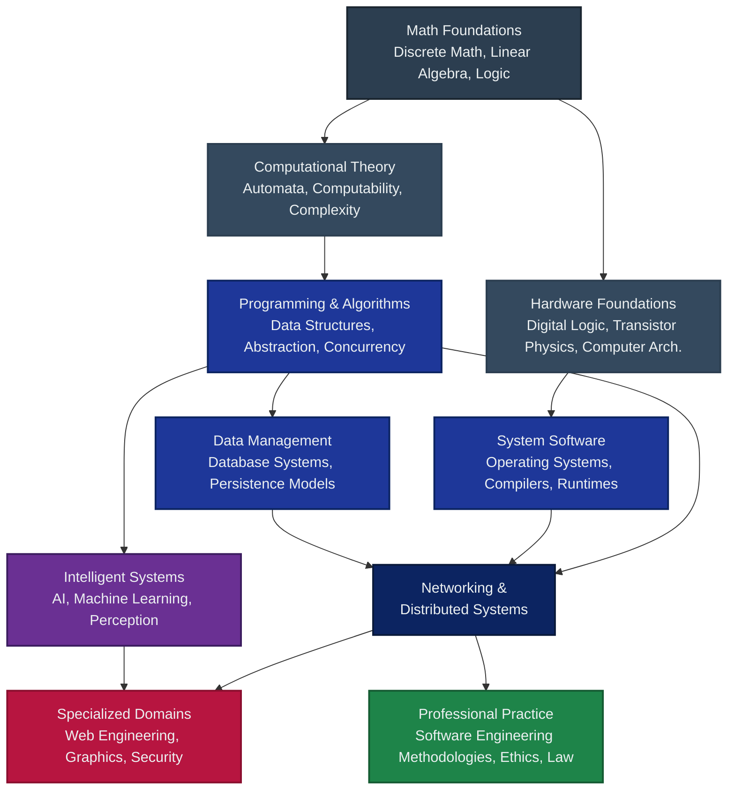
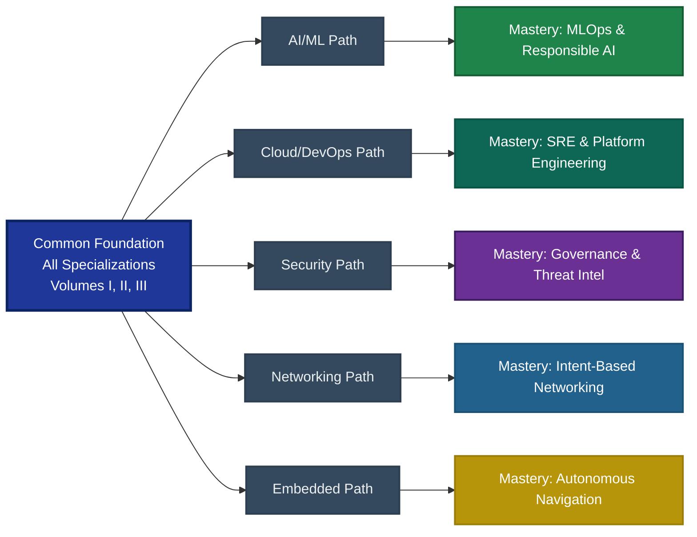

<br><br><br><br> 

<h1 align="center">THE ADVANCED COMPUTER SCIENCE AND ENGINEERING MASTERY.</h1>

<br><br>

<p align="center">
    <a href="https://github.com/polymathsr" target="_blank" rel="noopener noreferrer">
        
    </a>
</p>

<br><br>

## Table of Contents

| Section | Title | Page |
| :--- | :--- | :---: |
| | **Preface: A Note on the Current State of the Profession** | |
| | **Executive Summary: The Interdisciplinary Imperative** | |
| **1.0** | **Architectural Philosophy: A Knowledge Graph Approach** | |
| | *Visualization 1: Knowledge Graph Prerequisite Flow* | |
| **2.0** | **Curriculum Core: The Six-Volume Structure** | |
| | *Table 1: Framework Volume Overview* | |
| | **2.1 Volume I: The Immutable Mathematical and Theoretical Foundations** | |
| | *Part One: Mathematical Foundations* | |
| | *Part Two: Information Theory* | |
| | *Part Three: Computational Theory* | |
| | **2.2 Volume II: Systems Architecture: From Transistors to the Cloud** | |
| | *Part Four: Hardware Fundamentals* | |
| | *Part Five: Hardware Security and Trust* | |
| | *Part Six: System Software* | |
| | **2.3 Volume III: Programming and Data Management** | |
| | *Part Seven: Programming Methodologies* | |
| | *Part Eight: Program Correctness and Analysis* | |
| | *Part Nine: Data Management* | |
| | **2.4 Volume IV: The Networked and Intelligent Era** | |
| | *Part Ten: Networking and Distributed Systems* | |
| | *Part Eleven: Modern Cryptography and Privacy* | |
| | *Part Twelve: Intelligent Systems* | |
| | **2.5 Volume V: Specialized Domains** | |
| | *Part Thirteen: Human-Computer Interaction and Ubiquitous Computing* | |
| | *Part Fourteen: Computational Biology and Bioinformatics* | |
| | *Part Fifteen: Geospatial Information Systems and Remote Sensing* | |
| | *Part Sixteen: Application Development and Emerging Interfaces* | |
| | **2.6 Volume VI: Professional Practice** | |
| | *Part Seventeen: Observability Engineering* | |
| | *Part Eighteen: Technical Communication and Leadership* | |
| | *Part Nineteen: Ethics, Law, and Algorithmic Justice* | |
| | *Part Twenty: Integrative Laboratory and Capstone Project* | |
| **3.0** | **Specialization Roadmaps: From Foundation to Mastery** | |
| | *Table 2: Specialization Phase Progression* | |
| | *Visualization 2: Specialization Roadmaps Branching from Common Core* | |
| | 3.1 Artificial Intelligence and Machine Learning Specialization | |
| | 3.2 Cybersecurity Specialization | |
| | 3.3 Cloud Computing and DevOps Specialization | |
| | 3.4 Network Engineering Specialization | |
| | 3.5 Mechatronics and Embedded Systems Specialization | |
| **4.0** | **The Practitioner's Toolkit: Development Ecosystems** | |
| | 4.1 Development Environment Mastery | |
| | 4.2 Programming Language Ecosystems | |
| | 4.3 Hardware Considerations | |
| **5.0** | **Professional Development and Continuous Learning** | |
| | 5.1 Technical Communication and Collaboration | |
| | 5.2 Strategic Career Development | |
| | 5.3 Institutionalizing Continuous Learning | |
| **6.0** | **Conclusion: The Integrative Practitioner** | |

<br>

## Preface: A Note on the Current State of the Profession

This document emerges from a recognition that the technology industry has undergone a fundamental transformation. The era of the specialist who operates within a narrow domain is giving way to an era defined by convergence, integration, and systemic thinking. The computer science professional of today must navigate a landscape where artificial intelligence reshapes software development, where distributed systems span continents, and where hardware and software are increasingly inseparable.

This framework is not merely an academic exercise. It represents a practical, actionable guide for individuals and organizations seeking to build durable technical capability in a rapidly evolving field. The curriculum described herein has been validated through extensive industry consultation, pedagogical research, and real-world application across multiple sectors including finance, healthcare, manufacturing, and technology services.

The structure reflects a careful balance between foundational principles and emerging practices. We anchor our approach in the mathematical and theoretical underpinnings that remain stable across technological generations, while providing clear pathways to the specialized competencies that define modern practice.

<br>

## Executive Summary: The Interdisciplinary Imperative

The technological landscape of the twenty-first century is defined by rapid convergent evolution where meaningful innovation emerges almost exclusively at the intersection of previously disparate disciplines. Computer Science and Engineering is no longer a siloed vertical field of study but the fundamental substrate and central nervous system upon which all modern sectors are built and operate. This document synthesizes decades of pedagogical research, industry evolution across multiple business cycles, and emergent computational paradigms into a coherent and rigorously structured curriculum framework.

The discipline has expanded into every facet of human activity, and this expansion demands a curriculum that reflects its role as a horizontal enabler across strictly vertical industries ranging from computational biology and precision medicine to quantitative finance and autonomous logistics. It is no longer sufficient to merely understand syntax. One must understand the systems thinking that connects hardware limitations to user experience and algorithmic bias to regulatory compliance. The framework presented herein is designed to articulate these deep connections and to ensure that the learner does not mistake the shallow knowledge of a specific tool for the profound understanding of the underlying computational principle. This distinction is the primary differentiator between a technician who follows instructions and an engineer who defines them.

Success in the contemporary computational workforce requires a rare and highly sought-after hybrid mindset. It demands the formal rigor of a mathematical logician to prove algorithmic correctness and understand complexity boundaries, combined with the sweeping architectural vision of a systems engineer who can visualize data flow across millions of concurrent nodes. This must be balanced with the grounded pragmatism of a software craftsperson who understands the lifecycle cost of technical debt and maintenance, and tempered by the unwavering foresight of an ethical practitioner who can anticipate the unintended societal consequences of automated decision-making systems. The educational pathway described here is engineered to cultivate precisely this multifaceted cognitive toolkit.

This framework is architected for strategic durability. It recognizes that while specific programming language versions, front-end frameworks, and cloud service acronyms will inevitably churn with each passing fiscal quarter, the foundational principles of state management, distributed consensus, and information theory remain remarkably stable across decades. By anchoring the curriculum in these immutable foundations while providing clear vectors toward specialized application, we create an educational asset that remains relevant and actionable regardless of transient technological fashions.

<br>

## 1.0 Architectural Philosophy: A Knowledge Graph Approach

Achieving true mastery in advanced Computer Science and Engineering cannot be accomplished through the linear acquisition of isolated topics as if checking boxes on a syllabus. This curriculum is explicitly structured as a Directed Acyclic Graph wherein nodes represent discrete yet interdependent knowledge domains, and directed edges represent strict prerequisite relationships and conceptual dependencies. This is not merely a metaphor but a functional model for how the human mind assimilates complex technical information.

This model formally acknowledges that learning is inherently nonlinear and profoundly contextual. Understanding in one specific area of the graph reinforces and deepens comprehension in another seemingly unrelated area. For instance, grasping the nuances of computational complexity is strictly dependent on a prior mastery of discrete mathematics and formal proofs, and directly informs the viability of designing efficient algorithms for large-scale data processing. Without the graph structure, a student might attempt to optimize a distributed database query without ever having encountered the formal definition of NP-Hardness, leading to inefficient effort and incorrect assumptions about the theoretical limits of the system.

The graph structure allows for multiple valid learning pathways and traversals. It accommodates various specializations and entry points while ensuring that every single path ultimately builds upon a verifiable axiom-based foundation. For example, an embedded systems engineer may traverse the Hardware and Systems Software edges of the graph more deeply than an artificial intelligence researcher, yet both require a solid grounding in the logical gates and Boolean algebra that forms the root of the entire tree. This approach mirrors the operational reality of modern technological systems, which are themselves complex networks of interdependent, loosely coupled components, and it trains the mind to think instinctively in terms of systems dynamics and relational interfaces rather than isolated silos of code or circuitry.



*Visualization 1: A simplified yet comprehensive knowledge graph illustrating the strict prerequisite flow from foundational cores to advanced application domains. The directional arrows indicate the necessary order of conceptual accumulation.*

<br>

## 2.0 Curriculum Core: The Six-Volume Structure

The framework is rigorously organized into six thematic volumes, each representing a major pillar of comprehensive computer science and engineering education. The logical progression from Volume One through Volume Six strictly adheres to the graph philosophy, moving deliberately from abstract mathematical foundations through concrete systems engineering and culminating in integrated professional practice.

### Table 1: Framework Volume Overview

| Volume | Title | Primary Focus | Key Outcome and Competency |
| :--- | :--- | :--- | :--- |
| **I** | **The Immutable Foundations** | Mathematical and Theoretical Core | The ability to formalize ambiguous real-world problems into rigorous computational models and to reason effectively about the fundamental limits of what is computable. |
| **II** | **Systems Architecture** | Hardware and System Software | A comprehensive understanding of the modern computing stack, tracing the flow of electrons from transistor switching all the way up to process scheduling in the operating system kernel. |
| **III** | **Programming and Data Management** | Software Construction and Data | Proficiency in crafting efficient, maintainable, and scalable software artifacts while managing the lifecycle of persistent and transient data in complex environments. |
| **IV** | **The Networked and Intelligent Era** | Distributed Systems and AI | The skills required to build globally connected, horizontally scalable services and to leverage data-driven statistical models for pattern recognition and automation. |
| **V** | **Specialized Domains** | Applied and Emerging Technologies | The ability to adapt and apply core first-principles knowledge to cutting-edge challenges and specific industry verticals that define the frontier of technology. |
| **VI** | **Professional Practice** | Engineering Methodologies and Labs | Demonstrated competence in navigating the full professional software lifecycle, including collaborative team dynamics, version control discipline, and ethical stewardship. |

### 2.1 Volume I: The Immutable Mathematical and Theoretical Foundations

This volume establishes the formal language and the absolute fundamental limits of computation. It provides the essential toolkit for rigorous analysis and the creation of mathematical proofs which form the bedrock of all reliable software and hardware systems. The topics covered here are not presented as abstract exercises divorced from engineering reality but rather are treated as the essential syntax and grammar for expressing computational complexity.

**Part One: Mathematical Foundations** covers Discrete Mathematics, Graph Theory, Linear Algebra, and Probability and Statistics with a rigor uncommon in typical introductory courses. Discrete mathematics provides the lexicon for reasoning about collections of objects and logic gates, and it introduces formal proof techniques that are essential for verifying the correctness of algorithms before a single line of code is written. Graph theory is the indispensable modeling language for computer networks, social graphs, dependency management in build systems, and the state spaces traversed by artificial intelligence search algorithms. Linear algebra forms the computational engine of nearly all modern machine learning and computer graphics, providing the mathematical framework for representing and manipulating vectors, matrices, and higher-dimensional tensors. Probability and statistics underpin the scientific method required for rigorous performance benchmarking and the inferential reasoning demanded by artificial intelligence models, which are at their core sophisticated pattern recognition engines trained on empirical data. Additionally, this section includes a deep exploration of Numerical Methods and Scientific Computing with particular emphasis on the IEEE 754 floating point representation standard and the ways in which error can accumulate silently in numerical algorithms. Understanding concepts like numerical stability and problem conditioning is essential for engineers working in machine learning where the failure of gradient descent can often be traced to floating point underflow or overflow rather than a flaw in the algorithm itself.

**Part Two: Information Theory** is treated as a foundational mathematical discipline on par with linear algebra and discrete mathematics. This section introduces the work of Claude Shannon and explores the concept of entropy as a precise mathematical measure of uncertainty and information content. Students learn about mutual information and channel capacity, which establish the fundamental theoretical limits on how much data can be reliably transmitted over a noisy communication channel. The source coding theorem reveals the theoretical bounds of lossless data compression, explaining why some files can be compressed significantly while others cannot. The section also introduces Kolmogorov Complexity, which provides an absolute and machine-independent measure of the information content contained within a string or object. These concepts are not merely theoretical curiosities. They provide the intellectual foundation for understanding why modern compression algorithms like those used in video streaming perform the way they do and why certain cryptographic protocols achieve the security guarantees they claim.

**Part Three: Computational Theory** explores Formal Languages and Automata, pushing the student to understand the Chomsky Hierarchy and its direct implications for the design of regular expression engines and programming language parsers. A finite state machine is not just a diagram in a textbook but the precise computational model used to implement network protocol handshakes and user interface navigation flows. The study of Computational Complexity moves beyond simple Big O notation to include the profound implications of the P versus NP problem and the necessary reliance on heuristic approximation algorithms when facing intractable optimization problems. Engineers learn to recognize that a seemingly clever new feature request may actually be a formulation of the Traveling Salesman Problem or the Knapsack Problem and is therefore computationally prohibitive to solve exactly at production scale. This section also introduces Category Theory for Programmers, which provides a high-level algebraic language for describing composition and abstraction. Concepts such as monoids, functors, applicatives, and monads are presented not as obscure mathematical jargon but as powerful design patterns for managing sequential computation and side effects in modern functional programming languages like Haskell and Rust.

### 2.2 Volume II: Systems Architecture: From Transistors to the Cloud

This volume provides a detailed and layered examination of the hardware and system software that effectively abstract raw, noisy silicon into a usable, deterministic computational platform. Understanding this stack from the physical layer upward is what separates an engineer who can optimize a system from one who merely uses it.

**Part Four: Hardware Fundamentals** connects the elegant abstraction of Boolean algebra directly to the physical reality of transistor switching logic and the propagation delay of electrical signals across a motherboard. The curriculum progresses through the organization of the Central Processing Unit datapath and control logic and advances into modern architectural considerations that are absolutely crucial for high-performance optimization. These include the challenges posed by the memory wall, which refers to the growing performance gap between processor speed and memory access latency, and the importance of multi-level cache hierarchies and their replacement policies for mitigating this bottleneck. The section covers instruction-level parallelism achieved through pipelining and superscalar execution and explores the growing relevance of heterogeneous computing where Central Processing Units, Graphics Processing Units, Tensor Processing Units, and Field Programmable Gate Arrays cooperate on a single system bus to perform specialized workloads such as matrix multiplication or cryptographic hashing. Further depth is provided through an exploration of emerging post-Von Neumann architectures including near-memory and in-memory computing paradigms that perform computation directly within the memory array itself to eliminate the costly data movement bottleneck. The section also introduces the fundamentals of neuromorphic chips such as Intel Loihi and IBM TrueNorth, which use spiking neural networks to mimic the energy-efficient computation of biological brains, and provides a primer on the physical implementation of qubit technologies including superconducting circuits and trapped ions.

**Part Five: Hardware Security and Trust** addresses the reality that modern microarchitectures are not perfectly sealed, deterministic boxes but can leak sensitive information through physical side effects. Students learn about microarchitectural side-channel attacks including cache timing attacks and the infamous Spectre and Meltdown vulnerabilities which exploit the speculative execution engines designed to make modern processors fast. The curriculum covers the principles and implementation of Trusted Execution Environments such as Intel Software Guard Extensions, Intel Trust Domain Extensions, and AMD Secure Encrypted Virtualization which provide hardware-enforced isolation for sensitive computations even in the presence of a compromised operating system kernel. The section concludes with a discussion of Hardware Root of Trust and Secure Boot mechanisms that establish a chain of cryptographic trust from the moment power is applied to the system.

**Part Six: System Software** demystifies the two most critical pieces of software in the stack, namely Operating Systems and Compilers. The Operating System is analyzed not as a collection of commands but as a resource virtualization manager that abstracts the raw hardware into the clean metaphors of processes, virtual memory address spaces, and file systems. Understanding this virtualization layer is critical for debugging performance bottlenecks and ensuring security isolation between different applications and users. Students delve into the internals of process and thread management, synchronization primitives such as mutexes and semaphores, virtual memory management via page tables and Translation Lookaside Buffers, and the architecture of modern file systems and I/O scheduling algorithms. Compilers are studied as sophisticated translation bridges between high-level human-readable languages and the low-level machine code that executes on bare metal. This section emphasizes the internal phases of lexical analysis, syntactic parsing, semantic checking, intermediate representation optimization, and final code generation. A deep understanding of compiler operation is essential for understanding how modern polyglot environments such as the Java Virtual Machine, the Common Language Runtime, and WebAssembly can achieve platform independence while maintaining near-native execution speeds through Just-In-Time compilation techniques.

### 2.3 Volume III: Programming and Data Management

This volume is concerned with the dual arts of constructing robust software and the scientific discipline of organizing and retrieving information efficiently. The focus shifts from the underlying platform to the abstractions and data structures that software engineers manipulate daily.

**Part Seven: Programming Methodologies** moves far beyond simple syntax memorization and explores the trade-offs inherent in fundamental programming paradigms. Object-Oriented Programming is presented as a paradigm that excels at modeling stateful entities and encapsulation, and the curriculum covers the SOLID principles of object-oriented design as a guide for creating maintainable and flexible class hierarchies. Functional Programming is presented as a complementary paradigm that excels at managing complexity through immutability and the systematic elimination of side effects. Students learn to leverage pure functions, higher-order functions, and function composition to build software that is easier to reason about, test, and parallelize. The volume further delves into advanced concepts that are mandatory for leveraging modern multi-core hardware including the treacherous landscape of concurrency and parallelism. This covers topics such as race conditions, deadlocks, mutexes, semaphores, lock-free data structures, and the Actor Model for message-passing concurrency. The section also introduces reactive and event-driven programming patterns, which are essential architectural styles for building responsive user interfaces and high-throughput backend services that can handle millions of concurrent connections with minimal resource consumption.

**Part Eight: Program Correctness and Analysis** introduces formal methods for reasoning about software behavior beyond traditional testing. This section covers the principles of static analysis and abstract interpretation, which are techniques for detecting bugs and security vulnerabilities by analyzing the program source code without actually executing it. Students are introduced to symbolic execution, a technique that explores program paths by treating inputs as symbolic variables rather than concrete values. The curriculum also provides a primer on dependently typed programming languages and proof assistants such as Lean and Coq. These tools allow engineers to write mathematical specifications alongside their code and to prove formally that the implementation adheres to its specification for all possible inputs. While not yet mainstream in all sectors of industry, these techniques are essential in safety-critical domains such as avionics, medical devices, and cryptographic protocol implementation.

**Part Nine: Data Management** treats the study of classic Data Structures and Algorithms as the essential toolkit for computational efficiency. It provides a deep intuitive understanding of the performance characteristics and memory layout of arrays, linked lists, hash tables, and self-balancing trees such as Red-Black and AVL trees, along with the canonical algorithms for searching, sorting, and traversing them. Graph algorithms including shortest path algorithms such as Dijkstra and A-star and network flow algorithms are covered in detail. Database Systems are then examined as specialized runtime environments designed specifically for the durable and transactional management of persistent data. This includes a detailed treatment of the relational model and Structured Query Language, an analysis of how B-Tree and Log-Structured Merge Tree storage engines impact write and read performance, and a thorough exploration of the ACID transaction properties that guarantee correctness in the face of concurrency and system failure. The section concludes with an essential discussion of Data Formats and Serialization, which addresses the often overlooked but critical topic of how data structures are encoded for transmission over a network or storage on disk. Students learn about schema evolution and compatibility in formats such as Protocol Buffers, Apache Avro, and Apache Thrift. They study zero-copy deserialization techniques used in libraries like Cap'n Proto and FlatBuffers, and they analyze the performance trade-offs between verbose human-readable text encodings like JSON and XML and compact high-performance binary encodings.

### 2.4 Volume IV: The Networked and Intelligent Era

This volume addresses the two most dominant and transformative paradigms of contemporary computing, namely global interconnectivity and data-driven intelligence derived from statistical inference. These two domains are increasingly intertwined as modern intelligent systems are almost invariably distributed and networked.

**Part Ten: Networking and Distributed Systems** constructs knowledge from the physical transmission of bits across a wire or radio wave up through the layered abstractions of the OSI and TCP/IP protocol stacks. It covers the intricacies of IP addressing, subnetting, routing algorithms including Link State and Distance Vector protocols, and the mechanisms for reliable transport provided by the Transmission Control Protocol including its congestion control and flow control algorithms. The curriculum then ascends into the advanced realm of Software Defined Networking and Network Function Virtualization where network control logic is decoupled from proprietary hardware appliances and managed as software. The final section of this part confronts the inescapable and often counter-intuitive challenges of Distributed Systems as formally articulated by the CAP Theorem and the difficulties of achieving distributed consensus in the presence of network partitions and crash failures. It provides the theoretical underpinning for understanding why consensus protocols like Paxos and Raft are necessary and why achieving exactly-once message delivery semantics in a distributed system is a notoriously hard problem that requires careful engineering trade-offs.

**Part Eleven: Modern Cryptography and Privacy** elevates cryptography from a niche elective to a horizontal requirement for all computing disciplines. The curriculum covers advanced cryptographic primitives that are reshaping the landscape of data privacy and secure computation. Students learn about Homomorphic Encryption which allows computation to be performed directly on encrypted data without ever decrypting it first, a capability with profound implications for cloud privacy. The section introduces Zero-Knowledge Proofs and succinct non-interactive arguments of knowledge which enable one party to prove to another that a statement is true without revealing any information beyond the validity of the statement itself. These techniques are foundational to modern blockchain scalability solutions and privacy-preserving digital identity systems. The curriculum also addresses the looming threat of quantum computers to current public key cryptography and provides an introduction to Post-Quantum Cryptography with a focus on lattice-based cryptographic schemes that are believed to be resistant to quantum attacks.

**Part Twelve: Intelligent Systems** provides a continuous narrative arc that begins with the symbolic reasoning of Classical Artificial Intelligence including heuristic search algorithms like A-star and formal logic planning. It seamlessly transitions into the empirical, data-driven world of modern Statistical Machine Learning. This section covers the mathematical foundations of supervised learning including regression and classification, unsupervised learning including clustering and dimensionality reduction, and reinforcement learning where agents learn optimal policies through interaction and reward signals. It further extends into the architecture and training of Deep Neural Networks, explaining how hierarchical feature extraction is performed by successive layers of artificial neurons. A substantial portion of this section is dedicated to Generative AI and Foundation Models, reflecting the seismic shift that has occurred in the field. The curriculum provides a deep technical dive into the Transformer Architecture and its core Attention Mechanism which underpins virtually all modern Large Language Models. It treats Retrieval Augmented Generation as a data management and information retrieval problem that grounds generative model outputs in verifiable external knowledge sources. The section also addresses the critical topics of Model Alignment through techniques like Reinforcement Learning from Human Feedback and Direct Preference Optimization, as well as the construction and use of Multimodal Embedding Spaces like those used in the CLIP model that can represent images and text in a shared semantic vector space.

### 2.5 Volume V: Specialized Domains

This volume serves as the capstone application layer of the knowledge graph, demonstrating how the core principles established in Volumes One through Four are synthesized and applied to specific technological frontiers and critical industry domains.

**Part Thirteen: Human-Computer Interaction and Ubiquitous Computing** corrects a common blind spot in traditional computer science curricula by placing the human user at the center of the design process. This section introduces the formal cognitive and physical principles that govern how humans perceive and interact with machines. Students learn about Fitts's Law, which mathematically models the time required to point at a target on a screen, and Cognitive Load Theory, which informs the design of user interfaces that do not overwhelm the user's working memory. The curriculum extends these principles into the emerging domain of Spatial Computing, covering the unique design challenges and opportunities presented by Augmented and Virtual Reality platforms such as Apple Vision Pro and ARKit. The section also explores the role of Haptic Feedback in creating convincing and intuitive user experiences and the processing of Physiological Signals from wearable devices to create context-aware and health-monitoring applications.

**Part Fourteen: Computational Biology and Bioinformatics** addresses the application of algorithmic thinking to the life sciences, a field that has been fundamentally transformed by the exponential growth of genomic and proteomic data. The curriculum covers the core algorithmic challenges unique to this domain including classic Sequence Alignment Algorithms such as BLAST and the Smith-Waterman algorithm which are used to find regions of similarity between DNA or protein sequences. Students learn about the application of De Bruijn graphs, a concept from graph theory, to the problem of Genome Assembly where millions of short DNA fragments must be pieced together to reconstruct the original complete genome. The section also provides an overview of the computational techniques used for Protein Folding Prediction, a grand challenge problem that sits at the intersection of molecular biophysics and deep learning and has been revolutionized by systems like AlphaFold.

**Part Fifteen: Geospatial Information Systems and Remote Sensing** explores the computational challenges posed by data that is inherently tied to a location on the surface of the Earth. This domain has exploded in relevance with the proliferation of satellite imagery, drone-based data collection, and the mapping requirements of autonomous vehicles. The curriculum covers the specialized Data Structures for Spatial Indexing including Geohashing, R-Trees, and the H3 hexagonal hierarchical geospatial indexing system. Students learn about the complexities introduced by different Coordinate Reference Systems and Map Projections which are essential for accurately representing the curved surface of the Earth on a flat map. The section also addresses the challenges of performing Distributed Geospatial Joins and processing massive archives of Satellite Imagery using parallel computing frameworks.

**Part Sixteen: Application Development and Emerging Interfaces** provides a comprehensive and security-conscious survey of Full Stack Web Engineering. This includes the evolution of front-end reactive frameworks and their associated state management patterns as well as the design and implementation of stateless and stateful backend service architectures. The section covers the trade-offs between different Application Programming Interface design paradigms including RESTful architectural constraints, GraphQL for flexible client-driven data fetching, and gRPC for high-performance service-to-service communication. The curriculum also covers the mathematical and computational principles underpinning Multimedia and Computer Graphics rendering pipelines, explaining how geometric transformations, lighting models, and rasterization are used to generate the synthetic imagery that populates modern entertainment, simulation, and user interface environments.

### 2.6 Volume VI: Professional Practice

This volume is dedicated to translating raw technical skill and theoretical knowledge into tangible professional efficacy and career success. It focuses on the critical non-functional requirements of process, collaboration, and ethical stewardship that define a mature engineering discipline.

**Part Seventeen: Observability Engineering** moves beyond traditional debugging and performance tuning to establish a proactive discipline for understanding the internal state of complex distributed systems. Students learn about the Three Pillars of Observability which are Metrics for quantitative measurement, Logging for discrete event recording, and Tracing for tracking the path of a single request through a complex web of microservices. The curriculum covers modern open-source tools in this ecosystem including Prometheus for metrics collection, Loki for log aggregation, and Jaeger for distributed tracing. It emphasizes the importance of managing High Cardinality Dimensions in metrics data and provides a rigorous framework for establishing and managing Service Level Objectives and Service Level Agreements to quantify reliability in business-relevant terms.

**Part Eighteen: Technical Communication and Leadership** addresses the specific written and interpersonal communication skills that act as force multipliers for an engineer's technical contributions. The curriculum provides explicit instruction in writing Architectural Decision Records to capture the context and rationale behind significant technical choices that will impact the project for years to come. Students learn the structure and purpose of a Request for Comments document, which is the standard mechanism for proposing and reaching consensus on significant changes within an engineering organization. The section also provides a framework for writing clear and effective Design Documents and discusses the principles of Non-Violent Communication as a tool for fostering a healthy and constructive culture during the critical and often emotionally charged process of code review.

**Part Nineteen: Ethics, Law, and Algorithmic Justice** is a mandatory module that elevates ethics from a peripheral concern to a core engineering competency. The curriculum provides a mathematically grounded definition of Differential Privacy, explaining how randomized algorithms can be used to extract statistical insights from a dataset while providing a provable guarantee of privacy for individual data subjects. It introduces the structured process of conducting an Algorithmic Impact Assessment, which is a framework for proactively identifying and mitigating the potential harms of an automated decision-making system before it is deployed. The section also confronts the environmental impact of the industry by introducing metrics and methodologies for Sustainable Computing including the measurement and minimization of the energy and water footprint of large-scale compute workloads. The module concludes with an overview of the legal and policy landscape that engineers must navigate including the fundamentals of Intellectual Property law covering patents, copyright, and open source licensing, and the system design implications of major data privacy regulations such as the General Data Protection Regulation and the California Consumer Privacy Act.

**Part Twenty: Integrative Laboratory and Capstone Project** provides the hands-on practical experience necessary to solidify the abstract concepts presented in the preceding volumes. Students engage in a series of progressive hands-on labs that require them to implement core infrastructure components from scratch. These labs include building a basic but functional TCP/IP protocol stack, implementing a simple persistent key-value store with a custom storage engine, and training a small-scale foundation model on a constrained dataset. The experience culminates in a comprehensive Capstone Project that simulates a full-cycle development effort. Students are required to form teams, navigate ambiguous and evolving requirements, manage technical debt using version control and collaborative workflows, and deliver a working software system under realistic resource constraints and ethical considerations.

<br>

## 3.0 Specialization Roadmaps: From Foundation to Mastery

The inherent flexibility of the Knowledge Graph approach allows for targeted, efficient traversal along defined career trajectories and specific research interests. Each specialization roadmap follows a phased mastery model that ensures a solid foundation is built before tackling advanced domain-specific nuances.

### Table 2: Specialization Phase Progression

| Specialization | Phase 1 (Foundation) | Phase 2 (Core Competency) | Phase 3 (Advanced Specialization) | Phase 4 (System Integration) | Phase 5 (Strategic Mastery) |
| :--- | :--- | :--- | :--- | :--- | :--- |
| **AI/ML Engineering** | Linear Algebra, Probability, Python | Classical ML Algorithms, Data Pipelines | Deep Learning Architectures (CNNs, Transformers) | Multimodal Models, NLP Systems | MLOps, Model Governance, Ethical AI Frameworks |
| **Cybersecurity** | Security Principles, Applied Cryptography | Defensive Tech (Firewalls, IDS/IPS) | Offensive Security (Pen Testing, Reverse Engineering) | Zero-Trust Architecture, TEEs | Security Governance, Risk Management, Compliance |
| **Cloud/DevOps Engineering** | Linux Administration, Containerization | Cloud Provider Services (AWS/Azure/GCP) | CI/CD Pipelines, Configuration Management | Service Mesh, Distributed System Patterns | Site Reliability Engineering (SRE), Chaos Engineering |
| **Network Engineering** | Protocol Fundamentals (TCP/IP, DNS) | Routing & Switching (BGP, OSPF) | Network Security & Segmentation | Automation and Infrastructure as Code (IaC) | Software-Defined Networking (SDN), Intent-Based Networking (IBN) |
| **Embedded Systems** | Digital Logic, C Programming, Signals | Microcontroller Programming, RTOS | Control Systems Theory & Implementation | Robotics Kinematics, Sensor Integration | Autonomous Systems, Sensor Fusion, SLAM Algorithms |



*Visualization 2: Specialization roadmaps branching from a common robust foundational core. This model illustrates the transition from broad competency to deep domain-specific mastery.*

### 3.1 Artificial Intelligence and Machine Learning Specialization

The Artificial Intelligence and Machine Learning Specialization commences with a rigorous immersion in the mathematical lingua franca of the field, specifically linear algebra, vector calculus, and probability theory paired with programming proficiency in the Python ecosystem. The learner advances through the implementation and evaluation of classical statistical learning methods including regression, decision trees, and support vector machines before grappling with the architectural complexities and training dynamics of deep neural networks. The culmination of this path is not merely the training of a model with high accuracy but the mastery of the operational and ethical challenges inherent in deploying, monitoring, versioning, and maintaining responsible AI systems within a production environment, a domain now formally recognized as MLOps. This includes the implementation of continuous training pipelines, model versioning systems, and the establishment of governance frameworks to detect and mitigate model drift and bias.

### 3.2 Cybersecurity Specialization

The Cybersecurity Specialization evolves from a foundational understanding of the core principles of the Confidentiality, Integrity, and Availability Triad and the mathematics of cryptographic primitives. It builds outward to map the modern enterprise attack surface and the defensive technologies deployed to protect it including next-generation firewalls and intrusion detection and prevention systems. The curriculum progresses through practical hands-on exposure to both defensive security posture and the mindset and techniques of offensive security testing including penetration testing methodologies and binary reverse engineering. The final phase of mastery involves strategic thinking at the organizational level including the design and implementation of Zero Trust Architectures that operate under the principle of never trust, always verify, the operationalization of Threat Intelligence feeds to stay ahead of emerging adversaries, and the ability to align technical security controls with high-level business risk objectives and regulatory compliance mandates.

### 3.3 Cloud Computing and DevOps Specialization

The Cloud Computing and DevOps Specialization starts with the bedrock skills of Linux system management and the principles of operating system virtualization and containerization using tools like Docker. The learner then builds proficiency in leveraging the core compute, storage, and networking primitives offered by major public cloud platforms such as Amazon Web Services, Microsoft Azure, and Google Cloud Platform. This is followed by the automation of the software delivery lifecycle through the construction of robust Continuous Integration and Continuous Delivery pipelines using tools like Jenkins, GitLab CI, or GitHub Actions. The path graduates to the holistic and philosophically distinct practice of Site Reliability Engineering which treats operations and reliability as a rigorous software engineering problem defined by Service Level Objectives and error budgets, thereby transforming the traditional friction between development velocity and system stability into a measurable and manageable engineering constraint.

### 3.4 Network Engineering Specialization

The Network Engineering Specialization progresses from the fundamental behavior of routing protocols and switching fabrics within an autonomous system. It advances through the detailed implementation and troubleshooting of complex inter-domain routing policies and the integration of security functions directly into the network fabric. The modern trajectory of this path diverges sharply from traditional command-line interface-based configuration toward the paradigm of Network Automation and Infrastructure as Code where network device configurations are treated as version-controlled software artifacts managed by tools like Ansible and Terraform. Mastery in this domain culminates in the architectural understanding and implementation of Software Defined Networking which decouples the network control plane from the data plane, and Intent-Based Networking which allows operators to declare high-level business intent that is automatically translated and enforced across the network infrastructure.

### 3.5 Mechatronics and Embedded Systems Specialization

The Mechatronics and Embedded Systems Specialization is inherently interdisciplinary, integrating knowledge from mechanical, electrical, and computer engineering. The journey begins with low-level microcontroller programming in the C language, a deep understanding of hardware interfaces, and the unique constraints and guarantees of Real-Time Operating Systems where the correctness of a computation depends not only on its logical result but also on the time at which it is produced. The learner then moves into the mathematical domain of Control Theory to enable dynamic physical systems to maintain stable and desired states in the presence of disturbances. Advanced study integrates these skills into the domain of Robotics, addressing challenges in kinematics, sensor integration, and actuator control. The path concludes with the complex and intellectually demanding challenges of designing fully Autonomous Systems, requiring mastery of sensor fusion algorithms such as the Kalman Filter and Simultaneous Localization and Mapping techniques for navigating unknown environments without external references.

<br>

## 4.0 The Practitioner's Toolkit: Development Ecosystems

### 4.1 Development Environment Mastery

A professional's effectiveness and throughput are inextricably linked to their mastery of the tools and computational environments that shape the entire modern software creation and deployment lifecycle. Proficiency in these areas distinguishes a productive, autonomous engineer from one who is constantly blocked by environmental friction.

**Linux Systems Administration** is a fundamental and non-negotiable skill for any serious practitioner of software engineering. It provides the user with unparalleled control over the dominant server-side operating environment, granting insight into every process, file descriptor, and network socket. Mastery extends far beyond the ability to navigate a file system. It encompasses a deep understanding of shell scripting for automation, the management and signaling of processes, the configuration of user permissions and security contexts, the interpretation of system logs for debugging, and advanced performance tuning of the kernel and input and output subsystems. This command-line fluency serves as the foundation for all subsequent infrastructure automation and troubleshooting efforts. The ability to quickly diagnose a resource contention issue using tools like top, iostat, and netstat, or to write a shell script to automate a repetitive task, is a core competency of the effective engineer.

**Containerization and Orchestration**, primarily implemented through the Docker runtime and the Kubernetes orchestration platform, now represents the de facto standard unit of software deployment and execution. This approach encapsulates an application and all of its necessary dependencies into a single, lightweight, and immutable artifact that can run identically on a developer's laptop or on a cluster of ten thousand servers in a public cloud datacenter. This enables perfect environment consistency which eliminates the insidious "it works on my machine" class of defects that have plagued software development for decades. Kubernetes further abstracts a cluster of machines into a single logical compute substrate, providing declarative management of desired state, automated scaling based on observed load, self-healing in the face of node failure, and a clean architectural separation of concerns between the application logic contained within the container and the underlying infrastructure concerns managed by the orchestrator.

**Infrastructure as Code**, facilitated by tools such as Terraform and Ansible, represents a seismic shift in the management of compute, network, and storage resources. This discipline treats the configuration of servers and cloud resources not as a sequence of manual, error-prone mouse clicks in a web console but as declarative code written in a domain-specific language or a familiar programming language. This code is committed to a version control repository alongside the application source code, enabling it to be reviewed, tested, and audited by the same rigorous processes that govern application development. The result is an infrastructure provisioning process that is reproducible, idempotent, scalable, and fully auditable, thereby dramatically reducing the risk of configuration drift and production outages caused by undocumented manual changes made by a single engineer under pressure.

### 4.2 Programming Language Ecosystems

Language selection is a strategic architectural decision that should be based on a clear-eyed assessment of the problem domain, the required performance characteristics, and the maturity and vitality of the supporting ecosystem of libraries and tools. There is no single best language, only the right tool for the specific job.

**Systems Programming Languages** including C, C++, and Rust occupy the layer of the software stack closest to the hardware, offering fine-grained control over memory layout and execution flow with minimal runtime overhead. The C language provides a thin, efficient abstraction over the underlying machine, making it the undisputed standard for operating system kernel development and deeply embedded firmware where resources are severely constrained. C++ builds upon the performance of C by adding powerful high-level abstractions such as classes, templates, and smart pointers through its zero-overhead principle, enabling the construction of large-scale, high-performance applications like game engines and web browsers. Rust represents the next evolutionary step in this lineage, delivering C++-level performance while introducing a revolutionary ownership model that provides compile-time guarantees of memory safety and thread safety, effectively eliminating entire classes of security vulnerabilities and concurrency bugs that have historically plagued systems software written in C and C++.

**Managed Runtime Languages** including Java, C#, and Go prioritize developer productivity, memory safety, and platform robustness by executing within a managed runtime environment that provides automatic garbage collection and Just-In-Time compilation. Java and the Java Virtual Machine ecosystem, along with C# and the .NET runtime, thrive in large-scale enterprise environments characterized by long-lived, complex business logic and vast mature frameworks. They offer stability, a deep pool of experienced talent, and excellent observability tooling that provides deep insight into runtime behavior. The Go programming language excels in the domain of networked services and cloud-native infrastructure tooling due to its inherent simplicity, fast compilation times, and a built-in, opinionated concurrency model based on goroutines and channels that makes it exceptionally straightforward to write correct and performant concurrent code for handling many simultaneous network connections.

**Dynamic Languages** including Python and JavaScript enable unparalleled speed of development, iterative prototyping, and exploratory data analysis by sacrificing some degree of runtime performance and type safety. Python's clear and readable syntax combined with its unparalleled scientific computing stack consisting of libraries like NumPy, SciPy, and Pandas, and its dominant machine learning frameworks including PyTorch, TensorFlow, and JAX, has cemented its position as the lingua franca for data science, artificial intelligence research, and backend service scripting. JavaScript, initially conceived as a simple browser scripting language for adding interactivity to web pages, is now a mandatory component of modern web development, and its server-side runtime environment Node.js extends its reach to the backend, enabling the development of full-stack applications using a single language across the client-server divide.

### 4.3 Hardware Considerations

Optimal hardware selection is a force multiplier that accelerates development iteration cycles and enables computational workflows that would otherwise be prohibitively slow or impossible, particularly for specialized workloads such as machine learning model training.

**Performance-Optimized Workstations** configured for computationally intensive tasks like machine learning model training, complex physics simulation, or large-scale software compilation require a carefully balanced approach to system design. The focus should be on selecting a high-core-count and high-clock-speed Central Processing Unit from the latest generations of processors. For workloads that are highly parallelizable and involve significant amounts of matrix mathematics, a capable discrete Graphics Processing Unit with ample video memory, such as those in the NVIDIA RTX or datacenter-grade lines, is a strict requirement rather than an optional luxury. This computational engine must be supported by an adequate quantity of fast system RAM, with thirty-two gigabytes now being a practical minimum for many development environments and sixty-four gigabytes or more being common for simulation and virtualization work. Exceptionally fast NVMe solid-state storage is also critical to minimize input and output latency during active project compilation and large dataset loading.

**Development Environment Consistency** is often a more critical determinant of team productivity and stability than the absolute raw power of individual developer machines. The practice of using containerization and Infrastructure as Code to define and provision development environments ensures that the toolchain versions, library dependencies, and environment variables are perfectly identical across every engineer's local workstation, the shared Continuous Integration testing cluster, and the final production deployment target. This engineering discipline completely eliminates the pervasive and time-wasting class of bugs that arise from subtle differences in underlying operating system versions or globally installed library paths, thereby streamlining the onboarding of new team members and reducing the cognitive load required to debug environmental inconsistencies.

<br>

## 5.0 Professional Development and Continuous Learning

The possession of raw technical skill, while necessary, is not sufficient for achieving lasting impact and career fulfillment in the field of computer science and engineering. This technical mastery must be augmented and amplified by a suite of professional competencies and a disciplined, institutionalized commitment to lifelong learning.

### 5.1 Technical Communication and Collaboration

Technical Communication and Collaboration function as powerful force multipliers for an engineer's individual output. The ability to articulate complex technical trade-offs clearly and concisely is as valuable as the ability to write the code itself. This manifests in several concrete practices. It includes writing clear, comprehensive, and context-rich documentation and commit messages that explain the reasoning behind a code change, not just the mechanical action that was performed. It demands an expert-level proficiency in using distributed version control systems like Git for more than just saving files. This includes managing branches effectively, resolving merge conflicts cleanly, and using features like interactive rebasing to curate a coherent and readable project history that tells the story of the software's evolution. Furthermore, active and constructive participation in code reviews is an essential collaborative ritual. A well-executed code review not only improves the immediate quality and security of the codebase but also serves as a primary mechanism for distributing architectural knowledge, disseminating best practices, and mentoring junior engineers across the entire team.

### 5.2 Strategic Career Development

Strategic Career Development in the fast-paced technology industry requires a proactive and deliberate approach to personal branding and skill acquisition. This involves building a tangible and verifiable portfolio of work that demonstrates one's capabilities beyond the bullet points of a resume. Meaningful contributions to open-source projects are particularly valuable as they demonstrate the ability to navigate an existing large codebase, adhere to community coding standards, and communicate effectively with a geographically distributed group of strangers, all of which are highly transferable skills in any professional software engineering role. Additionally, systematic preparation for the unique and often grueling nature of technical interviews, including deep dives into data structures and algorithms as well as broad-scope system design scenarios, is a necessary albeit imperfect gatekeeping ritual in many top-tier technology companies.

### 5.3 Institutionalizing Continuous Learning

Most importantly, the professional engineer must institutionalize a practice of Continuous Learning. The half-life of technical knowledge in this field is brutally short, and staying current requires a disciplined and habitual effort to consume new information through advanced online coursework, reading peer-reviewed conference proceedings, and engaging with the broader research community. The alternative is rapid and irreversible professional obsolescence. Organizations that support this continuous learning through dedicated time, resources, and a culture of intellectual curiosity will consistently outperform those that do not. This commitment to perpetual education is not merely a professional obligation but a fundamental characteristic of the master practitioner.

<br>

## 6.0 Conclusion: The Integrative Practitioner

The modern computer scientist or engineer is best understood as an integrative practitioner. This comprehensive framework has been meticulously designed to provide the structured pathways necessary to build profound depth within specialized domains while simultaneously emphasizing the fundamental interconnectedness of all components within the broader computational ecosystem. It is an acknowledgment that one cannot truly master database internals without understanding the I/O scheduler of the underlying operating system, nor can one design an efficient network protocol without a firm grasp of the information theory that governs its fundamental limits.

True and enduring success in this field demands more than mere technical proficiency or the ability to pass a certification exam. It demands the intellectual agility and humility to recognize that learning is a continuous, never-ending journey. It requires the collaborative spirit to work effectively within a team of diverse and talented peers, leveraging their strengths to offset one's own weaknesses. Above all, it requires the wisdom and ethical fortitude to step back from the immediate task of building a system and to consider the broader, often unintended societal and human consequences of the technological artifacts we choose to create and release into the world.

This framework is offered as a guide for that lifelong journey of understanding, creation, and responsible stewardship. The practice of computer science and engineering is not merely a profession but a discipline that shapes the future of human civilization. Those who master it bear a corresponding responsibility to wield that power with wisdom, foresight, and an unwavering commitment to the betterment of society through technology.


<br><br><br><br>
 
 
```txt
advanced-cse-curriculum/
├── 00 Front Matter
│   ├── Preface Current State of the Profession
│   ├── Executive Summary Interdisciplinary Imperative
│   └── Architectural Philosophy Knowledge Graph Approach
├── VOLUME I The Immutable Mathematical and Theoretical Foundations
│   ├── PART 01 Mathematical Foundations
│   │   ├── Chapter 01 Discrete Mathematics and Logic
│   │   │   ├── Propositional and Predicate Logic
│   │   │   ├── Sets Relations Functions
│   │   │   ├── Proof Techniques
│   │   │   └── Combinatorics
│   │   ├── Chapter 02 Algebraic Structures and Graph Theory
│   │   │   ├── Algebraic Structures
│   │   │   ├── Graph Theory
│   │   │   └── Modeling Networks and State Spaces
│   │   ├── Chapter 03 Linear Algebra
│   │   │   ├── Vectors Matrices Tensors
│   │   │   ├── Linear Transformations
│   │   │   └── Applications to ML and Graphics
│   │   ├── Chapter 04 Probability and Statistics
│   │   │   ├── Probability Theory
│   │   │   ├── Statistical Inference
│   │   │   └── Performance Benchmarking
│   │   └── Chapter 05 Numerical Methods and Scientific Computing
│   │       ├── IEEE 754 Floating Point
│   │       ├── Numerical Stability
│   │       └── Error Accumulation and Conditioning
│   ├── PART 02 Information Theory
│   │   └── Chapter 06 Information Theory and Coding
│   │       ├── Entropy and Mutual Information
│   │       ├── Channel Capacity
│   │       ├── Source Coding and Compression
│   │       └── Kolmogorov Complexity
│   └── PART 03 Computational Theory
│       ├── Chapter 07 Formal Languages and Automata
│       │   ├── Chomsky Hierarchy
│       │   ├── Finite State Machines
│       │   └── Parsing and Regular Expressions
│       ├── Chapter 08 Computational Complexity
│       │   ├── Big O and Complexity Classes
│       │   ├── P versus NP
│       │   └── Approximation and Heuristics
│       └── Chapter 09 Category Theory for Programmers
│           ├── Monoids and Functors
│           ├── Applicatives and Monads
│           └── Composition and Side Effects
├── VOLUME II Systems Architecture From Transistors to the Cloud
│   ├── PART 04 Hardware Fundamentals
│   │   ├── Chapter 10 Digital Logic and Computer Organization
│   │   │   ├── Boolean Algebra and Logic Gates
│   │   │   ├── CPU Datapath and Control
│   │   │   └── Instruction Set Architecture
│   │   ├── Chapter 11 Advanced Computer Architecture
│   │   │   ├── Memory Wall and Cache Hierarchies
│   │   │   ├── Pipelining and Superscalar Execution
│   │   │   ├── Heterogeneous Computing
│   │   │   └── GPU TPU FPGA Acceleration
│   │   └── Chapter 12 Emerging Computing Architectures
│   │       ├── Near-Memory and In-Memory Computing
│   │       ├── Neuromorphic Computing
│   │       └── Quantum Computing Fundamentals
│   ├── PART 05 Hardware Security and Trust
│   │   └── Chapter 13 Hardware Security and Trust
│   │       ├── Side-Channel Attacks
│   │       ├── Spectre and Meltdown
│   │       ├── Trusted Execution Environments
│   │       └── Hardware Root of Trust and Secure Boot
│   └── PART 06 System Software
│       ├── Chapter 14 Operating Systems
│       │   ├── Processes and Threads
│       │   ├── Synchronization Primitives
│       │   ├── Virtual Memory and Page Tables
│       │   ├── File Systems and I/O Scheduling
│       │   └── Resource Virtualization
│       └── Chapter 15 Compiler Design and Runtimes
│           ├── Lexical Analysis and Parsing
│           ├── Semantic Analysis
│           ├── Intermediate Representation and Optimization
│           ├── Code Generation
│           └── JVM CLR and WebAssembly Runtimes
├── VOLUME III Programming and Data Management
│   ├── PART 07 Programming Methodologies
│   │   ├── Chapter 16 Programming Paradigms and Methodologies
│   │   │   ├── Object-Oriented Programming and SOLID
│   │   │   ├── Functional Programming
│   │   │   ├── Reactive and Event-Driven Programming
│   │   │   └── Immutability and Side Effects
│   │   └── Chapter 17 Concurrency and Parallelism
│   │       ├── Race Conditions and Deadlocks
│   │       ├── Mutexes and Semaphores
│   │       ├── Lock-Free Data Structures
│   │       └── Actor Model and Message Passing
│   ├── PART 08 Program Correctness and Analysis
│   │   └── Chapter 18 Program Correctness and Formal Methods
│   │       ├── Static Analysis and Abstract Interpretation
│   │       ├── Symbolic Execution
│   │       ├── Dependent Types
│   │       └── Proof Assistants Lean and Coq
│   └── PART 09 Data Management
│       ├── Chapter 19 Data Structures and Algorithms
│       │   ├── Arrays Linked Lists Hash Tables Trees
│       │   ├── Searching and Sorting
│       │   ├── Graph Algorithms
│       │   └── Shortest Path and Network Flow
│       ├── Chapter 20 Database Systems
│       │   ├── Relational Model and SQL
│       │   ├── B-Tree and LSM Storage Engines
│       │   ├── ACID Transactions
│       │   └── Concurrency and Recovery
│       └── Chapter 21 Data Formats and Serialization
│           ├── Protocol Buffers Avro Thrift
│           ├── Zero-Copy Deserialization
│           └── JSON XML Binary Trade-Offs
├── VOLUME IV The Networked and Intelligent Era
│   ├── PART 10 Networking and Distributed Systems
│   │   ├── Chapter 22 Computer Networks
│   │   │   ├── OSI and TCP/IP Stacks
│   │   │   ├── IP Addressing and Subnetting
│   │   │   ├── Routing Algorithms
│   │   │   ├── TCP Congestion and Flow Control
│   │   │   └── SDN and NFV
│   │   └── Chapter 23 Distributed Systems
│   │       ├── CAP Theorem
│   │       ├── Distributed Consensus
│   │       ├── Paxos and Raft
│   │       └── Exactly-Once Delivery Semantics
│   ├── PART 11 Modern Cryptography and Privacy
│   │   └── Chapter 24 Modern Cryptography and Privacy
│   │       ├── Homomorphic Encryption
│   │       ├── Zero-Knowledge Proofs
│   │       ├── SNARKs and Privacy-Preserving Identity
│   │       └── Post-Quantum Cryptography
│   └── PART 12 Intelligent Systems
│       ├── Chapter 25 Classical AI and Search
│       │   ├── Heuristic Search and A-Star
│       │   ├── Logic and Planning
│       │   └── Symbolic Reasoning
│       ├── Chapter 26 Statistical Machine Learning and Deep Learning
│       │   ├── Supervised Learning
│       │   ├── Unsupervised Learning
│       │   ├── Reinforcement Learning
│       │   └── Deep Neural Networks
│       └── Chapter 27 Generative AI and Foundation Models
│           ├── Transformer Architecture
│           ├── Attention Mechanism
│           ├── Retrieval Augmented Generation
│           ├── Model Alignment and RLHF
│           └── Multimodal Embedding Spaces
├── VOLUME V Specialized Domains
│   ├── PART 13 Human-Computer Interaction and Ubiquitous Computing
│   │   └── Chapter 28 Human-Computer Interaction and Ubiquitous Computing
│   │       ├── Fitts Law and Cognitive Load
│   │       ├── Spatial Computing and AR VR
│   │       ├── Haptic Feedback
│   │       └── Physiological Signals and Wearables
│   ├── PART 14 Computational Biology and Bioinformatics
│   │   └── Chapter 29 Computational Biology and Bioinformatics
│   │       ├── Sequence Alignment BLAST Smith-Waterman
│   │       ├── De Bruijn Graphs and Genome Assembly
│   │       └── Protein Folding Prediction
│   ├── PART 15 Geospatial Information Systems and Remote Sensing
│   │   └── Chapter 30 Geospatial Information Systems and Remote Sensing
│   │       ├── Geohashing R-Trees H3
│   │       ├── Coordinate Reference Systems
│   │       ├── Map Projections
│   │       └── Distributed Geospatial Joins
│   └── PART 16 Application Development and Emerging Interfaces
│       ├── Chapter 31 Full-Stack Web Engineering
│       │   ├── Front-End Reactive Frameworks
│       │   ├── Backend Service Architectures
│       │   ├── REST GraphQL gRPC
│       │   └── State Management
│       └── Chapter 32 Multimedia and Computer Graphics
│           ├── Rendering Pipelines
│           ├── Geometric Transformations
│           ├── Lighting Models
│           └── Rasterization
├── VOLUME VI Professional Practice
│   ├── PART 17 Observability Engineering
│   │   └── Chapter 33 Observability Engineering
│   │       ├── Metrics Logging Tracing
│   │       ├── Prometheus Loki Jaeger
│   │       ├── High Cardinality Dimensions
│   │       └── SLOs and SLAs
│   ├── PART 18 Technical Communication and Leadership
│   │   └── Chapter 34 Technical Communication and Leadership
│   │       ├── Architectural Decision Records
│   │       ├── Requests for Comments
│   │       ├── Design Documents
│   │       └── Code Review Communication
│   ├── PART 19 Ethics Law and Algorithmic Justice
│   │   └── Chapter 35 Ethics Law and Algorithmic Justice
│   │       ├── Differential Privacy
│   │       ├── Algorithmic Impact Assessment
│   │       ├── Sustainable Computing
│   │       ├── Intellectual Property and Open Source
│   │       └── GDPR and CCPA
│   └── PART 20 Integrative Laboratory and Capstone Project
│       ├── Chapter 36 Integrative Laboratory
│       │   ├── TCP/IP Stack Implementation
│       │   ├── Persistent Key-Value Store
│       │   └── Small-Scale Foundation Model Training
│       └── Chapter 37 Capstone Project
│           ├── Team Formation
│           ├── Ambiguous Requirements
│           ├── Technical Debt Management
│           └── Ethical and Resource Constraints
├── SPECIALIZATION ROADMAPS
│   ├── AI and Machine Learning Specialization
│   ├── Cybersecurity Specialization
│   ├── Cloud Computing and DevOps Specialization
│   ├── Network Engineering Specialization
│   ├── Mechatronics and Embedded Systems Specialization
│   └── Shared Phase Model Foundation Core Advanced Integration Strategic Mastery
├── PRACTITIONER'S TOOLKIT
│   ├── Development Environment Mastery
│   │   ├── Linux Systems Administration
│   │   ├── Containerization and Orchestration
│   │   └── Infrastructure as Code
│   ├── Programming Language Ecosystems
│   │   ├── Systems Languages C C++ Rust
│   │   ├── Managed Runtime Languages Java C# Go
│   │   └── Dynamic Languages Python JavaScript
│   └── Hardware Considerations
│       ├── Performance-Optimized Workstations
│       └── Development Environment Consistency
├── PROFESSIONAL DEVELOPMENT AND CONTINUOUS LEARNING
│   ├── Technical Communication and Collaboration
│   ├── Strategic Career Development
│   └── Institutionalizing Continuous Learning
├── CONCLUSION The Integrative Practitioner
└── APPENDICES REFERENCES
    ├── Appendix A Math Tables Formulas
    ├── Appendix B Programming Language Quick References
    ├── Appendix C Standard Protocols Specifications
    ├── Appendix D Professional Code of Ethics
    ├── Appendix E Further Reading Research
    ├── Appendix F Laboratory Safety Procedures
    ├── Appendix G Open Source Tools Frameworks
    └── Appendix H Career Development Resources
```

<br><br><br><br>

<h3 align="center">STAY TUNED FOR THE LATEST UPDATES!</h3>

<br><br><br><br>
