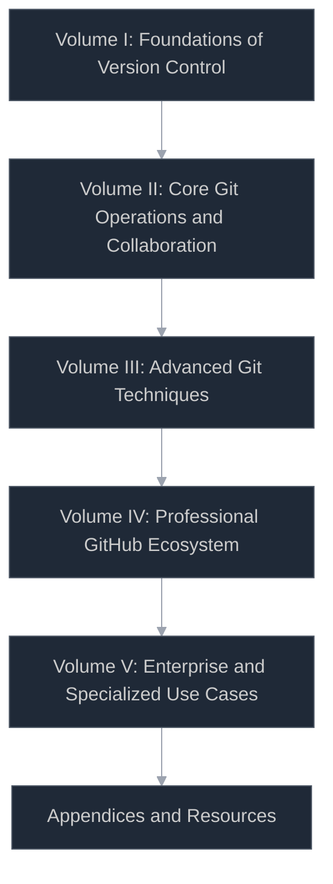
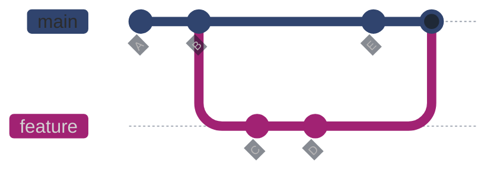
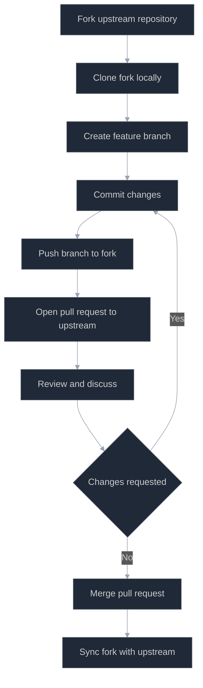
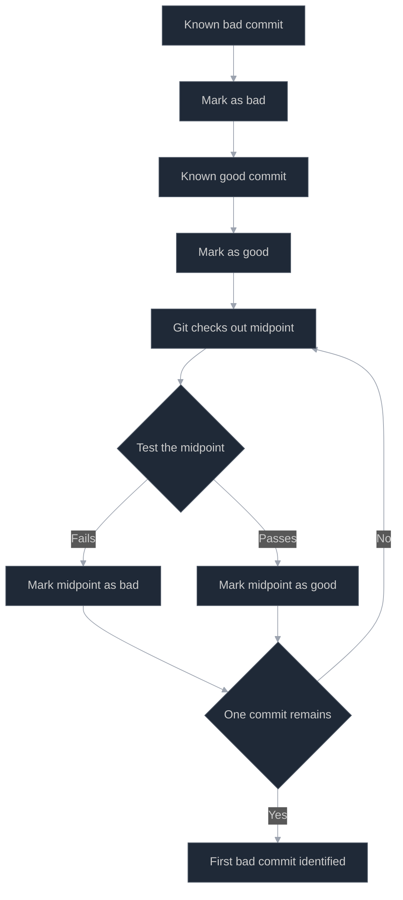
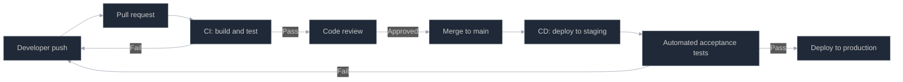

<br><br><br><br> 

<h1 align="center">GIT & GITHUB MASTERY.</h1>

<br><br>

<p align="center">
    <a href="https://github.com/polymathsr" target="_blank" rel="noopener noreferrer">
        
    </a>
</p>

<br><br>

## About This Roadmap

This document presents a structured learning path for developers who want to move from basic version control awareness to professional use of Git and GitHub in real projects. The roadmap is organised into five volumes, each covering a distinct stage of skill development, followed by appendices that serve as reference material.

The content is written for software engineers, team leads, DevOps practitioners, and students who already have some exposure to programming and the command line. It assumes no prior Git knowledge, but it does assume comfort with navigating a terminal, editing text files, and reading technical documentation.

The roadmap is practical rather than theoretical. Every chapter maps to tasks that appear in day to day engineering work: setting up a repository, resolving a merge conflict, reviewing a pull request, automating a build, or debugging a regression. The goal is not to memorise commands but to understand why each operation exists and when to use it.

### How to Use This Roadmap

| Reader profile | Recommended path |
|---|---|
| Complete beginner | Read Volumes I and II in order, practise each chapter in a scratch repository, then continue to Volume III |
| Developer with basic Git experience | Skim Volume I, study Volume II carefully, then move to Volumes III and IV |
| Team lead or DevOps engineer | Focus on Volumes II, IV, and V, and use the appendices as reference |
| Open source contributor | Study Volumes II and III, then Chapter 29 in Volume V |

### Prerequisites

- A computer with Git installed or permission to install it
- A GitHub account
- A text editor or IDE
- Basic command line familiarity
- Willingness to practise in a disposable repository

### Roadmap at a Glance

| Volume | Parts | Chapters | Primary focus |
|---|---|---|---|
| Volume I | Parts 1 and 2 | 01 to 06 | Version control concepts, Git architecture, installation, and basic workflows |
| Volume II | Parts 3 and 4 | 07 to 12 | Branching, merging, conflict resolution, and GitHub collaboration |
| Volume III | Parts 5 and 6 | 13 to 18 | History inspection, safe rewriting, debugging, hooks, submodules, and large file handling |
| Volume IV | Parts 7 and 8 | 19 to 24 | GitHub Actions, CI/CD pipelines, project management, and community documentation |
| Volume V | Parts 9 and 10 | 25 to 30 | Team branching at scale, monorepos, code review, DevOps, open source, and education |
| Appendices | A to E | Reference | Command reference, API tools, migration, troubleshooting, and continued learning |

### Learning Path Overview



<br>

## Volume I: Foundations of Version Control

Volume I establishes the mental model required for everything that follows. It explains what version control systems do, how Git implements those ideas, and how to configure a working environment. Readers who skip this volume often struggle later with concepts such as the staging area, detached HEAD, or remote tracking branches.

### Part 1: Introduction to Git and Version Control

#### Chapter 01: Understanding Version Control Systems

This chapter explains why version control exists and what problems it solves. It covers the difference between local, centralised, and distributed version control models, and describes how each model affects collaboration and backup. The chapter also introduces core vocabulary: repository, commit, branch, tag, merge, and remote. By the end, the reader should be able to explain why a distributed model is useful for both individual and team work.

Key topics:
- The purpose of version control in software development
- Local, centralised, and distributed models
- Core terminology used throughout Git documentation
- How version control supports auditing, rollback, and parallel work

#### Chapter 02: Git Fundamentals and Architecture

This chapter describes how Git stores data. It introduces the working directory, the staging area (also called the index), the local repository, and the remote repository. It explains that Git tracks content by snapshot rather than by file difference, and that commits are identified by cryptographic hashes. The chapter also covers the three states of a file in Git: modified, staged, and committed. Understanding this architecture prevents many common mistakes later.

Key topics:
- The four areas of a Git project
- Snapshots versus delta based storage
- Commit objects, trees, and blobs
- File states and how they move between areas


#### Chapter 03: Git vs Alternative VCS Solutions

This chapter compares Git with other version control systems that readers may encounter in professional environments. It does not argue that one tool is universally better. Instead, it describes trade offs in model, performance, branching cost, and typical use cases. The comparison helps readers understand why Git became dominant in open source and web development while other systems remain in specific industries.

| Feature | Git | Subversion (SVN) | Mercurial | Perforce |
|---|---|---|---|---|
| Storage model | Distributed | Centralised | Distributed | Centralised with distributed workspace options |
| Offline history access | Full history locally | Limited | Full history locally | Limited without a workspace |
| Branching cost | Very low | Directory based, heavier | Low | Stream based, workspace dependent |
| Typical branching workflow | Frequent and lightweight | Less frequent | Frequent | Controlled by workspace and stream rules |
| Performance for local operations | Fast | Network dependent for many operations | Fast | Fast within local workspace |
| Learning curve | Moderate to steep | Moderate | Moderate | Steep |
| Common adoption areas | Open source, web, most software teams | Legacy enterprise systems | Some large projects and organisations | Game development, large binary assets |

### Part 2: Initial Setup and Configuration

#### Chapter 04: Installing and Configuring Git

This chapter covers installation on common operating systems and the first configuration steps. It explains the difference between system, global, and local configuration levels, and shows how to set the user name, email address, default branch name, and line ending behaviour. It also introduces configuration files and how to inspect current settings. Correct configuration at this stage prevents commit attribution problems and cross platform line ending issues.

Key topics:
- Installation methods for Windows, macOS, and Linux
- Configuration levels and precedence
- User identity, default editor, and default branch name
- Line ending settings for cross platform teams
- Viewing and editing configuration with `git config`

#### Chapter 05: Creating and Managing Repositories

This chapter explains how to start a new repository and how to work with an existing one. It covers `git init`, cloning from a remote, and the role of the `.git` directory. It also describes what belongs in a repository and what does not, introducing ignore rules through `.gitignore`. The chapter closes with basic repository hygiene: keeping generated files out of history and understanding the difference between a local and a remote repository.

Key topics:
- Initialising a repository with `git init`
- Cloning an existing repository
- The structure and purpose of the `.git` directory
- Ignore rules and common patterns
- Local versus remote repositories

#### Chapter 06: Basic Git Commands and Workflows

This chapter introduces the commands used in everyday work. It covers checking status, staging changes, committing, viewing history, and pushing to a remote. It also explains how to write a useful commit message and why commit size matters. The workflow presented here is deliberately simple: edit, stage, commit, push. Later volumes build on this foundation with branching and collaboration.

| Task | Command | Notes |
|---|---|---|
| Check working tree status | `git status` | Shows staged, unstaged, and untracked files |
| Stage a file | `git add <file>` | Use `git add .` to stage all changes in the current directory |
| Commit staged changes | `git commit -m "message"` | The message should describe why the change was made |
| View commit history | `git log` | Use `--oneline` for a compact view |
| Show differences | `git diff` | Compares working directory with staging area by default |
| Push to remote | `git push` | Requires a configured remote and an upstream branch |
| Pull from remote | `git pull` | Fetches and integrates remote changes |

<br>

## Volume II: Core Git Operations and Collaboration

Volume II moves from individual work to team work. It covers branching and merging in detail, then introduces GitHub as a collaboration platform. The emphasis is on workflows that scale beyond a single developer and that keep history understandable.

### Part 3: Branching and Merging Strategies

#### Chapter 07: Branch Operations and Management

This chapter explains branches as movable pointers to commits. It covers creating, switching, listing, renaming, and deleting branches. It also explains the difference between a local branch and a remote tracking branch, and how `git switch` and `git checkout` relate to each other. The chapter emphasises that branches are cheap in Git and should be used frequently to isolate work.

Key topics:
- Branch creation and switching
- Local versus remote tracking branches
- Renaming and deleting branches
- Detached HEAD state and how to recover from it
- Listing branches with `git branch` and `git branch -a`

#### Chapter 08: Merge Techniques and Conflict Resolution

This chapter covers how Git combines work from different branches. It explains fast forward merges, three way merges, and the difference between merge commits and rebase. It then walks through conflict resolution: how conflicts are marked in files, how to edit them, and how to complete the merge. The chapter also discusses when to merge and when to rebase, with attention to shared branches and history clarity.

Key topics:
- Fast forward and three way merges
- Merge commits versus rebase
- Reading and resolving conflict markers
- Aborting and continuing a merge
- Using `git mergetool` when appropriate



#### Chapter 09: Advanced Branching Strategies

This chapter presents branching strategies used by real teams. It compares Git Flow, GitHub Flow, trunk based development, and environment based branching. For each strategy, it describes the branch structure, the release cadence it supports, and the coordination cost it introduces. The chapter does not prescribe a single strategy. Instead, it explains how to choose based on team size, deployment frequency, and release process.

| Strategy | Suitable for | Release cadence | Coordination cost |
|---|---|---|---|
| Git Flow | Products with scheduled releases and multiple environments | Scheduled | High |
| GitHub Flow | Web applications with continuous deployment | Continuous | Low |
| Trunk based development | Teams with strong automated testing and CI | Continuous | Low to moderate |
| Environment based branching | Teams that deploy through fixed stages | Continuous with stage gates | Moderate |

### Part 4: Collaboration with GitHub

#### Chapter 10: GitHub Interface and Repository Management

This chapter introduces GitHub as a hosting and collaboration platform. It covers repository creation, the repository home page, the code view, commit history, and settings that affect collaboration. It also explains visibility options, repository topics, and basic access control. The chapter focuses on what a developer needs to navigate a project and find relevant information quickly.

Key topics:
- Creating and configuring a repository on GitHub
- Repository visibility and access settings
- Navigating commits, branches, and tags in the web interface
- Using the repository README and description effectively
- Transferring and archiving repositories

#### Chapter 11: Forking and Pull Request Workflows

This chapter explains the fork and pull request model, which is central to open source collaboration. It covers forking a repository, cloning the fork, creating a feature branch, pushing changes, and opening a pull request. It also describes how review comments, requested changes, and approvals work. The chapter includes guidance on keeping a fork in sync with the upstream repository.

Key topics:
- Fork versus branch within the same repository
- Opening a pull request with a clear description
- Reviewing code and responding to feedback
- Keeping a fork synchronised with upstream
- Draft pull requests and their use



#### Chapter 12: Team Collaboration and Organization Management

This chapter covers GitHub organisations and teams. It explains how to structure access for teams, how to use team level permissions, and how to manage repository access at scale. It also discusses protected branches, required reviews, and status checks as controls that support collaboration without blocking work. The chapter is intended for readers who administer repositories or contribute to team level decisions.

Key topics:
- Organisation and team structure
- Repository roles and permission levels
- Protected branches and required reviews
- CODEOWNERS and review routing
- Managing outside collaborators

<br>

## Volume III: Advanced Git Techniques

Volume III covers operations that go beyond daily use. These techniques are useful for debugging, cleaning up history before review, automating local checks, and handling specialised content such as large files. They should be learned after the reader is comfortable with branching and merging.

### Part 5: History Manipulation and Debugging

#### Chapter 13: Viewing and Comparing Changes

This chapter explains how to inspect history and differences in detail. It covers `git log` options, `git diff` between commits and branches, and `git show` for individual commits. It also introduces `git blame` and `git grep` as tools for understanding why code changed and where terms appear. The focus is on answering practical questions: what changed, when, and by whom.

Key topics:
- Filtering and formatting commit history
- Comparing branches and commits
- Tracing line changes with blame
- Searching history and content
- Reading diff output efficiently

#### Chapter 14: Rewriting History Safely

This chapter explains how to change commits after they are created. It covers amending the most recent commit, interactive rebase for reordering, squashing, and editing commits, and resetting branches to earlier states. It also explains the risks of rewriting shared history and the difference between `git reset`, `git revert`, and `git rebase`. The chapter emphasises safety: work on a branch, understand the recovery options, and avoid rewriting commits that others have based work on.

Key topics:
- Amending the last commit
- Interactive rebase for cleanup
- Soft, mixed, and hard reset
- Reverting a commit safely
- Force pushing with lease and its risks

#### Chapter 15: Debugging with Bisect and Reflog

This chapter introduces two debugging tools that solve different problems. `git bisect` performs a binary search through history to find the commit that introduced a bug. `git reflog` records where branch tips and HEAD have been, which helps recover from accidental resets or branch deletions. The chapter includes a practical bisect workflow and explains how reflog differs from log.

Key topics:
- Starting and marking a bisect session
- Automating bisect with a test script
- Reading and using the reflog
- Recovering lost commits and branches
- Limits of reflog as a recovery tool



### Part 6: Advanced Git Features

#### Chapter 16: Git Hooks for Automation

This chapter explains hooks as scripts that run at specific points in the Git workflow. It covers client side hooks such as pre commit, commit msg, and pre push, and server side hooks used in hosted environments. It discusses what hooks are suitable for, such as formatting checks and commit message validation, and what they should not be relied on for, such as security enforcement on the client side. The chapter also mentions tools that manage hooks across a team.

Key topics:
- Client side versus server side hooks
- Common hooks and when they run
- Writing a simple pre commit check
- Sharing hooks with a team
- Limits of client side enforcement

#### Chapter 17: Submodules and Subtrees

This chapter covers ways to include one repository inside another. It explains submodules as references to specific commits in another repository, and subtrees as copied content with history merged into the parent repository. It compares their strengths and weaknesses, including update complexity, cloning behaviour, and suitability for shared libraries versus vendored dependencies.

| Aspect | Submodules | Subtrees |
|---|---|---|
| Storage model | Reference to another repository at a commit | Content copied into the parent repository |
| Clone behaviour | Requires initialisation and update | Content is present after clone |
| Update process | Explicit update command needed | Pull or merge from the subtree remote |
| History visibility | Separate history in the submodule | Merged history in the parent repository |
| Suitable for | Shared components with independent release cycles | Vendored dependencies or content that changes rarely |

#### Chapter 18: Git Attributes and LFS

This chapter explains how to control Git behaviour for specific files. Git attributes can define line ending rules, diff drivers, merge strategies, and export behaviour. Large File Storage (LFS) moves large binary files out of the main repository and stores pointers instead. The chapter explains when LFS is appropriate, how to set it up, and what limitations it has in terms of hosting and bandwidth.

Key topics:
- `.gitattributes` syntax and common rules
- Line ending normalisation across platforms
- Custom diff and merge drivers
- When to use Git LFS
- Cloning and fetching LFS content

<br>

## Volume IV: Professional GitHub Ecosystem

Volume IV focuses on the platform features that support professional software delivery. It covers automation with GitHub Actions, pipeline design, project management, and community documentation. These topics are relevant to developers who maintain projects, review code, or participate in release processes.

### Part 7: GitHub Automation and CI/CD

#### Chapter 19: GitHub Actions Fundamentals

This chapter introduces GitHub Actions as an automation platform built into GitHub. It explains workflows, jobs, steps, runners, and events. It covers the structure of a workflow file, how to use marketplace actions, and how to store secrets safely. The chapter includes a minimal working example and explains how to read workflow run logs.

Key topics:
- Workflow file structure and location
- Events that trigger workflows
- Jobs, steps, and runners
- Using actions from the marketplace
- Secrets and environment variables

#### Chapter 20: Advanced Workflow Automation

This chapter builds on the fundamentals with matrix builds, conditional steps, reusable workflows, and job dependencies. It covers caching dependencies to speed up runs, uploading artifacts, and using environments with protection rules. It also discusses workflow security, including pinning actions to commits and limiting token permissions.

Key topics:
- Matrix strategies for multiple versions and platforms
- Conditional execution and job dependencies
- Reusable workflows and composite actions
- Dependency caching and artifacts
- Security practices for workflow files

#### Chapter 21: CI/CD Pipeline Implementation

This chapter describes how to design a pipeline that moves code from commit to deployment. It covers the stages of continuous integration and continuous delivery, quality gates, and environment promotion. It explains how to connect tests, builds, and deployments into a coherent workflow, and how to handle failures without blocking the entire team.

Key topics:
- Stages of a typical CI/CD pipeline
- Quality gates and required checks
- Environment promotion and approvals
- Handling flaky tests and pipeline failures
- Rollback and deployment visibility



### Part 8: GitHub Project Management

#### Chapter 22: Issues and Project Management

This chapter covers GitHub Issues, labels, milestones, and project boards. It explains how to write an issue that others can act on, how to use templates, and how to connect issues to pull requests. It also describes project views and automation rules that reduce manual status updates.

Key topics:
- Writing clear and actionable issues
- Labels, milestones, and assignees
- Issue templates and forms
- Project boards and views
- Linking issues to pull requests

#### Chapter 23: Documentation and Community Building

This chapter explains how to document a project so that new contributors can participate. It covers README files, contribution guidelines, code of conduct, licence files, and changelogs. It also discusses GitHub Pages and wikis as documentation options. The chapter focuses on clarity and maintenance rather than volume.

Key topics:
- README structure and purpose
- Contribution guidelines and issue templates
- Code of conduct and licence
- Changelogs and release notes
- Documentation hosting options

#### Chapter 24: GitHub Advanced Features

This chapter introduces features that support larger projects and organisations. It covers GitHub Packages, security advisories, dependency scanning, code scanning, and discussions. It explains what each feature does and when it is worth enabling. The chapter does not attempt to cover every setting, but it provides enough context to evaluate these features for a project.

Key topics:
- Package hosting and registry use
- Dependency and code scanning
- Security advisories and disclosure
- Discussions and community Q and A
- Organisation level policy and audit

<br>

## Volume V: Enterprise and Specialized Use Cases

Volume V addresses situations that appear in larger organisations or specialised contexts. It covers team branching at scale, repository size management, code review systems, DevOps integration, open source contribution patterns, and educational use.

### Part 9: Large Scale Development

#### Chapter 25: Branching Strategies for Teams

This chapter revisits branching strategies with attention to team size and coordination. It covers release branches, hotfix processes, feature flags, and the role of short lived branches in reducing merge conflicts. It also discusses how to document a branching policy and how to enforce parts of it through platform settings.

Key topics:
- Release and hotfix branch management
- Feature flags versus long lived branches
- Branch naming and lifecycle conventions
- Documenting and enforcing branching policy
- Coordination across multiple teams

#### Chapter 26: Monorepos and Large Repositories

This chapter explains the trade offs of monorepos and strategies for keeping them manageable. It covers partial clones, sparse checkout, shallow clones, and commit graph features. It also discusses build systems that determine which projects are affected by a change, and how to keep clone and fetch times reasonable.

Key topics:
- Monorepo benefits and costs
- Partial clone and sparse checkout
- Shallow clones and history limits
- Commit graph and maintenance commands
- Build and test selection in large repositories

#### Chapter 27: Code Review and Quality Assurance

This chapter covers code review as a technical and social process. It explains how to write a review that is useful, how to separate blocking issues from suggestions, and how to use automated checks without replacing human judgement. It also discusses review scope, review latency, and the role of pair review in complex changes.

Key topics:
- Preparing a change for review
- Writing actionable review comments
- Separating blocking and non blocking feedback
- Using automation alongside human review
- Reviewing large or risky changes

### Part 10: Specialized Git Workflows

#### Chapter 28: Git in DevOps and Infrastructure

This chapter explains how Git is used in infrastructure and operations. It covers infrastructure as code repositories, environment configuration, secret handling, and the relationship between Git history and deployment history. It also discusses GitOps principles at a practical level and how repository structure affects operational safety.

Key topics:
- Infrastructure as code repository structure
- Secret management and avoiding leaks
- Environment configuration and promotion
- GitOps workflows and reconciliation
- Auditability and change traceability

#### Chapter 29: Open Source Contribution Patterns

This chapter describes how open source projects differ from internal projects. It covers finding issues to work on, reading contribution guidelines, communicating with maintainers, and handling review feedback. It also explains the maintainer side: triaging issues, reviewing pull requests, and setting expectations for response times.

Key topics:
- Finding and evaluating open issues
- Following project contribution guidelines
- Communicating with maintainers
- Reviewing and responding to feedback
- Maintainer responsibilities and boundaries

#### Chapter 30: Educational and Institutional Use

This chapter covers Git and GitHub in teaching and institutional settings. It explains how to use templates and classroom tools, how to structure assignments that avoid common cheating patterns, and how to give students a realistic collaboration experience. It also discusses privacy, data retention, and access management for institutions.

Key topics:
- Repository templates for assignments
- Classroom and organisation setup
- Designing collaborative exercises
- Privacy and data retention
- Assessing individual contribution

<br>

## Appendices and Resources

### Appendix A: Essential Git Commands Reference

| Category | Command | Purpose |
|---|---|---|
| Setup | `git config --global user.name` | Set the name attached to commits |
| Setup | `git config --global user.email` | Set the email attached to commits |
| Setup | `git config --list` | Show current configuration |
| Repository | `git init` | Create a new repository |
| Repository | `git clone <url>` | Copy a remote repository locally |
| Status | `git status` | Show working tree status |
| Staging | `git add <path>` | Stage changes for commit |
| Staging | `git restore --staged <path>` | Unstage changes |
| Commit | `git commit -m "message"` | Create a commit from staged changes |
| Commit | `git commit --amend` | Modify the most recent commit |
| History | `git log --oneline` | Show compact commit history |
| History | `git show <commit>` | Show details of a commit |
| Diff | `git diff` | Compare working tree with staging area |
| Diff | `git diff <branch1>..<branch2>` | Compare two branches |
| Branch | `git branch` | List local branches |
| Branch | `git switch -c <name>` | Create and switch to a new branch |
| Branch | `git branch -d <name>` | Delete a merged branch |
| Merge | `git merge <branch>` | Merge a branch into the current branch |
| Rebase | `git rebase <branch>` | Reapply commits on top of another branch |
| Remote | `git remote -v` | List configured remotes |
| Remote | `git fetch` | Download remote changes without merging |
| Remote | `git pull` | Fetch and integrate remote changes |
| Remote | `git push` | Upload local commits to a remote |
| Recovery | `git reflog` | Show recent HEAD movements |
| Debug | `git bisect start` | Start a bisect session |
| Cleanup | `git clean -n` | Preview untracked files to remove |

### Appendix B: GitHub API and Automation Tools

This appendix introduces ways to interact with GitHub beyond the web interface and Git commands. It covers the REST API, the command line tool `gh`, and common automation patterns such as creating issues, managing pull requests, and triggering workflows. It also mentions rate limits and authentication methods.

| Tool or method | Use case | Notes |
|---|---|---|
| REST API | Custom integrations and scripts | Requires authentication for most endpoints |
| GraphQL API | Efficient queries for complex data | Single endpoint with flexible response shape |
| `gh` CLI | Local terminal workflows | Wraps common API operations |
| Webhooks | Event driven integrations | Requires a receiving endpoint |
| Actions API | Workflow and run management | Useful for custom dashboards and triggers |

### Appendix C: Migration from Other VCS

This appendix describes how to move history from another version control system into Git. It covers available migration tools, the importance of preserving commit metadata, and common issues such as empty commits, branch mapping, and large binary files. It also recommends validating the migrated repository before switching team workflows.

Key topics:
- Migration tools for common systems
- Preserving authors, dates, and messages
- Branch and tag mapping
- Handling large files during migration
- Validation and cutover planning

### Appendix D: Common Problems and Solutions

| Problem | Likely cause | Resolution |
|---|---|---|
| Commit authored by wrong user | Incorrect local or global configuration | Update `user.name` and `user.email`, then amend or rebase as needed |
| Merge conflict during pull | Local and remote changes overlap | Resolve conflicts in affected files, stage them, and complete the merge |
| Detached HEAD after checkout | Checked out a commit instead of a branch | Create a branch at the current commit or switch back to an existing branch |
| Accidental reset lost commits | Branch pointer moved unexpectedly | Use `git reflog` to locate the previous commit and create a branch |
| Push rejected | Remote has commits not present locally | Fetch and integrate remote changes before pushing |
| Large file rejected by remote | File exceeds platform size limit | Remove the file from history or use Git LFS |
| Line ending changes on every commit | Inconsistent line ending configuration | Set `core.autocrlf` or `.gitattributes` rules consistently |

### Appendix E: Continuing Education and Community

This appendix lists ways to continue learning after the roadmap is complete. It covers official documentation, community forums, release notes, and practice repositories. It also suggests habits that keep skills current, such as reading changelogs, following security advisories, and contributing to projects with active review cultures.

Key topics:
- Official Git and GitHub documentation
- Release notes and deprecation notices
- Community forums and discussion platforms
- Practice through contribution
- Security advisories and update habits

<br>

## Conclusion

This roadmap is intended to be followed in order for foundational topics and used as a reference for advanced topics. The most important habit is consistent practice in a real repository. Reading about branching or conflict resolution without applying it rarely builds confidence. Each volume ends with skills that can be demonstrated in a small project, a team contribution, or an open source pull request.

The appendices are designed to remain useful after the first read. Commands change less often than interfaces, and the problem and solution table addresses issues that appear repeatedly in day to day work. Readers who complete the roadmap should be able to work comfortably in a shared repository, review code, automate routine checks, and reason about history when something goes wrong.

<br><br><br><br>
 
```
complete-git-github-mastery-roadmap/
├── FRONT MATTER
│   ├── About This Roadmap
│   ├── How to Use This Roadmap
│   ├── Prerequisites
│   ├── Roadmap at a Glance
│   └── Learning Path Overview
├── VOLUME I: Foundations of Version Control
│   ├── PART 1: Introduction to Git and Version Control
│   │   ├── Chapter 01: Understanding Version Control Systems
│   │   ├── Chapter 02: Git Fundamentals and Architecture
│   │   └── Chapter 03: Git vs Alternative VCS Solutions
│   └── PART 2: Initial Setup and Configuration
│       ├── Chapter 04: Installing and Configuring Git
│       ├── Chapter 05: Creating and Managing Repositories
│       └── Chapter 06: Basic Git Commands and Workflows
├── VOLUME II: Core Git Operations and Collaboration
│   ├── PART 3: Branching and Merging Strategies
│   │   ├── Chapter 07: Branch Operations and Management
│   │   ├── Chapter 08: Merge Techniques and Conflict Resolution
│   │   └── Chapter 09: Advanced Branching Strategies
│   └── PART 4: Collaboration with GitHub
│       ├── Chapter 10: GitHub Interface and Repository Management
│       ├── Chapter 11: Forking and Pull Request Workflows
│       └── Chapter 12: Team Collaboration and Organization Management
├── VOLUME III: Advanced Git Techniques
│   ├── PART 5: History Manipulation and Debugging
│   │   ├── Chapter 13: Viewing and Comparing Changes
│   │   ├── Chapter 14: Rewriting History Safely
│   │   └── Chapter 15: Debugging with Bisect and Reflog
│   └── PART 6: Advanced Git Features
│       ├── Chapter 16: Git Hooks for Automation
│       ├── Chapter 17: Submodules and Subtrees
│       └── Chapter 18: Git Attributes and LFS
├── VOLUME IV: Professional GitHub Ecosystem
│   ├── PART 7: GitHub Automation and CI/CD
│   │   ├── Chapter 19: GitHub Actions Fundamentals
│   │   ├── Chapter 20: Advanced Workflow Automation
│   │   └── Chapter 21: CI/CD Pipeline Implementation
│   └── PART 8: GitHub Project Management
│       ├── Chapter 22: Issues and Project Management
│       ├── Chapter 23: Documentation and Community Building
│       └── Chapter 24: GitHub Advanced Features
├── VOLUME V: Enterprise and Specialized Use Cases
│   ├── PART 9: Large Scale Development
│   │   ├── Chapter 25: Branching Strategies for Teams
│   │   ├── Chapter 26: Monorepos and Large Repositories
│   │   └── Chapter 27: Code Review and Quality Assurance
│   └── PART 10: Specialized Git Workflows
│       ├── Chapter 28: Git in DevOps and Infrastructure
│       ├── Chapter 29: Open Source Contribution Patterns
│       └── Chapter 30: Educational and Institutional Use
├── APPENDICES AND RESOURCES
│   ├── Appendix A: Essential Git Commands Reference
│   ├── Appendix B: GitHub API and Automation Tools
│   ├── Appendix C: Migration from Other VCS
│   ├── Appendix D: Common Problems and Solutions
│   └── Appendix E: Continuing Education and Community
└── CONCLUSION
```

<br><br><br><br>

<h3 align="center">STAY TUNED FOR THE LATEST UPDATES!</h3>

<br><br><br><br>
