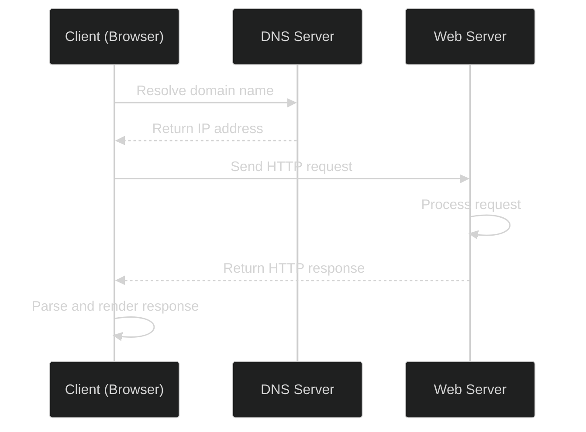
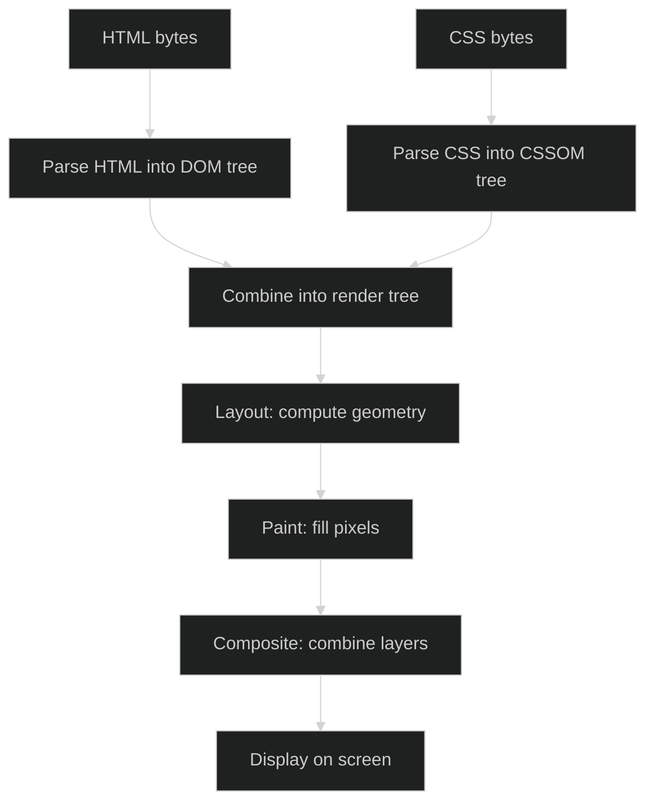
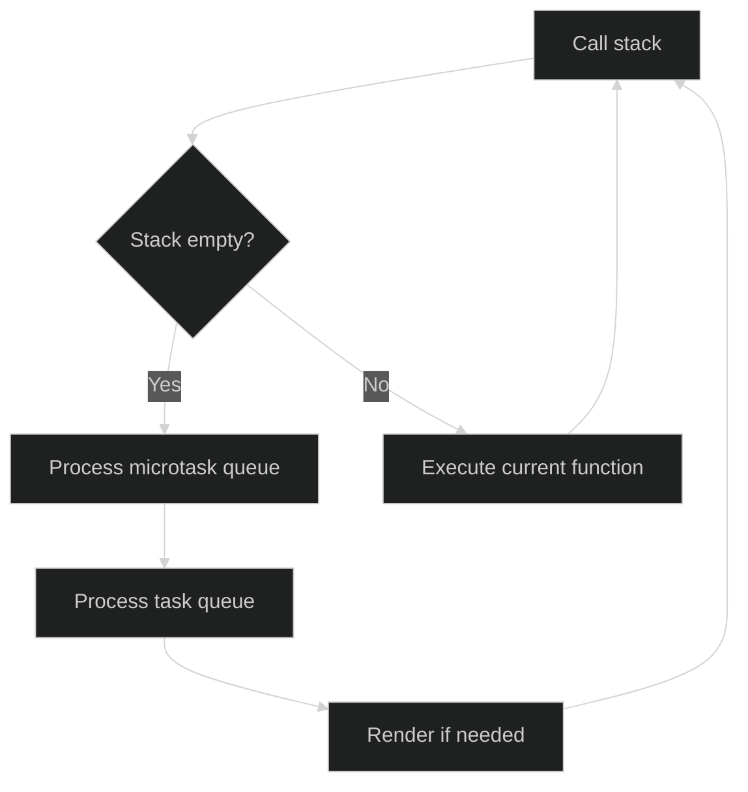

<br><br><br><br> 

<h1 align="center">HTML CSS & JAVASCRIPT MASTERY.</h1>

<br><br>

<p align="center">
    <a href="https://github.com/polymathsr" target="_blank" rel="noopener noreferrer">
        
    </a>
</p>

<br><br>
 
## Table of Contents

1. Overview
2. Volume I: Web Fundamentals and Core HTML
3. Volume II: CSS Fundamentals and Layout Systems
4. Volume III: Advanced CSS Techniques
5. Volume IV: JavaScript Fundamentals and Core Language
6. Volume V: Advanced JavaScript Language Features
7. Volume VI: Browser APIs and DOM Manipulation
8. Volume VII: Modern Development Patterns
9. Volume VIII: Build Tools and Development Ecosystem
10. Volume IX: Testing and Quality Assurance
11. Volume X: Performance Optimization
12. Volume XI: Security and Best Practices
13. Volume XII: Professional Development and Architecture
14. Appendices and Reference Materials

<br>

## Overview

This documentation presents a structured learning path for mastering HTML, CSS and JavaScript. It is designed for developers who want to build production quality web applications. The material follows a logical progression from foundational concepts to advanced professional practices.

The guide is divided into twelve volumes. Each volume contains parts that group related topics. Each part contains chapters that cover specific subjects in detail. The appendices provide reference material for daily work.

### How to Use This Guide

| Reader Type | Recommended Path |
|---|---|
| Complete beginner | Volumes I through IV in sequence |
| Developer with HTML/CSS basics | Volumes II through VII |
| Backend developer moving to frontend | Volumes I, IV, V, VI then VII through IX |
| Experienced developer seeking depth | Volumes III, V, VII, X, XI, XII |
| Team lead or architect | Volumes VII, VIII, XI, XII and appendices |

### Core Principles

The material in this guide follows several guiding principles:

1. Understand the platform before reaching for abstractions. HTML, CSS and JavaScript have deep specifications. Learning how they work prevents costly mistakes.
2. Build for the user first. Performance, accessibility and clarity matter more than tooling choices.
3. Prefer simple solutions. Complexity should be justified by real requirements.
4. Test what you build. Automated tests and manual checks catch different classes of defects.
5. Document decisions. Code explains how; documentation explains why.

<br>

## Volume I: Web Fundamentals and Core HTML

### Part 1: Introduction to Web Technologies

This part establishes the mental model for how the web works. Developers who understand these foundations debug faster and make better architectural choices.

#### Chapter 1: Web Architecture and the Client-Server Model

The web uses a client-server architecture. A client, usually a web browser, sends requests to a server. The server processes the request and returns a response. The client and server communicate over a network using standard protocols.

Key concepts:

- **Client**: Software that initiates requests. Browsers are the most common clients.
- **Server**: Software that listens for requests and returns responses.
- **Resource**: Any item that can be requested. Examples include HTML documents, images, stylesheets and scripts.
- **Statelessness**: Each request is independent. The server does not automatically remember previous requests.

The following diagram shows the basic request-response flow between a client and a server.



Real-world systems add layers such as content delivery networks, load balancers and reverse proxies. These layers exist to improve performance, reliability and security. A developer should understand the base model before working with these additions.

#### Chapter 2: HTTP Protocol and the Request-Response Cycle

HTTP is the protocol that carries most web traffic. It defines how messages are formatted and how servers and clients should behave.

An HTTP request contains:

- A method, such as GET, POST, PUT or DELETE.
- A target path, such as /products/list.
- Headers that carry metadata.
- An optional body for methods that send data.

An HTTP response contains:

- A status code, such as 200 for success or 404 for not found.
- Headers that describe the response.
- An optional body with the requested content.

| Status Code Range | Meaning | Common Examples |
|---|---|---|
| 1xx | Informational | 101 Switching Protocols |
| 2xx | Success | 200 OK, 201 Created, 204 No Content |
| 3xx | Redirection | 301 Moved Permanently, 304 Not Modified |
| 4xx | Client error | 400 Bad Request, 401 Unauthorized, 404 Not Found |
| 5xx | Server error | 500 Internal Server Error, 503 Service Unavailable |

HTTP/1.1 introduced persistent connections. HTTP/2 introduced multiplexing over a single connection. HTTP/3 uses QUIC over UDP. Each version improves performance but preserves the core request-response model.

Caching is a central part of HTTP. Servers can mark responses as cacheable using headers such as Cache-Control and ETag. Clients can then reuse responses without contacting the server. Proper caching reduces latency and server load.

#### Chapter 3: Browser Rendering Engine Fundamentals

When a browser receives an HTML document, it goes through several stages to display the page. The main stages are parsing, style calculation, layout, paint and composite.



The DOM tree represents the document structure. The CSSOM tree represents style rules. The render tree contains only visible elements. Layout computes the position and size of each element. Paint fills in colors, images and borders. Composite combines painted layers, sometimes on the GPU.

Understanding this pipeline helps developers reason about performance. For example, changing a layout property such as width triggers layout and paint. Changing a paint-only property such as background-color skips layout. Changing a composite-only property such as transform can skip both layout and paint.

#### Chapter 4: Development Environment Setup and Tools

A productive development environment includes a code editor, a modern browser with developer tools, a version control system and a local web server.

| Tool Category | Recommended Options | Purpose |
|---|---|---|
| Code editor | Visual Studio Code, WebStorm, Neovim | Write and navigate code |
| Browser | Chrome, Firefox, Safari, Edge | Run and debug applications |
| Version control | Git with a remote host such as GitHub or GitLab | Track changes and collaborate |
| Local server | Vite dev server, Python http.server, Live Server extension | Serve files over HTTP during development |
| Package manager | npm, pnpm, yarn | Install and manage dependencies |
| Terminal | Built-in terminal, iTerm2, Windows Terminal | Run commands and scripts |

Browser developer tools provide element inspection, console output, network activity, performance profiles, memory snapshots and application storage views. Learning to use these tools well is more valuable than learning any single framework.

<br>

### Part 2: HTML Fundamentals and Document Structure

HTML defines the structure and meaning of content. Good HTML improves accessibility, search engine understanding and maintainability.

#### Chapter 5: HTML5 Semantic Elements and Document Outline

Semantic elements describe the role of content. They replace generic containers where a more specific element exists.

| Element | Purpose | When to Use |
|---|---|---|
| header | Introductory content for a page or section | Page header, article header |
| nav | Navigation links | Main menu, table of contents |
| main | Primary content of the document | One per page |
| article | Self-contained composition | Blog post, product card |
| section | Thematic grouping of content | Chapter, tab panel |
| aside | Content tangentially related to the main content | Sidebar, pull quote |
| footer | Footer for a page or section | Copyright, related links |

The document outline is formed by headings from h1 to h6. A well-structured document has one h1 that describes the page, with h2 through h6 used for subsections in order. Skipping heading levels creates a confusing outline for assistive technology.

#### Chapter 6: Document Metadata and Head Elements

The head element contains metadata that is not displayed as page content. It controls how the page behaves and how it is described to other systems.

Common head elements:

- **title**: The page title shown in browser tabs and search results.
- **meta charset**: Declares the character encoding. UTF-8 is the standard choice.
- **meta name="viewport"**: Controls layout on mobile devices.
- **meta name="description"**: Provides a summary for search engines.
- **link rel="stylesheet"**: Loads external CSS.
- **link rel="icon"**: Sets the favicon.
- **script**: Loads JavaScript, with defer or async as appropriate.

The viewport meta tag is essential for responsive design. A typical value is width=device-width, initial-scale=1. This tells the browser to match the layout width to the device width and to start at a normal zoom level.

#### Chapter 7: Text Content Elements and Hierarchical Structure

Text content elements define headings, paragraphs, lists, quotations and preformatted text.

| Element | Meaning | Example Use |
|---|---|---|
| p | Paragraph | Body text |
| h1 to h6 | Headings | Section titles |
| ul | Unordered list | Feature lists, navigation |
| ol | Ordered list | Step-by-step instructions |
| dl | Description list | Term and definition pairs |
| blockquote | Extended quotation | Pull quotes, citations |
| pre | Preformatted text | Code blocks |
| hr | Thematic break | Separation between sections |

Lists should be used for items that form a set. Navigation menus are lists of links. Steps in a process are ordered lists. Using the correct list type improves clarity for all users and for assistive technology.

#### Chapter 8: Inline Text Semantics and Content Markup

Inline elements mark up parts of text. They carry meaning that affects rendering, accessibility and machine interpretation.

| Element | Meaning |
|---|---|
| strong | Strong importance |
| em | Stress emphasis |
| a | Hyperlink |
| code | Inline code fragment |
| kbd | Keyboard input |
| samp | Sample output |
| mark | Highlighted or marked text |
| small | Side comments and fine print |
| time | Machine-readable date or time |
| abbr | Abbreviation or acronym |

Use strong and em for meaning, not just for visual styling. If text only needs to look bold, use CSS. If the text carries importance that should be conveyed to screen readers and search engines, use strong.

Links should have descriptive text. Avoid phrases such as click here. A link that says View the pricing guide is more useful than a link that says click here.

#### Chapter 9: HTML Attributes and Global Properties

Attributes provide additional information about elements. Global attributes can be used on any element.

| Attribute | Purpose |
|---|---|
| id | Unique identifier for the element |
| class | Space-separated list of class names |
| style | Inline CSS declarations |
| title | Advisory information |
| lang | Language of the element content |
| dir | Text direction, such as ltr or rtl |
| hidden | Indicates that the element is not yet relevant |
| tabindex | Controls keyboard focus order |
| data-* | Custom data attributes for scripts and styles |

The id attribute must be unique within a document. The class attribute can be shared by many elements. Prefer classes for styling and ids for fragment links or script hooks.

Data attributes provide a way to attach custom data to elements. They are useful for passing configuration from HTML to JavaScript without inventing non-standard attributes.

<br>

### Part 3: Multimedia and Interactive Elements

Modern HTML supports images, audio, video, canvas drawing, vector graphics and forms. These elements require attention to performance, accessibility and fallback behavior.

#### Chapter 10: Image Formats and Responsive Media

Images are often the largest assets on a page. Choosing the right format and serving the right size improves load time and user experience.

| Format | Best For | Notes |
|---|---|---|
| JPEG | Photographs and complex images | Lossy compression, no transparency |
| PNG | Images with transparency or sharp edges | Lossless, larger file size |
| WebP | General purpose web images | Good compression, wide support |
| AVIF | High compression needs | Excellent compression, growing support |
| SVG | Icons, logos, diagrams | Vector format, scales without loss |

The img element supports srcset and sizes attributes for responsive images. These attributes let the browser choose an appropriate source based on viewport size and pixel density.

The picture element provides art direction. It allows different images to be shown at different breakpoints. This is useful when a wide image should be replaced by a cropped version on small screens.

Always provide an alt attribute. For decorative images, use an empty alt attribute. For informative images, describe the content and purpose.

#### Chapter 11: Audio and Video Element Implementation

The audio and video elements provide native media playback. They support multiple sources, captions and playback controls.

Basic usage:

- The video element displays video content.
- The audio element plays audio content.
- The source element specifies a media file and type.
- The track element adds captions, subtitles or descriptions.

Browsers support different codecs. Providing multiple sources lets the browser choose a supported format. Common video formats include MP4 with H.264 and WebM with VP9. Common audio formats include MP3 and AAC.

Accessibility requires captions for video with speech. Captions serve users who are deaf or hard of hearing and users in noisy environments. Transcripts serve users who prefer reading and improve search indexing.

#### Chapter 12: Canvas and SVG Integration

Canvas and SVG provide two different approaches to graphics.

| Feature | Canvas | SVG |
|---|---|---|
| Model | Pixel-based drawing surface | Retained tree of vector elements |
| Scaling | Raster, may blur when scaled | Vector, scales cleanly |
| Performance | Good for many small objects and real-time rendering | Good for fewer complex shapes and static graphics |
| Accessibility | Poor by default, requires fallback content | Good, elements can be described |
| Use cases | Games, charts with many points, image processing | Icons, diagrams, maps, illustrations |

Canvas is controlled through JavaScript. The developer draws shapes and manages the scene. SVG is a markup format. Elements are part of the DOM and can be styled with CSS and manipulated with JavaScript.

Both approaches can be used together. A common pattern is to use SVG for interface icons and canvas for data-heavy visualizations.

#### Chapter 13: Form Elements and Input Types

Forms collect user input. HTML provides many input types and form controls.

| Input Type | Purpose | Validation Support |
|---|---|---|
| text | Single-line text | Pattern, maxlength |
| email | Email address | Format validation |
| password | Masked text | minlength |
| number | Numeric value | min, max, step |
| date | Date selection | min, max |
| checkbox | Multiple selections | required |
| radio | Single selection from a group | required |
| file | File upload | accept, multiple |
| range | Slider value | min, max, step |
| search | Search field | None built-in |

The label element associates a description with a form control. Every control should have a label. Placeholders are not a replacement for labels because they disappear when the user types and are not reliably announced by screen readers.

Form validation should be implemented on both the client and the server. Client-side validation improves user experience. Server-side validation enforces correctness and security because client-side checks can be bypassed.

#### Chapter 14: Accessibility Fundamentals and ARIA Attributes

Accessibility means that people with disabilities can use the content. It is a core requirement, not an optional enhancement.

Key practices:

1. Use semantic HTML. A button element is more accessible than a div with a click handler.
2. Provide text alternatives for non-text content.
3. Ensure keyboard access for all interactive elements.
4. Maintain sufficient color contrast.
5. Use headings in a logical order.
6. Associate labels with form controls.

ARIA attributes add accessibility information when HTML alone is insufficient. Common ARIA attributes include role, aria-label, aria-describedby, aria-expanded and aria-hidden.

The first rule of ARIA is to not use ARIA if a native HTML element or attribute already provides the needed behavior. Use ARIA to fill gaps, not to replace semantic HTML.

#### Chapter 15: Data Attributes and Custom Properties

Data attributes store custom data on elements. They are written as data-name and accessed in JavaScript through the dataset property.

Example use cases:

- Storing an identifier for a component.
- Passing configuration to a script.
- Marking elements for behavior such as data-action="open-menu".

CSS custom properties, also called CSS variables, are declared with a double hyphen prefix. They hold values that can be reused throughout a stylesheet.

| Feature | Data Attributes | CSS Custom Properties |
|---|---|---|
| Purpose | Store data for scripts and styles | Store reusable style values |
| Access in CSS | Limited selector use | Full value access with var() |
| Access in JavaScript | dataset property | getPropertyValue and setProperty |
| Inheritance | No | Yes, by default |

Using data attributes for state, such as data-state="open", is a common pattern. CSS can style based on state, and JavaScript can read and update the attribute.

<br>

## Volume II: CSS Fundamentals and Layout Systems

### Part 4: CSS Core Concepts and Selectors

CSS controls presentation. A solid understanding of the cascade, specificity and the box model is essential for predictable styling.

#### Chapter 16: CSS Syntax and Rule Structure

A CSS rule consists of a selector and a declaration block. The declaration block contains one or more declarations. Each declaration has a property and a value.

```css
.article-card {
  padding: 16px;
  border: 1px solid #d0d0d0;
  border-radius: 8px;
}
```

Stylesheets can be included in three ways:

1. External stylesheet linked with a link element. This is the preferred approach.
2. Embedded style element in the document head. Useful for critical CSS.
3. Inline style attribute on an element. Use sparingly.

At-rules begin with an at sign. Common at-rules include @media, @supports, @font-face and @keyframes. At-rules extend CSS with conditional logic and resource loading.

#### Chapter 17: Selector Specificity and the Cascade Algorithm

The cascade determines which CSS declaration applies when multiple declarations target the same element. Several factors are considered in order:

1. **Origin and importance**: User agent styles, user styles and author styles each have their own precedence. Important declarations reverse the normal order.
2. **Specificity**: A measure of how specific a selector is.
3. **Source order**: When specificity is equal, the later declaration wins.

Specificity is calculated as a tuple with four parts: inline styles, ids, classes and attributes, and elements. A common notation is (a, b, c, d).

| Selector | Specificity |
|---|---|
| p | 0, 0, 0, 1 |
| .card | 0, 0, 1, 0 |
| #header | 0, 1, 0, 0 |
| .card .title | 0, 0, 2, 0 |
| a:hover | 0, 0, 1, 1 |
| style="color: red" | 1, 0, 0, 0 |

Understanding specificity prevents the need for excessive use of !important. When styles are not applying, check specificity and source order before adding overrides.

#### Chapter 18: Box Model and Visual Formatting

Every element generates a box. The box model describes the parts of that box.

| Part | Description |
|---|---|
| Content | The actual content area |
| Padding | Space between content and border |
| Border | The border around padding |
| Margin | Space outside the border |

The box-sizing property controls how width and height are calculated. The default value, content-box, applies width and height to the content area only. The value border-box includes padding and border in the specified width and height.

Setting box-sizing: border-box on all elements is a common practice. It makes layout calculations more intuitive.

Margins can collapse. When two vertical margins meet, the larger margin wins. This behavior affects spacing between block elements. Padding and borders prevent margin collapse.

#### Chapter 19: Colors, Units and Value Types

CSS supports several color notations.

| Notation | Example | Notes |
|---|---|---|
| Named colors | red, transparent | Limited set |
| Hexadecimal | #ff0000, #f00 | Common in designs |
| RGB | rgb(255 0 0) | Supports alpha with rgb(255 0 0 / 0.5) |
| HSL | hsl(0 100% 50%) | Easier to reason about hue and lightness |
| Modern functions | oklch(0.7 0.15 30) | Perceptually uniform color spaces |

Units are divided into absolute and relative categories.

| Unit Type | Examples | Behavior |
|---|---|---|
| Absolute | px, cm, mm | Fixed size regardless of context |
| Font-relative | em, rem, ex, ch | Relative to font size |
| Viewport-relative | vw, vh, vmin, vmax | Relative to viewport dimensions |
| Container-relative | cqw, cqh | Relative to container size |
| Percentage | % | Relative to a context-dependent value |

The rem unit is based on the root font size. It is useful for consistent spacing that respects user font size settings. The em unit is based on the current element font size and compounds in nested contexts.

#### Chapter 20: Typography and Text Styling Properties

Typography affects readability and visual hierarchy. CSS provides properties for font selection, spacing and alignment.

| Property | Purpose |
|---|---|
| font-family | Set the typeface |
| font-size | Set text size |
| font-weight | Set weight or boldness |
| line-height | Set space between lines |
| letter-spacing | Adjust space between characters |
| text-align | Align text within its container |
| text-decoration | Add lines such as underline |
| text-transform | Change letter case |

Font stacks list preferred fonts in order. A typical stack starts with a specific font, followed by fallback fonts, and ends with a generic family such as sans-serif.

Web fonts are loaded with @font-face or a service such as Google Fonts. Custom fonts improve branding but add network requests. Use font-display: swap to show fallback text while the custom font loads.

<br>

### Part 5: Layout Systems and Positioning

Layout is the arrangement of boxes on the page. Modern CSS provides several layout modes, each suited to different tasks.

#### Chapter 21: Normal Flow and Display Properties

Normal flow is the default layout behavior. Block-level elements stack vertically. Inline-level elements flow horizontally within text.

The display property changes an element's layout behavior.

| Display Value | Behavior |
|---|---|
| block | Takes full width, starts on a new line |
| inline | Flows within text, width based on content |
| inline-block | Flows inline but accepts width and height |
| flex | Creates a flex container |
| grid | Creates a grid container |
| none | Removes the element from layout |

Changing display affects the formatting context. A flex container establishes a flex formatting context for its children. A grid container establishes a grid formatting context.

#### Chapter 22: Flexbox Layout Fundamentals

Flexbox is a one-dimensional layout model. It arranges items along a main axis and a cross axis.

| Property | Applies To | Purpose |
|---|---|---|
| display: flex | Container | Enables flex layout |
| flex-direction | Container | Sets main axis direction |
| justify-content | Container | Aligns items along main axis |
| align-items | Container | Aligns items along cross axis |
| flex-wrap | Container | Allows items to wrap |
| gap | Container | Sets space between items |
| flex-grow | Item | Controls how items grow |
| flex-shrink | Item | Controls how items shrink |
| flex-basis | Item | Sets initial size |

Flexbox is well suited to navigation bars, card rows, form controls and centering content. It handles unknown content sizes better than older layout methods.

Common pattern for centering:

```css
.center {
  display: flex;
  align-items: center;
  justify-content: center;
  min-height: 100vh;
}
```

#### Chapter 23: CSS Grid Layout System

Grid is a two-dimensional layout model. It defines rows and columns and places items into cells.

| Property | Applies To | Purpose |
|---|---|---|
| display: grid | Container | Enables grid layout |
| grid-template-columns | Container | Defines column tracks |
| grid-template-rows | Container | Defines row tracks |
| gap | Container | Sets space between tracks |
| grid-column | Item | Places item across columns |
| grid-row | Item | Places item across rows |
| grid-template-areas | Container | Defines named areas |

Grid is well suited to page layouts, dashboards, image galleries and any design with alignment in both directions.

Example of a simple page layout:

```css
.layout {
  display: grid;
  grid-template-columns: 240px 1fr;
  grid-template-rows: auto 1fr auto;
  grid-template-areas:
    "header header"
    "sidebar main"
    "footer footer";
  min-height: 100vh;
}
```

Named areas make the layout easy to read and modify. Items are placed by referencing the area name with grid-area.

#### Chapter 24: Positioning Contexts and Stacking

The position property controls how an element is positioned relative to other elements.

| Position Value | Behavior |
|---|---|
| static | Default normal flow |
| relative | Offset from normal position, preserves space |
| absolute | Positioned relative to nearest positioned ancestor |
| fixed | Positioned relative to viewport |
| sticky | Toggles between relative and fixed based on scroll |

The z-index property controls stacking order for positioned elements. Elements with a higher z-index appear above elements with a lower z-index. Stacking contexts are created by certain properties, including position with a z-index value, transform, filter and opacity less than 1.

Stacking contexts can cause unexpected layering. When a child element with a high z-index appears behind another element, check whether an ancestor creates a stacking context that limits its effect.

#### Chapter 25: Float-Based Layouts and Clearfix Techniques

Floats were originally intended for wrapping text around images. They were later used for layout before flexbox and grid became widely supported.

A floated element is removed from normal flow and shifted to the left or right. Content flows around it. Floats can cause parent containers to collapse because floated children are removed from normal flow.

The clearfix technique forces a container to contain its floated children. A common implementation uses a pseudo-element:

```css
.clearfix::after {
  content: "";
  display: table;
  clear: both;
}
```

Modern layout should use flexbox or grid. Float-based layout is mostly of historical interest, but floats remain useful for their original purpose of wrapping text around media.

#### Chapter 26: Multi-column Layout Implementation

The multi-column layout module arranges content into columns, similar to a newspaper.

| Property | Purpose |
|---|---|
| column-count | Sets number of columns |
| column-width | Sets ideal column width |
| column-gap | Sets space between columns |
| column-rule | Adds a line between columns |
| break-inside | Controls breaks within elements |

Multi-column layout is suitable for long text content such as articles. It is not suitable for interface layouts because the number of columns and the distribution of content can vary with viewport size.

<br>

### Part 6: Responsive Design Principles

Responsive design ensures that a layout works across screen sizes and device capabilities. It combines flexible layouts, media queries and responsive media.

#### Chapter 27: Media Queries and Breakpoint Strategy

Media queries apply CSS conditionally based on device or viewport characteristics. Common features include width, height, orientation, resolution and prefers-color-scheme.

```css
@media (min-width: 768px) {
  .sidebar {
    display: block;
  }
}
```

Breakpoints should be chosen based on content needs, not specific device models. A common approach is to start with a mobile layout and add breakpoints where the content becomes cramped or difficult to read.

| Breakpoint Range | Typical Target |
|---|---|
| Below 480px | Small phones |
| 480px to 767px | Large phones |
| 768px to 1023px | Tablets |
| 1024px to 1279px | Small laptops |
| 1280px and above | Desktops |

These ranges are guidelines. The actual breakpoints should reflect the design and content.

#### Chapter 28: Responsive Images and Art Direction

Responsive images serve different image files based on viewport size and pixel density.

The srcset attribute lists image candidates with width or density descriptors. The sizes attribute tells the browser how much space the image will occupy.

```html

```

The picture element enables art direction. Different source elements can specify different images for different media conditions. This is useful when the composition of an image should change at different sizes.

#### Chapter 29: Mobile-First Development Approach

Mobile-first development starts with the smallest layout and adds enhancements for larger screens. This approach has several benefits:

1. It prioritizes content and essential features.
2. It often produces smaller CSS because base styles are simpler.
3. It aligns with the reality that most traffic comes from mobile devices.

A mobile-first stylesheet uses min-width media queries. Base styles apply to all sizes. Larger screens add complexity.

```css
.card {
  padding: 12px;
}

@media (min-width: 768px) {
  .card {
    padding: 24px;
  }
}
```

#### Chapter 30: Viewport Configuration and Mobile Optimization

The viewport meta tag tells the browser how to scale the page on mobile devices.

```html
<meta name="viewport" content="width=device-width, initial-scale=1">
```

Without this tag, mobile browsers assume a desktop width and zoom out. This makes text tiny and requires users to pinch and zoom.

Additional considerations for mobile optimization:

- Use touch-friendly target sizes. A minimum of 44 by 44 CSS pixels is a common guideline.
- Avoid hover-dependent interactions. Touch devices do not have hover.
- Test on real devices when possible.
- Consider network conditions. Mobile connections can be slower and less stable.

#### Chapter 31: Responsive Typography and Fluid Layouts

Responsive typography adjusts text size and spacing based on viewport size. Fluid typography uses viewport-relative units and clamp() to create smooth scaling.

```css
h1 {
  font-size: clamp(1.75rem, 4vw + 1rem, 3rem);
}
```

The clamp() function takes a minimum value, a preferred value and a maximum value. The browser chooses the preferred value but keeps it within the minimum and maximum bounds.

Fluid layouts use relative units such as percentages, fr units and minmax() in grid. These units allow content to adapt to available space without discrete breakpoints.

#### Chapter 32: CSS Custom Properties for Responsive Design

Custom properties store values that can be reused and changed. They are especially useful for theming and responsive adjustments.

```css
:root {
  --space-unit: 8px;
  --content-width: 1200px;
}

.container {
  max-width: var(--content-width);
  padding: calc(var(--space-unit) * 2);
}

@media (min-width: 1024px) {
  :root {
    --space-unit: 12px;
  }
}
```

Custom properties can be changed within media queries. This allows multiple related values to update together. They can also be set inline on elements, which makes them useful for component-level customization.

<br>

## Volume III: Advanced CSS Techniques

### Part 7: Advanced Styling and Visual Effects

Advanced CSS features enable rich visual design without images or JavaScript. They should be used with attention to performance and accessibility.

#### Chapter 33: CSS Transforms and 3D Transformations

The transform property moves, rotates, scales or skews an element without affecting surrounding layout.

| Function | Effect |
|---|---|
| translate() | Moves the element |
| rotate() | Rotates the element |
| scale() | Changes size |
| skew() | Skews the element |
| perspective() | Sets 3D perspective for children |

Transforms are commonly used for hover effects, modal animations and image galleries. They are also used to create performance-friendly animations because transform changes can be handled by the compositor.

3D transforms add depth. The perspective property on a parent creates a sense of depth for transformed children. The transform-style: preserve-3d property allows children to exist in three-dimensional space.

#### Chapter 34: Transitions and Animation Properties

Transitions animate changes between two states. Animations define keyframes and can loop or run independently.

Transition properties:

| Property | Purpose |
|---|---|
| transition-property | Specifies which properties animate |
| transition-duration | Sets how long the transition takes |
| transition-timing-function | Controls acceleration curve |
| transition-delay | Delays the start of the transition |

The @keyframes rule defines animation steps. The animation property applies a keyframe set to an element.

```css
@keyframes fade-in {
  from {
    opacity: 0;
  }
  to {
    opacity: 1;
  }
}

.message {
  animation: fade-in 200ms ease-out;
}
```

Animations should respect user preferences. The prefers-reduced-motion media query allows developers to reduce or disable motion for users who request it.

#### Chapter 35: Advanced Backgrounds and Gradients

CSS supports multiple backgrounds, gradients and background blending.

| Feature | Syntax Example | Use Case |
|---|---|---|
| Linear gradient | linear-gradient(to right, #fff, #000) | Section backgrounds |
| Radial gradient | radial-gradient(circle, #fff, #000) | Spotlight effects |
| Conic gradient | conic-gradient(red, yellow, green, red) | Charts, color wheels |
| Multiple backgrounds | background: url(a.png), url(b.png) | Layered decoration |

Gradients are resolution-independent and often smaller than image files. They are useful for decorative backgrounds and can replace simple images.

#### Chapter 36: Filters, Blend Modes and Compositing

Filters apply graphical effects to elements.

| Filter | Effect |
|---|---|
| blur() | Softens the element |
| brightness() | Adjusts lightness |
| contrast() | Adjusts contrast |
| grayscale() | Removes color |
| drop-shadow() | Adds a shadow based on alpha channel |
| sepia() | Applies a sepia tone |

Blend modes control how an element blends with its backdrop. The mix-blend-mode property applies blending within a stacking context. The background-blend-mode property blends background layers.

Filters and blend modes can be expensive to render. Use them deliberately and test performance on lower-end devices.

#### Chapter 37: Masking, Clipping and Shape-Outside

Masking and clipping control which parts of an element are visible.

- **clip-path** defines a clipping region. Common shapes include circle, ellipse, polygon and inset.
- **mask-image** uses an image or gradient as an alpha mask. Transparent areas hide the element.
- **shape-outside** defines a shape for text to wrap around.

These features enable non-rectangular layouts. They should be used with fallbacks for browsers that do not support them.

#### Chapter 38: Custom Cursors and System Integration

The cursor property changes the mouse pointer appearance. Standard values include pointer, default, text, move and not-allowed.

Custom cursors can be loaded with the url() function. They should be used sparingly because unfamiliar cursors can confuse users. Always provide a fallback keyword.

```css
.custom-cursor {
  cursor: url("cursor.png") 4 4, auto;
}
```

System integration features include prefers-color-scheme for dark mode, prefers-contrast for high contrast preferences and forced-colors for Windows high contrast mode. Respecting these preferences improves usability.

<br>

### Part 8: CSS Architecture and Methodology

As stylesheets grow, organization becomes critical. Several methodologies provide conventions for naming and structure.

#### Chapter 39: BEM (Block Element Modifier) Methodology

BEM names classes in three parts: block, element and modifier.

- **Block**: A standalone component, such as card.
- **Element**: A part of a block, written with two underscores, such as card__title.
- **Modifier**: A variation of a block or element, written with two hyphens, such as card--featured.

| Part | Syntax | Example |
|---|---|---|
| Block | block | navigation |
| Element | block__element | navigation__item |
| Modifier | block--modifier | navigation--horizontal |

BEM reduces naming collisions and makes the relationship between classes clear. It does not prescribe file structure, but it pairs well with component-based organization.

#### Chapter 40: SMACSS and Scalable Architecture

SMACSS stands for Scalable and Modular Architecture for CSS. It categorizes styles into five groups:

1. Base: Default element styles.
2. Layout: Styles that define the structure of major sections.
3. Module: Reusable components.
4. State: Styles that describe a temporary state, such as is-active.
5. Theme: Styles that change visual appearance.

SMACSS encourages separation of concerns. Base styles apply globally. Layout styles define regions. Module styles are scoped to components. State styles are applied and removed by scripts.

#### Chapter 41: OOCSS Principles and Implementation

Object-Oriented CSS separates structure from skin and content from container.

Two main principles:

1. **Separate structure and skin**: A button's layout and its visual theme should be defined separately.
2. **Separate content from container**: Styles should not depend on where an element is placed.

OOCSS leads to reusable classes that can be combined. For example, a .btn class defines basic button structure, and a .btn-primary class adds visual styling.

#### Chapter 42: ITCSS and Inverted Triangle Architecture

ITCSS organizes stylesheets in layers from generic to specific.

| Layer | Purpose |
|---|---|
| Settings | Variables and configuration |
| Tools | Mixins and functions |
| Generic | Resets and box-sizing |
| Elements | Bare element styles |
| Objects | Layout patterns |
| Components | UI components |
| Utilities | Helper classes |

The inverted triangle metaphor reflects specificity and reach. Styles at the top affect many elements and have low specificity. Styles at the bottom affect few elements and have high specificity.

#### Chapter 43: CSS Modules and Scope Isolation

CSS Modules scope class names to a specific file. When a CSS Module is imported, class names are transformed into unique identifiers.

This prevents naming collisions across components. It also makes it safe to use simple class names such as .title within a module.

CSS Modules are commonly used with component frameworks and build tools. They require a build step to transform class names and generate the associated JavaScript or TypeScript imports.

#### Chapter 44: Utility-First CSS and Atomic Design

Utility-first CSS provides small, single-purpose classes that are combined in markup.

Examples: .flex, .p-4, .text-center, .bg-blue.

| Advantage | Consideration |
|---|---|
| Fast prototyping | Markup can become verbose |
| Consistent spacing and colors | Requires discipline to avoid arbitrary values |
| No naming conflicts | Learning curve for new team members |
| Easy to remove unused styles with tooling | Can encourage inline-style thinking |

Atomic design is a related concept for component hierarchies. It describes five levels: atoms, molecules, organisms, templates and pages. Utility-first CSS and atomic design both favor composition over large, monolithic components.

<br>

### Part 9: Advanced Layout Techniques

Modern CSS continues to add layout capabilities. These features solve problems that previously required JavaScript or complex workarounds.

#### Chapter 45: Subgrid and Nested Grid Layouts

Subgrid allows a grid item to participate in its parent grid's tracks.

```css
.parent {
  display: grid;
  grid-template-columns: repeat(3, 1fr);
}

.child {
  display: grid;
  grid-column: span 3;
  grid-template-columns: subgrid;
}
```

Subgrid is useful when nested components need to align with the parent grid. It avoids the need to duplicate track definitions or use fixed dimensions.

#### Chapter 46: CSS Masonry Layout Implementation

Masonry layout arranges items in columns with varying heights, filling gaps efficiently. Native CSS masonry is still being standardized. Current approaches include:

1. JavaScript libraries that position items absolutely.
2. CSS columns, which provide a column-based approximation.
3. Grid with auto-placement, which does not produce true masonry.

CSS columns are the simplest native approach but they order content vertically. True masonry requires JavaScript or experimental CSS features. Developers should evaluate whether the visual benefit justifies the added complexity.

#### Chapter 47: Container Queries and Element-Based Responsiveness

Container queries allow styles to respond to the size of a parent container rather than the viewport.

```css
.card-container {
  container-type: inline-size;
}

@container (min-width: 400px) {
  .card {
    display: flex;
  }
}
```

Container queries are useful for reusable components that appear in different contexts. A card in a narrow sidebar can use a stacked layout, while the same card in a wide main area can use a horizontal layout.

#### Chapter 48: Scroll Snap and Controlled Scrolling

Scroll snap controls scrolling behavior so that scrolling stops at defined points.

| Property | Applies To | Purpose |
|---|---|---|
| scroll-snap-type | Container | Enables snapping and sets strictness |
| scroll-snap-align | Item | Defines snap alignment |
| scroll-padding | Container | Adjusts snap position |
| scroll-margin | Item | Adds margin around snap area |

Scroll snap is useful for carousels, image galleries and full-page sections. It improves the feel of touch scrolling and can replace some JavaScript-based carousel logic.

#### Chapter 49: Aspect Ratio and Intrinsic Sizing

The aspect-ratio property sets a preferred width-to-height ratio for an element.

```css
.video-wrapper {
  aspect-ratio: 16 / 9;
}
```

Before aspect-ratio, developers used padding-top hacks to reserve space for media. The aspect-ratio property is simpler and more robust.

Intrinsic sizing keywords include min-content, max-content and fit-content. These keywords size elements based on their content.

| Keyword | Behavior |
|---|---|
| min-content | Smallest size without overflow |
| max-content | Size needed to fit content on one line |
| fit-content | Size based on available space, capped by max-content |

These keywords are useful in grid and flex layouts where content size should influence track sizing.

#### Chapter 50: Logical Properties and Writing Modes

Logical properties use flow-relative directions instead of physical directions.

| Physical Property | Logical Equivalent |
|---|---|
| margin-left | margin-inline-start |
| margin-right | margin-inline-end |
| margin-top | margin-block-start |
| margin-bottom | margin-block-end |
| width | inline-size |
| height | block-size |

Logical properties adapt to writing modes. In a left-to-right language, inline-start is left. In a right-to-left language, inline-start is right. This makes styles more portable across languages and scripts.

The writing-mode property changes the flow direction. Values include horizontal-tb, vertical-rl and vertical-lr. Logical properties are essential when supporting vertical writing modes.

<br>

### Part 10: Performance and Optimization

CSS affects page load and rendering performance. Optimization should be based on measurement, not guesswork.

#### Chapter 51: Critical CSS and Render Blocking Optimization

CSS is render-blocking by default. The browser must download and parse stylesheets before it can render the page. Critical CSS is the subset of styles needed to render above-the-fold content.

Strategies:

1. Inline critical CSS in the document head.
2. Load the rest of the CSS asynchronously.
3. Use media attributes to mark non-critical stylesheets as non-blocking.

```html
<style>
  /* Critical styles here */
</style>
<link rel="stylesheet" href="styles.css" media="print" onload="this.media='all'">
```

The goal is to reduce the time to first meaningful paint. Critical CSS should be generated by tooling rather than written manually for large sites.

#### Chapter 52: CSS Minification and Compression

Minification removes whitespace, comments and unnecessary characters. Compression reduces transfer size using algorithms such as gzip or Brotli.

| Technique | Effect | Typical Tool |
|---|---|---|
| Minification | Removes whitespace and comments | cssnano, clean-css |
| Gzip compression | Compresses text over the wire | Server configuration |
| Brotli compression | Better compression ratio than gzip | Server configuration |
| CSS bundling | Reduces request count | Build tools |

Modern servers and CDNs often handle compression automatically. Minification should be part of the build pipeline.

#### Chapter 53: Hardware Acceleration and Performance

The browser can use the GPU to composite layers. Certain CSS properties trigger layer creation and GPU compositing. These include transform, opacity, filter and will-change.

Using will-change can improve performance for elements that will animate. However, overuse creates many layers and consumes memory. Apply will-change only to elements that need it, and remove it when the animation completes.

Animations that only change transform and opacity can run on the compositor thread. Animations that change layout or paint properties require more work on the main thread.

#### Chapter 54: CSS Complexity Analysis and Refactoring

Large stylesheets accumulate unused rules, overly specific selectors and duplicated declarations. Complexity analysis identifies areas that need refactoring.

Signs of CSS complexity:

- Frequent use of !important.
- Selectors with high specificity.
- Repeated declarations across files.
- Unused rules that are no longer applied.
- Deep nesting in preprocessor output.

Refactoring should be incremental. Tools can detect unused CSS. Manual review is needed to confirm that a rule is truly unused.

#### Chapter 55: Tree Shaking and Dead Code Elimination

Tree shaking removes code that is not referenced. For CSS, this means removing selectors that do not match any element in the rendered pages.

CSS tree shaking is harder than JavaScript tree shaking because CSS selectors can be applied dynamically. A selector may not appear in static HTML but may be added by JavaScript at runtime. Tools that remove unused CSS must be configured carefully to avoid removing needed rules.

#### Chapter 56: Browser DevTools for CSS Optimization

Browser developer tools provide several features for CSS analysis.

| Tool Panel | Use |
|---|---|
| Elements | Inspect computed styles and box model |
| Styles | View and edit CSS rules |
| Coverage | Identify unused CSS and JavaScript |
| Performance | Record and analyze rendering performance |
| Rendering | Show paint flashing and layer borders |

The coverage panel shows which CSS rules were used during a recording. This is useful for finding dead CSS. The performance panel shows style recalculation and layout times. The rendering panel helps visualize compositing and paint behavior.

<br>

## Volume IV: JavaScript Fundamentals and Core Language

### Part 11: Introduction to the JavaScript Ecosystem

JavaScript runs in browsers, servers and many other environments. Understanding its history and runtime model helps developers write correct and portable code.

#### Chapter 57: JavaScript Evolution and ECMAScript Standards

JavaScript is standardized as ECMAScript. The standard is maintained by Ecma International. New versions are released yearly.

| Version | Year | Notable Features |
|---|---|---|
| ES5 | 2009 | Strict mode, JSON support, array methods |
| ES6 (ES2015) | 2015 | let and const, arrow functions, classes, modules, promises |
| ES2016 | 2016 | Exponentiation operator, includes |
| ES2017 | 2017 | async and await, shared memory |
| ES2018 | 2018 | Object rest and spread, async iteration |
| ES2019 | 2019 | Array flat, Object fromEntries |
| ES2020 | 2020 | Optional chaining, nullish coalescing, BigInt |
| ES2021 | 2021 | Logical assignment, numeric separators |
| ES2022 | 2022 | Top-level await, class fields |
| ES2023 | 2023 | Array findLast, hashbang grammar |

Browsers implement features at different times. Transpilers such as Babel convert newer syntax into older syntax for compatibility. Polyfills add missing APIs. The choice of target environments determines which tools are needed.

#### Chapter 58: JavaScript Runtime Environments and Execution Context

A JavaScript engine executes code. Common engines include V8 in Chrome and Node.js, SpiderMonkey in Firefox and JavaScriptCore in Safari.

A runtime environment provides the engine plus additional APIs. Browsers provide the DOM, fetch, storage and other web APIs. Node.js provides file system, network and process APIs.

An execution context is the environment in which code runs. It includes the variable environment, the scope chain and the value of this. The global execution context is created when a script starts. Each function call creates a new execution context.

The call stack tracks execution contexts. When a function is called, a new context is pushed onto the stack. When the function returns, the context is popped. Stack overflow occurs when the call stack exceeds its limit, often due to unbounded recursion.

#### Chapter 59: Development Environment and Tooling Setup

A JavaScript development environment includes a runtime, a package manager, a code editor and build tools.

| Tool | Purpose |
|---|---|
| Node.js | JavaScript runtime for development tooling and servers |
| npm or pnpm | Package management |
| Visual Studio Code | Code editing and debugging |
| ESLint | Static analysis for code quality |
| Prettier | Code formatting |
| Vitest or Jest | Unit testing |
| Vite | Development server and build tool |

Project configuration is stored in package.json. Scripts define common tasks such as dev, build, test and lint. Dependencies are listed with version ranges. Lockfiles record exact versions for reproducible installs.

#### Chapter 60: Debugging Fundamentals and Browser DevTools

Debugging is the process of finding and fixing defects. Browser DevTools provide several debugging tools.

| Tool | Use |
|---|---|
| Console | Log messages and run expressions |
| Sources | Set breakpoints, step through code, inspect scope |
| Network | Inspect requests and responses |
| Performance | Record CPU profiles and frame timing |
| Memory | Take heap snapshots and detect leaks |
| Application | Inspect storage, cookies and service workers |

Breakpoints pause execution at a specific line. Conditional breakpoints pause only when a condition is true. Logpoints print a message without pausing. The debugger statement in code also pauses execution when DevTools is open.

The console supports several methods beyond log, including warn, error, table, group and time. These methods make output easier to read and organize.

<br>

### Part 12: Core Syntax and Basic Constructs

This part covers the building blocks of JavaScript: variables, types, operators, control flow, loops, functions and scope.

#### Chapter 61: Variables, Data Types and Type Coercion

JavaScript has several primitive types and one object type.

| Type | Example | Notes |
|---|---|---|
| string | "hello" | Text |
| number | 42, 3.14 | Floating point, includes NaN and Infinity |
| bigint | 9007199254740993n | Arbitrary precision integers |
| boolean | true, false | Logical values |
| undefined | undefined | Variable declared but not assigned |
| null | null | Intentional absence of value |
| symbol | Symbol("id") | Unique identifier |
| object | {}, [] | Collections and complex values |

Variables are declared with let, const or var. let and const are block-scoped. var is function-scoped and hoisted with an initial value of undefined.

Type coercion converts values from one type to another. Explicit coercion uses functions such as Number() or String(). Implicit coercion happens during operations, such as "5" + 2 producing "52". Understanding coercion prevents subtle bugs.

#### Chapter 62: Operators and Expression Evaluation

Operators perform operations on values. Operator precedence determines the order of evaluation.

| Category | Operators | Notes |
|---|---|---|
| Arithmetic | +, -, *, /, %, ** | Basic math |
| Comparison | ==, ===, !=, !==, <, >, <=, >= | === avoids type coercion |
| Logical | &&, \|\|, !, ?? | Short-circuit evaluation |
| Assignment | =, +=, -=, *=, /= | Combine operation and assignment |
| Ternary | condition ? a : b | Inline conditional |
| Optional chaining | obj?.prop | Returns undefined if obj is null or undefined |
| Nullish coalescing | a ?? b | Returns b if a is null or undefined |

The equality operators == and === behave differently. == performs type coercion before comparison. === compares value and type without coercion. Prefer === unless there is a specific reason to allow coercion.

#### Chapter 63: Control Flow and Conditional Logic

Control flow determines which code runs based on conditions.

- **if / else if / else**: Runs blocks based on boolean conditions.
- **switch**: Compares a value against multiple cases.
- **try / catch / finally**: Handles exceptions.

```javascript
if (status === "loading") {
  showSpinner();
} else if (status === "error") {
  showError();
} else {
  showContent();
}
```

The switch statement uses strict comparison. Each case should usually end with break to prevent fallthrough. Fallthrough can be intentional, but it should be documented.

#### Chapter 64: Loops and Iteration Patterns

Loops repeat code. JavaScript provides several loop constructs.

| Loop | Use Case |
|---|---|
| for | General-purpose iteration with a counter |
| for...of | Iterating over iterable values such as arrays |
| for...in | Iterating over enumerable property names |
| while | Repeating while a condition is true |
| do...while | Repeating at least once, then while a condition is true |

for...of works with arrays, strings, maps, sets and other iterables. It reads values. for...in reads property keys and includes inherited enumerable properties. for...in is generally not recommended for arrays because it may include non-index properties.

Array methods such as forEach, map, filter and reduce are often clearer than manual loops for data transformation.

#### Chapter 65: Functions and Execution Context

Functions are reusable blocks of code. They can be declared, expressed or created with the arrow syntax.

```javascript
function add(a, b) {
  return a + b;
}

const subtract = function (a, b) {
  return a - b;
};

const multiply = (a, b) => a * b;
```

Function declarations are hoisted. Function expressions and arrow functions are not hoisted in the same way. Arrow functions do not have their own this, arguments or super binding. They inherit this from the surrounding scope.

When a function is called, a new execution context is created. The arguments are bound to parameters. The this value is determined by how the function is called.

#### Chapter 66: Scope, Closures and Lexical Environment

Scope determines where variables are accessible. JavaScript has global scope, function scope and block scope.

A closure is a function that retains access to variables from its lexical scope even after the outer function has returned.

```javascript
function createCounter() {
  let count = 0;
  return function () {
    count += 1;
    return count;
  };
}

const counter = createCounter();
counter(); // 1
counter(); // 2
```

Closures are used for data privacy, event handlers, partial application and module patterns. They also explain why variables in loops can behave unexpectedly when using var. Using let creates a new binding for each iteration, which often matches developer expectations.

<br>

### Part 13: Data Structures and Built-in Objects

JavaScript provides built-in objects for common data tasks. Knowing their methods and behaviors improves code quality.

#### Chapter 67: Arrays and Array Methods

Arrays are ordered collections. They can hold values of any type and resize dynamically.

| Method | Purpose | Mutates Array |
|---|---|---|
| push | Add to end | Yes |
| pop | Remove from end | Yes |
| shift | Remove from start | Yes |
| unshift | Add to start | Yes |
| slice | Copy a portion | No |
| splice | Remove or insert | Yes |
| map | Transform each item | No |
| filter | Select items | No |
| reduce | Accumulate a value | No |
| find | Return first match | No |
| findIndex | Return index of first match | No |
| some | Test if any item matches | No |
| every | Test if all items match | No |
| flat | Flatten nested arrays | No |
| sort | Sort in place | Yes |
| toSorted | Return a sorted copy | No |

Methods that mutate arrays can cause bugs when the array is shared. Prefer non-mutating methods in code that needs predictable state, especially in frontend frameworks.

#### Chapter 68: Objects and Property Descriptors

Objects are collections of key-value pairs. Keys are strings or symbols. Values can be any type.

Property descriptors define how a property behaves.

| Descriptor | Purpose |
|---|---|
| value | The property value |
| writable | Whether the value can be changed |
| enumerable | Whether the property appears in enumeration |
| configurable | Whether the property can be redefined or deleted |
| get | Getter function |
| set | Setter function |

Object.create, Object.defineProperty and Object.getOwnPropertyDescriptor provide control over property behavior. These tools are useful for libraries and advanced patterns. Most application code uses plain object literals and does not need descriptors.

#### Chapter 69: Strings and Text Processing

Strings are immutable sequences of characters. Many methods are available for searching, slicing and transforming text.

| Method | Purpose |
|---|---|
| length | Number of characters |
| includes | Check for substring |
| startsWith | Check prefix |
| endsWith | Check suffix |
| indexOf | Find position of substring |
| slice | Extract a portion |
| substring | Extract a portion, with argument swapping |
| replace | Replace first match |
| replaceAll | Replace all matches |
| split | Split into an array |
| trim | Remove whitespace from both ends |
| toLowerCase | Convert to lowercase |
| toUpperCase | Convert to uppercase |

Template literals provide string interpolation and multiline strings. Tagged templates allow custom processing of template literals, which is useful for escaping, localization and domain-specific languages.

#### Chapter 70: Numbers, Math and Date Operations

The number type is a double-precision floating-point format. This has implications for precision. For example, 0.1 + 0.2 does not equal 0.3 exactly.

The Math object provides common mathematical operations. Methods include Math.round, Math.floor, Math.ceil, Math.abs, Math.max, Math.min and Math.random.

The Date object represents a point in time. It has methods for reading and setting components such as year, month, day, hour and minute. Date handling is a common source of bugs because of time zones and daylight saving time. Libraries such as Temporal are being developed to improve date handling. For complex date logic, a well-tested library is often a better choice than manual Date manipulation.

#### Chapter 71: Maps, Sets and Modern Collections

Map and Set are collections introduced in ES6.

| Collection | Description | Key Equality |
|---|---|---|
| Map | Key-value pairs with any key type | SameValueZero |
| Set | Unique values | SameValueZero |
| WeakMap | Key-value pairs with object keys, weak references | Object identity |
| WeakSet | Unique object values, weak references | Object identity |

Map preserves insertion order and allows any type as a key. A plain object only allows string and symbol keys. Set stores unique values and is useful for deduplication and membership tests.

WeakMap and WeakSet do not prevent garbage collection of their keys. They are useful for associating data with objects without creating memory leaks.

#### Chapter 72: JSON and Data Serialization

JSON is a text format for exchanging data. It supports objects, arrays, strings, numbers, booleans and null. It does not support functions, undefined, symbols or circular references.

| Method | Purpose |
|---|---|
| JSON.stringify | Convert a value to a JSON string |
| JSON.parse | Convert a JSON string to a value |

JSON.stringify accepts a replacer function or array to control which properties are included. It also accepts a space argument for pretty printing. JSON.parse accepts a reviver function to transform parsed values.

Common pitfalls include losing Date objects, which become strings, and failing on circular structures. For complex serialization needs, consider structuredClone or a dedicated library.

<br>

## Volume V: Advanced JavaScript Language Features

### Part 14: Object-Oriented Programming in JavaScript

JavaScript uses prototypal inheritance. The class syntax provides a familiar interface over prototypes.

#### Chapter 73: Prototypal Inheritance and the Prototype Chain

Every object has an internal link to another object called its prototype. When a property is accessed and not found on the object, JavaScript looks up the prototype chain.

```javascript
const animal = {
  speak() {
    return "sound";
  },
};

const dog = Object.create(animal);
dog.speak(); // "sound"
```

The prototype chain ends at Object.prototype, whose prototype is null. Property lookup follows the chain until the property is found or the chain ends.

Understanding the prototype chain explains method resolution and inheritance. It also explains why adding properties to Object.prototype is dangerous: they become visible on almost every object.

#### Chapter 74: Constructor Functions and Class Syntax

Before ES6, constructor functions were the standard way to create objects with shared behavior.

```javascript
function Person(name) {
  this.name = name;
}

Person.prototype.greet = function () {
  return `Hello, ${this.name}`;
};
```

ES6 introduced the class syntax. Classes are syntactic sugar over prototypes.

```javascript
class Person {
  constructor(name) {
    this.name = name;
  }

  greet() {
    return `Hello, ${this.name}`;
  }
}
```

Class methods are non-enumerable. Class declarations are not hoisted in the same way as function declarations. Classes must be defined before use.

#### Chapter 75: Encapsulation and Information Hiding

Encapsulation hides internal state and exposes a controlled interface. JavaScript provides several mechanisms.

- **Closures**: Variables in a function scope are private.
- **Private class fields**: Fields prefixed with # are accessible only within the class.
- **WeakMaps**: Store private data keyed by object instances.
- **Symbols**: Use unique keys to avoid accidental access.

Private class fields are the most direct modern approach.

```javascript
class Counter {
  #count = 0;

  increment() {
    this.#count += 1;
  }

  get value() {
    return this.#count;
  }
}
```

Private fields improve safety and make intent clear. They are supported in modern browsers and build tooling.

#### Chapter 76: Polymorphism and Method Overriding

Polymorphism allows different types to respond to the same method call in different ways. In JavaScript, this is achieved through inheritance and duck typing.

Method overriding occurs when a subclass provides its own implementation of a method defined in a superclass.

```javascript
class Shape {
  area() {
    return 0;
  }
}

class Circle extends Shape {
  constructor(radius) {
    super();
    this.radius = radius;
  }

  area() {
    return Math.PI * this.radius ** 2;
  }
}
```

Duck typing means that an object's suitability is determined by its methods and properties rather than its type. This supports flexible composition but requires careful documentation and testing.

#### Chapter 77: Composition vs Inheritance Patterns

Inheritance models an is-a relationship. Composition models a has-a relationship. Composition often leads to more flexible designs.

| Approach | Relationship | Trade-offs |
|---|---|---|
| Inheritance | is-a | Simple for clear hierarchies, can become rigid |
| Composition | has-a | Flexible, can require more wiring |

A common recommendation is to favor composition over inheritance unless the hierarchy is natural and stable. Mixins and higher-order functions provide composition mechanisms in JavaScript.

#### Chapter 78: Static Methods and Properties

Static members belong to the class itself, not to instances.

```javascript
class MathUtils {
  static double(value) {
    return value * 2;
  }
}

MathUtils.double(5); // 10
```

Static methods are useful for utility functions, factory methods and constants. They cannot access instance properties directly because they are not called on an instance.

<br>

### Part 15: Modern JavaScript Features (ES6+)

Modern syntax improves readability and reduces boilerplate. Developers should understand both the new syntax and the older patterns it replaces.

#### Chapter 79: Arrow Functions and Lexical This

Arrow functions provide a shorter syntax and do not bind their own this.

```javascript
const numbers = [1, 2, 3];
const doubled = numbers.map((n) => n * 2);
```

Arrow functions inherit this from the surrounding scope. This makes them useful for callbacks that need the outer this value. They are not suitable for methods that need their own this or for constructors.

Arrow functions also do not have their own arguments object. Use rest parameters instead when needed.

#### Chapter 80: Destructuring and Spread/Rest Operators

Destructuring extracts values from arrays and objects.

```javascript
const { name, age } = user;
const [first, second] = items;
```

Default values and renaming are supported.

```javascript
const { name: userName = "Guest" } = user;
```

The spread operator expands iterables into individual elements. The rest operator collects remaining elements into an array or object.

```javascript
const copy = [...items];
const merged = { ...defaults, ...options };
const [head, ...tail] = list;
```

Spread creates shallow copies. Nested objects are still shared by reference. For deep copies, use structuredClone or a dedicated library.

#### Chapter 81: Template Literals and Tagged Templates

Template literals use backticks and support interpolation.

```javascript
const message = `Hello, ${name}. You have ${count} items.`;
```

Template literals preserve line breaks. This makes them useful for multiline strings.

Tagged templates allow a function to process a template literal.

```javascript
function highlight(strings, ...values) {
  return strings.reduce((result, str, i) => {
    const value = values[i] ? `<mark>${values[i]}</mark>` : "";
    return result + str + value;
  }, "");
}
```

Tagged templates are used in libraries for escaping HTML, formatting SQL and building domain-specific languages.

#### Chapter 82: Modules and Module Systems

Modules divide code into separate files with explicit dependencies.

ES modules use import and export syntax.

```javascript
// math.js
export function add(a, b) {
  return a + b;
}

// app.js
import { add } from "./math.js";
```

| Module System | Syntax | Common Use |
|---|---|---|
| ES modules | import / export | Modern browsers and bundlers |
| CommonJS | require / module.exports | Node.js, legacy tooling |
| AMD | define / require | Older browser projects |

ES modules are the standard for new code. They are statically analyzable, which enables tree shaking and better tooling. CommonJS is still common in Node.js packages, but the ecosystem is moving toward ES modules.

#### Chapter 83: Enhanced Object Literals

ES6 added several conveniences for object literals.

- **Shorthand properties**: { name } instead of { name: name }.
- **Computed property names**: { [key]: value }.
- **Method shorthand**: { greet() { } } instead of { greet: function () { } }.

These features reduce repetition and make object definitions easier to read.

#### Chapter 84: Symbols, Iterators and Generators

Symbols are unique and immutable primitive values. They are often used as property keys to avoid collisions.

```javascript
const id = Symbol("id");
const user = { [id]: 1 };
```

Iterators define a sequence of values. An object is iterable if it implements the Symbol.iterator method.

Generators are functions that can pause and resume execution.

```javascript
function* range(start, end) {
  for (let i = start; i < end; i += 1) {
    yield i;
  }
}

for (const value of range(1, 4)) {
  console.log(value);
}
```

Generators are useful for lazy sequences, custom iteration and asynchronous control flow. Async generators combine generators with promises.

<br>

### Part 16: Asynchronous Programming

Asynchronous programming is central to JavaScript. It allows long-running operations to proceed without blocking the main thread.

#### Chapter 85: Event Loop and Concurrency Model

JavaScript runs on a single main thread. The event loop coordinates the execution of tasks.



The call stack executes synchronous code. When the stack is empty, the event loop processes microtasks, then tasks, then rendering. Microtasks include promise callbacks. Tasks include timers, events and I/O callbacks.

Understanding the event loop explains why a long synchronous function blocks rendering and why promise callbacks run before setTimeout callbacks.

#### Chapter 86: Callbacks and Higher-Order Functions

A callback is a function passed to another function to be called later. A higher-order function is a function that takes or returns another function.

```javascript
function fetchData(callback) {
  setTimeout(() => {
    callback({ status: "ok" });
  }, 1000);
}

fetchData((result) => {
  console.log(result);
});
```

Callbacks are simple but can lead to deeply nested code when multiple asynchronous operations depend on each other. This is often called callback hell. Promises and async/await address this problem.

#### Chapter 87: Promises and Promise Chaining

A promise represents the eventual result of an asynchronous operation. It can be pending, fulfilled or rejected.

```javascript
fetch("/api/users")
  .then((response) => response.json())
  .then((users) => {
    renderUsers(users);
  })
  .catch((error) => {
    showError(error);
  });
```

Promise methods include then, catch and finally. then returns a new promise, which enables chaining. catch handles rejections. finally runs regardless of outcome.

Promise chaining flattens asynchronous code compared to nested callbacks. Each step can transform the value or return a new promise.

#### Chapter 88: Async/Await and Error Handling

async and await provide syntax for working with promises.

```javascript
async function loadUsers() {
  try {
    const response = await fetch("/api/users");
    const users = await response.json();
    renderUsers(users);
  } catch (error) {
    showError(error);
  }
}
```

An async function always returns a promise. await pauses the function until the promise settles. The function resumes with the fulfilled value or throws the rejection reason.

try/catch handles both synchronous and asynchronous errors within an async function. For operations that should not fail the entire function, handle errors locally.

#### Chapter 89: Microtasks and Task Queues

Microtasks run after the current task and before the next task. Promise callbacks and queueMicrotask callbacks are microtasks. Tasks include timers and events.

```javascript
console.log("A");

setTimeout(() => console.log("B"), 0);

Promise.resolve().then(() => console.log("C"));

console.log("D");

// Output: A, D, C, B
```

The output order follows from the event loop model. Synchronous code runs first. Then microtasks run. Then tasks run.

#### Chapter 90: Concurrent Operations with Promise APIs

Promise.all and related methods coordinate multiple promises.

| Method | Behavior |
|---|---|
| Promise.all | Resolves when all promises resolve, rejects on first rejection |
| Promise.allSettled | Resolves when all promises settle, reports status of each |
| Promise.race | Settles with the first promise to settle |
| Promise.any | Resolves with the first fulfilled promise, rejects if all reject |

Promise.all is useful when several independent requests are needed and all results are required. Promise.allSettled is useful when partial success is acceptable. Promise.race is useful for timeouts and competing sources.

<br>

## Volume VI: Browser APIs and DOM Manipulation

### Part 17: Document Object Model (DOM)

The DOM is a programming interface for HTML and XML documents. It represents the document as a tree of nodes.

#### Chapter 91: DOM Tree Structure and Node Types

The document is a tree. Each element, text fragment and comment is a node.

| Node Type | Example | Constant |
|---|---|---|
| Document | The document root | Node.DOCUMENT_NODE |
| Element | div, p, a | Node.ELEMENT_NODE |
| Text | Text inside an element | Node.TEXT_NODE |
| Comment | HTML comments | Node.COMMENT_NODE |
| DocumentFragment | Lightweight container | Node.DOCUMENT_FRAGMENT_NODE |

Element nodes can have attributes and children. Text nodes contain text and cannot have children. DocumentFragment is useful for batching DOM changes because it is not part of the visible tree.

#### Chapter 92: Element Selection and Traversal

The DOM provides methods for selecting and traversing elements.

| Method | Returns |
|---|---|
| querySelector | First matching element |
| querySelectorAll | Static NodeList of matches |
| getElementById | Element with matching id |
| getElementsByClassName | Live HTMLCollection |
| getElementsByTagName | Live HTMLCollection |
| closest | Nearest ancestor matching selector |
| matches | Whether element matches selector |

querySelector and querySelectorAll use CSS selectors. They are flexible and widely used. The returned NodeList from querySelectorAll is static, meaning it does not update when the document changes. HTMLCollections from getElementsByClassName and getElementsByTagName are live.

Traversal properties include parentElement, children, firstElementChild, lastElementChild, nextElementSibling and previousElementSibling.

#### Chapter 93: DOM Manipulation and Content Updates

The DOM can be modified by creating, inserting and removing nodes.

| Method | Purpose |
|---|---|
| createElement | Create an element |
| createTextNode | Create a text node |
| append | Add nodes to the end |
| prepend | Add nodes to the start |
| before | Insert before an element |
| after | Insert after an element |
| remove | Remove an element |
| replaceWith | Replace an element |
| innerHTML | Read or write HTML content |
| textContent | Read or write text content |

innerHTML parses HTML and can introduce security risks if the content is not trusted. textContent treats content as text and is safer for user-provided values.

Batch changes with DocumentFragment or by building a subtree before inserting it. This reduces layout and paint work.

#### Chapter 94: Attribute and Class Manipulation

Attributes are accessed with getAttribute, setAttribute, removeAttribute and hasAttribute. The classList API provides a convenient way to manage classes.

```javascript
element.classList.add("active");
element.classList.remove("active");
element.classList.toggle("active");
element.classList.contains("active");
```

The dataset property provides access to data attributes. Setting dataset.userId updates the data-user-id attribute.

For accessibility, update ARIA attributes alongside visual state. For example, when opening a menu, set aria-expanded to true.

#### Chapter 95: Event System and Event Propagation

Events notify code about user actions and browser changes. Event listeners are registered with addEventListener.

```javascript
button.addEventListener("click", (event) => {
  console.log("clicked", event.target);
});
```

Events propagate through three phases: capture, target and bubble. By default, listeners run during bubbling. Passing true as the third argument or using the capture option registers a capture listener.

| Method | Effect |
|---|---|
| stopPropagation | Stops further propagation |
| preventDefault | Cancels the default browser action |
| stopImmediatePropagation | Stops propagation and other listeners on the same element |

Use stopPropagation sparingly because it can break other listeners. preventDefault is appropriate for custom form handling and link behavior when the default action is not desired.

#### Chapter 96: Custom Events and Event Delegation

Custom events allow components to communicate.

```javascript
const event = new CustomEvent("cart:add", {
  detail: { productId: 42 },
});

document.dispatchEvent(event);
```

Event delegation attaches a listener to a parent element and handles events from children based on the event target. This is efficient for lists and dynamic content.

```javascript
list.addEventListener("click", (event) => {
  const button = event.target.closest("[data-action='remove']");
  if (!button) return;
  removeItem(button.dataset.id);
});
```

Delegation reduces the number of listeners and works with elements added after the listener is registered.

<br>

### Part 18: Browser Storage and Client-Side Data

Browsers provide several storage mechanisms. Each has different capabilities and trade-offs.

#### Chapter 97: Web Storage API (LocalStorage and SessionStorage)

Web Storage stores key-value pairs as strings.

| Storage | Lifetime | Scope |
|---|---|---|
| localStorage | Until cleared | Origin |
| sessionStorage | Until tab closes | Origin and tab |

```javascript
localStorage.setItem("theme", "dark");
const theme = localStorage.getItem("theme");
localStorage.removeItem("theme");
```

Storage is synchronous and limited to roughly 5 MB per origin. It should not be used for sensitive data because it is accessible to any script on the origin. Values are strings, so objects must be serialized with JSON.stringify and parsed with JSON.parse.

#### Chapter 98: IndexedDB and Client-Side Databases

IndexedDB is a transactional database in the browser. It supports structured data, indexes and large storage quotas.

Key concepts:

- **Database**: A named collection of object stores.
- **Object store**: Similar to a table.
- **Index**: A way to query records by a property.
- **Transaction**: A unit of work that is atomic.

IndexedDB uses an asynchronous API based on events. Libraries such as idb provide promise-based wrappers. IndexedDB is suitable for offline data, caching large datasets and applications that need more than simple key-value storage.

#### Chapter 99: Cookies and Session Management

Cookies are small pieces of data sent with HTTP requests. They are used for sessions, preferences and tracking.

| Attribute | Purpose |
|---|---|
| Expires / Max-Age | Controls lifetime |
| Domain | Controls which hosts receive the cookie |
| Path | Controls which paths receive the cookie |
| Secure | Sends only over HTTPS |
| HttpOnly | Prevents JavaScript access |
| SameSite | Controls cross-site sending |

HttpOnly and Secure should be set for session cookies. SameSite helps prevent cross-site request forgery. Cookies have size limits and are sent with every matching request, so they should be kept small.

#### Chapter 100: Cache API and Service Workers

The Cache API stores request and response pairs. It is used with service workers to serve content offline.

Service workers are scripts that run in the background, separate from the page. They can intercept network requests and return cached responses.

| Capability | Description |
|---|---|
| Offline support | Serve cached assets when offline |
| Background sync | Retry failed requests when connectivity returns |
| Push notifications | Receive messages from a server |

Service workers require HTTPS except on localhost. They have a lifecycle with install, activate and fetch events. Caching strategies include cache-first, network-first and stale-while-revalidate.

#### Chapter 101: File API and Blob Operations

The File API allows web applications to read files selected by the user.

| Interface | Purpose |
|---|---|
| File | Metadata and content reference |
| FileList | Collection of selected files |
| FileReader | Read file contents |
| Blob | Raw binary data |
| URL.createObjectURL | Create a temporary URL for a blob |

FileReader reads files as text, data URLs or array buffers. Blobs can be created from strings or binary data and downloaded with anchor elements.

#### Chapter 102: Clipboard API and Drag/Drop Operations

The Clipboard API provides asynchronous read and write access to the clipboard.

```javascript
await navigator.clipboard.writeText("Copied text");
```

Clipboard access usually requires a user gesture and may require permission. The older document.execCommand approach is deprecated.

Drag and drop is implemented with drag events. Common events include dragstart, dragover, drop and dragend. The dragover event must call preventDefault to allow dropping. Data is transferred using the DataTransfer object.

<br>

### Part 19: Advanced Browser APIs

Browser APIs provide access to networking, history, background processing, real-time communication, device sensors and performance data.

#### Chapter 103: Fetch API and HTTP Client Operations

The Fetch API provides a promise-based interface for HTTP requests.

```javascript
const response = await fetch("/api/users", {
  method: "POST",
  headers: {
    "Content-Type": "application/json",
  },
  body: JSON.stringify({ name: "Ada" }),
});

if (!response.ok) {
  throw new Error(`Request failed: ${response.status}`);
}

const data = await response.json();
```

Fetch does not reject on HTTP error statuses. Check response.ok or response.status. For timeouts, use AbortController.

```javascript
const controller = new AbortController();
setTimeout(() => controller.abort(), 5000);

fetch("/api/data", { signal: controller.signal });
```

#### Chapter 104: History API and Single Page Applications

The History API allows navigation without full page reloads.

| Method | Purpose |
|---|---|
| pushState | Add a new history entry |
| replaceState | Replace the current entry |
| back | Go back one entry |
| forward | Go forward one entry |
| go | Go to a specific entry |

The popstate event fires when the active history entry changes. Single page applications use these APIs to update the URL and respond to navigation.

Server configuration must support client-side routes. A request for /products/42 should return the application shell, not a 404, if the route is handled by the client.

#### Chapter 105: Web Workers and Multithreading

Web workers run scripts in background threads. They allow CPU-intensive work without blocking the main thread.

```javascript
const worker = new Worker("worker.js");

worker.postMessage({ numbers: [1, 2, 3] });

worker.onmessage = (event) => {
  console.log(event.data);
};
```

Workers communicate with the main thread using postMessage and message events. Data is copied by default. Transferable objects such as ArrayBuffer can be transferred without copying.

Workers do not have access to the DOM. They can use many web APIs, including fetch and IndexedDB. Module workers support ES module imports.

#### Chapter 106: WebSocket and Real-Time Communication

WebSocket provides a persistent, bidirectional connection between client and server.

```javascript
const socket = new WebSocket("wss://example.com/chat");

socket.addEventListener("open", () => {
  socket.send(JSON.stringify({ type: "join", room: "general" }));
});

socket.addEventListener("message", (event) => {
  const message = JSON.parse(event.data);
  renderMessage(message);
});
```

WebSocket is suitable for chat, live updates and collaborative applications. For simpler server-to-client updates, server-sent events may be sufficient. Server-sent events use HTTP and are one-way.

#### Chapter 107: Geolocation and Device APIs

The Geolocation API provides access to the user's location with permission.

```javascript
navigator.geolocation.getCurrentPosition(
  (position) => {
    console.log(position.coords.latitude, position.coords.longitude);
  },
  (error) => {
    console.error(error.message);
  }
);
```

Location access requires user consent and is only available in secure contexts. Accuracy varies by device and environment.

Other device APIs include Camera and Microphone access through getUserMedia, Device Orientation and Battery Status. These APIs should be used only when needed and should degrade gracefully when unavailable.

#### Chapter 108: Performance API and Metrics Collection

The Performance API provides timing and resource data.

| Interface | Purpose |
|---|---|
| performance.now | High-resolution timestamp |
| performance.mark | Create a named timestamp |
| performance.measure | Measure time between marks |
| PerformanceObserver | Observe performance entries |
| performance.getEntriesByType | Retrieve resource and navigation timing |

Core Web Vitals are a set of metrics that reflect user experience. They include Largest Contentful Paint, Interaction to Next Paint and Cumulative Layout Shift. These metrics can be collected with the web-vitals library or through the PerformanceObserver API.

<br>

## Volume VII: Modern Development Patterns

### Part 20: Functional Programming Concepts

Functional programming emphasizes pure functions, immutability and composition. These ideas improve predictability and testability.

#### Chapter 109: Pure Functions and Side Effects

A pure function returns the same output for the same input and has no side effects.

```javascript
function add(a, b) {
  return a + b;
}
```

A side effect is any observable change outside the function, such as modifying a global variable, writing to the DOM or making a network request. Pure functions are easier to test and reason about.

Impure functions are necessary for I/O and state changes. The goal is to isolate side effects and keep most logic pure.

#### Chapter 110: Immutability and Persistent Data Structures

Immutability means that data is not changed after creation. Instead, new data structures are created for updates.

```javascript
const nextItems = [...items, newItem];
const nextUser = { ...user, name: "Grace" };
```

Immutability simplifies change detection and prevents accidental shared-state bugs. In frameworks such as React, immutable updates are important for rendering decisions.

Persistent data structures share structure between versions. Libraries such as Immutable.js and Immer provide efficient immutable updates. For most applications, spread syntax is sufficient.

#### Chapter 111: Higher-Order Functions and Function Composition

A higher-order function takes or returns a function. map, filter and reduce are higher-order functions.

Function composition combines functions so that the output of one becomes the input of another.

```javascript
const compose = (f, g) => (x) => f(g(x));

const toUpper = (s) => s.toUpperCase();
const exclaim = (s) => `${s}!`;

const shout = compose(exclaim, toUpper);
shout("hello"); // "HELLO!"
```

Composition encourages small, focused functions that can be reused and tested independently.

#### Chapter 112: Currying and Partial Application

Currying transforms a function with multiple arguments into a sequence of functions each taking one argument.

```javascript
const add = (a) => (b) => a + b;
const addFive = add(5);
addFive(3); // 8
```

Partial application fixes some arguments and returns a function for the rest. Currying and partial application are useful for creating specialized functions from general ones.

#### Chapter 113: Recursion and Trampolining

Recursion is a function calling itself. It is useful for tree traversal, parsing and divide-and-conquer algorithms.

```javascript
function factorial(n) {
  if (n <= 1) return 1;
  return n * factorial(n - 1);
}
```

Deep recursion can overflow the call stack. Trampolining converts recursive calls into a loop.

```javascript
function trampoline(fn) {
  return function (...args) {
    let result = fn(...args);
    while (typeof result === "function") {
      result = result();
    }
    return result;
  };
}
```

Most application code does not need trampolining. It is useful in functional programming and when processing deeply nested structures.

#### Chapter 114: Functors, Monads and Functional Patterns

Functors and monads are abstractions from category theory. In JavaScript, they appear in libraries and in patterns such as promises and arrays.

- **Functor**: An object with a map method that applies a function to its value.
- **Monad**: A functor with flatMap or chain for sequencing operations.

Promises are monad-like. then sequences operations and flattens nested promises. Arrays are functors with map.

These concepts are useful for understanding functional libraries. Most application developers can use the patterns without studying the underlying theory in depth.

<br>

### Part 21: Design Patterns and Architecture

Design patterns are reusable solutions to common problems. They provide shared vocabulary for teams.

#### Chapter 115: Module Pattern and Namespacing

The module pattern uses closures to create private state and expose a public API.

```javascript
const counter = (() => {
  let count = 0;

  return {
    increment() {
      count += 1;
    },
    get value() {
      return count;
    },
  };
})();
```

ES modules provide a standardized module system with file-level scope. The module pattern remains useful for encapsulating state within a single file or function.

#### Chapter 116: Factory and Constructor Patterns

A factory function creates objects without using the new keyword.

```javascript
function createUser(name) {
  return {
    name,
    greet() {
      return `Hello, ${this.name}`;
    },
  };
}
```

Factories are flexible and avoid some pitfalls of constructors, such as forgetting new. Constructor functions and classes are useful when instances need shared prototype methods and instanceof checks.

#### Chapter 117: Observer and Pub/Sub Patterns

The observer pattern defines a one-to-many relationship. When the subject changes, observers are notified.

```javascript
class Subject {
  #observers = [];

  subscribe(observer) {
    this.#observers.push(observer);
  }

  notify(data) {
    this.#observers.forEach((observer) => observer(data));
  }
}
```

The publish-subscribe pattern adds an event channel between publishers and subscribers. This decouples the two sides. Event emitters and DOM events are examples of pub/sub.

#### Chapter 118: Singleton and Dependency Injection

A singleton ensures that a class has only one instance. In JavaScript, module scope often provides a natural singleton.

```javascript
// config.js
export const config = {
  apiUrl: "/api",
};
```

Dependency injection passes dependencies into a function or class instead of creating them internally. This improves testability and flexibility.

```javascript
class UserService {
  constructor(httpClient) {
    this.httpClient = httpClient;
  }
}
```

#### Chapter 119: Decorator and Proxy Patterns

A decorator wraps a function or object to add behavior without modifying the original.

```javascript
function withLogging(fn) {
  return function (...args) {
    console.log("calling", fn.name);
    return fn.apply(this, args);
  };
}
```

The Proxy object intercepts operations on another object. It can be used for validation, logging and reactive state.

```javascript
const proxy = new Proxy(target, {
  get(obj, prop) {
    return obj[prop];
  },
  set(obj, prop, value) {
    obj[prop] = value;
    return true;
  },
});
```

Proxy is powerful but can add complexity. Use it when the interception behavior is a core requirement.

#### Chapter 120: Command and Strategy Patterns

The command pattern encapsulates a request as an object. This allows requests to be queued, logged or undone.

```javascript
class AddItemCommand {
  constructor(cart, item) {
    this.cart = cart;
    this.item = item;
  }

  execute() {
    this.cart.add(this.item);
  }

  undo() {
    this.cart.remove(this.item);
  }
}
```

The strategy pattern defines a family of algorithms and makes them interchangeable.

```javascript
const strategies = {
  uppercase: (text) => text.toUpperCase(),
  lowercase: (text) => text.toLowerCase(),
};

function format(text, strategy) {
  return strategies[strategy](text);
}
```

Strategy is useful when behavior varies by configuration or context.

<br>

### Part 22: Error Handling and Debugging

Errors are inevitable. Good error handling keeps applications stable and helps diagnose problems.

#### Chapter 121: Error Types and Exception Hierarchy

JavaScript has several built-in error types.

| Error Type | When It Occurs |
|---|---|
| Error | Base type for general errors |
| SyntaxError | Invalid syntax |
| ReferenceError | Accessing an undefined variable |
| TypeError | Value is not of the expected type |
| RangeError | Value is outside the allowed range |
| URIError | Invalid URI handling |
| AggregateError | Multiple errors grouped together |

Custom errors extend the Error class and add context.

```javascript
class ValidationError extends Error {
  constructor(message, field) {
    super(message);
    this.name = "ValidationError";
    this.field = field;
  }
}
```

#### Chapter 122: Try/Catch/Finally and Error Propagation

try/catch handles exceptions. finally runs regardless of outcome.

```javascript
try {
  const data = JSON.parse(input);
  process(data);
} catch (error) {
  reportError(error);
} finally {
  cleanup();
}
```

Errors propagate up the call stack until they are caught. Uncaught errors trigger the global error event in browsers or terminate the process in Node.js.

Avoid catching errors without handling them. A catch block that only logs and continues can hide serious problems. Rethrow the error if the function cannot recover.

#### Chapter 123: Custom Error Classes and Error Handling Strategies

Custom error classes make it possible to distinguish error types and attach metadata.

Strategies for handling errors:

1. **Recover**: Retry the operation or use a fallback.
2. **Report**: Log the error and notify the appropriate system.
3. **Rethrow**: Add context and let the caller decide.
4. **Fail fast**: Stop the operation and show an error to the user.

The choice depends on the operation. A failed image load can use a fallback. A failed payment must be reported and handled carefully.

#### Chapter 124: Debugging Techniques and Tools

Debugging techniques include console logging, breakpoints, step execution, watch expressions and call stack inspection.

| Technique | When to Use |
|---|---|
| console.log | Quick inspection of values |
| Breakpoints | Pause execution at a specific line |
| Conditional breakpoints | Pause only when a condition is true |
| Step over | Execute the next line without entering functions |
| Step into | Enter the function being called |
| Step out | Run to the end of the current function |
| Call stack | Understand the path that led to the current state |

Debugging should be systematic. Reproduce the bug, isolate the cause, fix it and add a test that prevents regression.

#### Chapter 125: Performance Profiling and Optimization

Performance profiling identifies where time is spent.

| Tool | Use |
|---|---|
| Performance panel | Record CPU profiles and frame timing |
| Lighthouse | Audit performance, accessibility and SEO |
| WebPageTest | Test from different locations and devices |
| User timing API | Add custom marks and measures |

Optimization should focus on measured bottlenecks. Common improvements include reducing JavaScript execution time, avoiding unnecessary re-renders, deferring non-critical work and optimizing data structures.

#### Chapter 126: Memory Management and Leak Detection

JavaScript uses automatic garbage collection. Memory leaks occur when objects are no longer needed but are still reachable.

Common causes:

1. Unremoved event listeners.
2. Timers that are not cleared.
3. Global variables holding large objects.
4. Detached DOM nodes referenced by JavaScript.
5. Closures that capture more than needed.

The Memory panel in DevTools provides heap snapshots and allocation timelines. Compare snapshots before and after an operation to identify retained objects.

<br>

## Volume VIII: Build Tools and Development Ecosystem

### Part 23: Module Bundlers and Build Systems

Build tools transform source files into deployable assets. They handle module resolution, transpilation, bundling, minification and more.

#### Chapter 127: Webpack Configuration and Loaders

Webpack builds a dependency graph from entry points and outputs bundles.

| Concept | Purpose |
|---|---|
| Entry | Starting point for the dependency graph |
| Output | Where bundles are written |
| Loader | Transform files before bundling |
| Plugin | Extend Webpack behavior |
| Mode | Development or production defaults |

A basic configuration:

```javascript
module.exports = {
  entry: "./src/index.js",
  output: {
    filename: "bundle.js",
    path: path.resolve(__dirname, "dist"),
  },
  module: {
    rules: [
      {
        test: /\.css$/,
        use: ["style-loader", "css-loader"],
      },
    ],
  },
};
```

Webpack is highly configurable. It supports code splitting, lazy loading, asset modules and many plugins.

#### Chapter 128: Babel Transpilation and Polyfills

Babel converts modern JavaScript into older syntax for compatibility.

| Package | Purpose |
|---|---|
| @babel/core | Core transformation engine |
| @babel/preset-env | Transform based on target environments |
| @babel/preset-react | Transform JSX |
| @babel/plugin-transform-runtime | Reuse helpers and polyfill APIs |

A typical configuration uses preset-env with browserslist targets. Babel handles syntax. Polyfills handle missing APIs.

```javascript
module.exports = {
  presets: [
    ["@babel/preset-env", { targets: "defaults" }],
  ],
};
```

#### Chapter 129: Rollup and ES Module Bundling

Rollup is a bundler optimized for libraries and ES modules. It produces smaller output than Webpack for many library use cases.

```javascript
export default {
  input: "src/index.js",
  output: {
    file: "dist/bundle.js",
    format: "esm",
  },
};
```

Rollup supports tree shaking and multiple output formats. It is commonly used for publishing packages.

#### Chapter 130: Parcel and Zero Configuration Bundling

Parcel aims to work without configuration. It detects file types and applies appropriate transformations.

```bash
parcel src/index.html
```

Parcel supports JavaScript, TypeScript, CSS, images and many other file types. It provides a development server with hot module replacement. The trade-off is less fine-grained control compared to Webpack.

#### Chapter 131: Vite and Modern Build Tooling

Vite uses native ES modules during development and Rollup for production builds.

| Feature | Benefit |
|---|---|
| Instant server start | No bundling during development |
| Hot module replacement | Fast updates without full reload |
| Optimized builds | Rollup-based production output |
| Plugin ecosystem | Compatible with Rollup plugins |

Vite has become a common choice for new projects because of its speed and simplicity.

#### Chapter 132: Tree Shaking and Code Splitting

Tree shaking removes unused exports from bundles. It relies on static ES module syntax.

Code splitting divides the bundle into smaller chunks that can be loaded on demand.

```javascript
const module = await import("./heavy-module.js");
```

Dynamic imports create separate chunks. Frameworks use this for route-based splitting and lazy-loaded components.

<br>

### Part 24: Package Management and Dependencies

Package managers install, update and publish packages. They manage dependency trees and lockfiles.

#### Chapter 133: NPM and package.json Configuration

package.json describes a project and its dependencies.

| Field | Purpose |
|---|---|
| name | Package name |
| version | Semantic version |
| scripts | Command aliases |
| dependencies | Runtime dependencies |
| devDependencies | Development dependencies |
| peerDependencies | Dependencies expected from the consumer |
| engines | Supported runtime versions |

Common scripts include start, build, test, lint and format. Scripts should be cross-platform when the project is used on multiple operating systems.

#### Chapter 134: Yarn and PNPM Alternatives

| Manager | Notable Features |
|---|---|
| npm | Default with Node.js, broad compatibility |
| Yarn | Workspaces, plug'n'play, lockfile |
| PNPM | Content-addressable store, efficient disk usage, strict dependency resolution |

PNPM is known for fast installs and efficient storage because it hard-links packages from a global store. Yarn workspaces are useful for monorepos.

#### Chapter 135: Semantic Versioning and Dependency Management

Semantic versioning uses three numbers: major, minor and patch.

| Change Type | Version Increment | Meaning |
|---|---|---|
| Breaking change | Major | Existing consumers may break |
| New feature | Minor | Backward compatible |
| Bug fix | Patch | Backward compatible |

Version ranges such as ^1.2.3 allow minor and patch updates. Ranges such as ~1.2.3 allow patch updates. Lockfiles pin exact versions for reproducible installs.

#### Chapter 136: Monorepo Management with Lerna or Nx

A monorepo contains multiple packages in one repository. Tools help manage dependencies, scripts and publishing.

| Tool | Focus |
|---|---|
| Lerna | Publishing and versioning of multiple packages |
| Nx | Build system, task caching, dependency graph |
| Turborepo | Task caching and parallel execution |

Monorepos simplify shared tooling and cross-package changes. They also require discipline to avoid unintended coupling.

#### Chapter 137: Package Publishing and Registry Management

Publishing a package makes it available to others. The npm registry is the most common target.

Key steps:

1. Choose a unique name and version.
2. Set the main, module and types fields.
3. Include a README and license.
4. Run tests and build before publishing.
5. Use npm publish with appropriate access settings.

Scoped packages use the @scope/name format. Private packages require registry configuration and authentication.

#### Chapter 138: Security Auditing and Vulnerability Management

Dependency vulnerabilities are a common risk. Package managers provide audit commands.

```bash
npm audit
```

| Practice | Purpose |
|---|---|
| Regular audits | Identify known vulnerabilities |
| Lockfile review | Detect unexpected changes |
| Dependency pinning | Control update timing |
| Automated updates | Receive patches quickly |
| License checks | Avoid incompatible licenses |

Security is an ongoing process. Dependencies should be reviewed and updated regularly.

<br>

### Part 25: Testing and Quality Assurance

Testing verifies that code behaves as expected. A balanced test strategy includes unit, integration and end-to-end tests.

#### Chapter 139: Unit Testing with Jest or Vitest

Unit tests verify small units of code in isolation.

```javascript
import { describe, expect, it } from "vitest";
import { add } from "./math.js";

describe("add", () => {
  it("adds two numbers", () => {
    expect(add(2, 3)).toBe(5);
  });
});
```

Vitest and Jest provide test runners, assertions, mocking and coverage. Vitest is designed for Vite projects and supports native ES modules.

#### Chapter 140: Test-Driven Development Practices

Test-driven development follows a short cycle:

1. Write a failing test for the next behavior.
2. Write the minimum code to pass the test.
3. Refactor while keeping tests green.

TDD encourages small steps and clear requirements. It is not mandatory for every project, but it is effective for complex logic and bug fixes.

#### Chapter 141: Integration and End-to-End Testing

Integration tests verify that multiple units work together. End-to-end tests verify the application through the browser.

| Test Type | Scope | Speed |
|---|---|---|
| Unit | Single function or module | Fast |
| Integration | Multiple modules or services | Medium |
| End-to-end | Full application flow | Slow |

Tools for end-to-end testing include Playwright and Cypress. These tools control a real browser and simulate user actions.

#### Chapter 142: Mocking and Test Doubles

Test doubles replace real dependencies in tests.

| Type | Purpose |
|---|---|
| Stub | Returns fixed values |
| Spy | Records calls |
| Mock | Verifies expectations |
| Fake | Simplified working implementation |

Mocking network requests keeps tests fast and deterministic. Overusing mocks can make tests pass while the real integration fails. Use integration tests to cover critical paths.

#### Chapter 143: Code Coverage and Quality Metrics

Coverage measures how much code is executed by tests.

| Metric | Meaning |
|---|---|
| Statement coverage | Percentage of statements executed |
| Branch coverage | Percentage of branches taken |
| Function coverage | Percentage of functions called |
| Line coverage | Percentage of lines executed |

High coverage does not guarantee correctness. Tests can execute code without asserting the right behavior. Coverage is a useful signal, not a goal by itself.

#### Chapter 144: Continuous Integration and Testing Pipelines

Continuous integration runs automated checks on every change.

A typical pipeline:

1. Install dependencies.
2. Run linters and formatters.
3. Run unit and integration tests.
4. Build the application.
5. Run end-to-end tests.
6. Deploy to a staging environment.

Pipelines should fail fast and provide clear logs. Caching dependencies and build outputs reduces run time.

<br>

## Volume IX: Performance Optimization

### Part 26: Web Performance Optimization

Performance affects user experience, conversion and operating costs. Optimization should be guided by measurement.

#### Chapter 145: Core Web Vitals and User Experience

Core Web Vitals are metrics that reflect loading, interactivity and visual stability.

| Metric | Measures | Good Threshold |
|---|---|---|
| Largest Contentful Paint | Loading performance | 2.5 seconds or less |
| Interaction to Next Paint | Responsiveness | 200 milliseconds or less |
| Cumulative Layout Shift | Visual stability | 0.1 or less |

These metrics are collected from real users through the web-vitals library and reported to analytics. Field data reflects real conditions. Lab data from tools such as Lighthouse helps diagnose issues.

#### Chapter 146: Rendering Optimization and Virtual DOM

Rendering performance depends on how often the browser recalculates styles, layout and paint.

Optimization techniques:

1. Minimize DOM size.
2. Avoid layout thrashing by batching reads and writes.
3. Use transform and opacity for animations.
4. Reduce style recalculation by keeping selectors simple.
5. Use content-visibility for off-screen content.

The virtual DOM is a programming concept used by frameworks to minimize direct DOM updates. It compares previous and next trees and applies the differences. It is not inherently faster than direct DOM manipulation; its benefit is predictable updates for complex interfaces.

#### Chapter 147: Bundle Size Optimization and Code Splitting

Large JavaScript bundles delay interactivity.

| Technique | Effect |
|---|---|
| Code splitting | Load only what is needed |
| Tree shaking | Remove unused exports |
| Minification | Reduce file size |
| Compression | Reduce transfer size |
| Dependency review | Avoid large unnecessary packages |

Bundle analyzers show which modules contribute most to size. Regular analysis prevents gradual growth.

#### Chapter 148: Image Optimization and Lazy Loading

Images often dominate page weight.

| Technique | Benefit |
|---|---|
| Modern formats | Smaller files at similar quality |
| Responsive images | Appropriate size per device |
| Lazy loading | Defer off-screen images |
| Compression | Reduce file size |
| CDN delivery | Faster global access |

The loading="lazy" attribute defers image loading until the image approaches the viewport. It should not be used for above-the-fold images because it can delay the largest contentful paint.

#### Chapter 149: Caching Strategies and Service Workers

Caching reduces network requests and improves repeat visits.

| Strategy | Behavior |
|---|---|
| Cache first | Serve from cache, fall back to network |
| Network first | Try network, fall back to cache |
| Stale while revalidate | Serve cache while updating in background |
| Cache only | Serve only from cache |
| Network only | Always use network |

HTTP caching headers control browser and CDN caching. Service workers provide application-level caching and offline support.

#### Chapter 150: Performance Monitoring and Analytics

Monitoring catches performance regressions in production.

| Data Source | What It Shows |
|---|---|
| Real user monitoring | Actual user experience |
| Synthetic monitoring | Controlled lab measurements |
| Error tracking | JavaScript errors and crashes |
| Custom metrics | Business-specific timings |

Alerts should be tied to meaningful thresholds. Performance data should be segmented by device, network and geography to identify affected users.

<br>

## Volume X: Security and Best Practices

### Part 27: Security and Best Practices

Security is a shared responsibility. Frontend code must handle untrusted data and protect user information.

#### Chapter 151: XSS Prevention and Content Security Policy

Cross-site scripting occurs when untrusted data is executed as code.

Prevention:

1. Escape output based on context.
2. Avoid innerHTML with untrusted data.
3. Use textContent for text.
4. Sanitize HTML with a trusted library when rich text is required.
5. Use a Content Security Policy to restrict script sources.

A Content Security Policy is an HTTP header that tells the browser which sources are allowed.

```text
Content-Security-Policy: default-src 'self'; script-src 'self'; style-src 'self'
```

CSP should be introduced in report-only mode first, then enforced after violations are addressed.

#### Chapter 152: CSRF Protection and Authentication

Cross-site request forgery tricks a user's browser into making an unwanted request.

Protection:

1. Use SameSite cookies.
2. Include CSRF tokens in state-changing requests.
3. Check Origin and Referer headers on the server.
4. Avoid state-changing GET requests.

Authentication should use secure, HttpOnly cookies or token-based schemes with short lifetimes. Tokens stored in localStorage are accessible to JavaScript and increase the impact of XSS.

#### Chapter 153: Secure Coding Practices and Linting

Secure coding reduces the attack surface.

Practices:

- Validate input on the server.
- Encode output for the correct context.
- Use parameterized queries for database access.
- Avoid eval and dynamic code execution.
- Keep dependencies updated.

Linters can detect some insecure patterns. ESLint plugins such as eslint-plugin-security flag risky code. Linting is not a substitute for security review.

#### Chapter 154: Dependency Security and Audit

Dependencies can introduce vulnerabilities.

| Practice | Purpose |
|---|---|
| Audit regularly | Find known vulnerabilities |
| Pin versions | Control updates |
| Review new dependencies | Assess maintenance and risk |
| Use lockfiles | Reproducible installs |
| Monitor advisories | Respond to disclosed issues |

Automated tools can open pull requests for updates. Human review is still needed for breaking changes.

#### Chapter 155: Privacy Considerations and GDPR Compliance

Privacy laws such as GDPR and CCPA impose requirements on data collection and processing.

Key considerations:

1. Collect only necessary data.
2. Provide clear notice and obtain consent where required.
3. Allow users to access and delete their data.
4. Protect data in transit and at rest.
5. Set appropriate retention periods.

Analytics and third-party scripts should be reviewed for data collection. Cookie banners must reflect actual practices and provide meaningful choices.

#### Chapter 156: Security Headers and HTTPS Implementation

HTTP security headers reduce common risks.

| Header | Purpose |
|---|---|
| Strict-Transport-Security | Enforce HTTPS |
| X-Content-Type-Options | Prevent MIME sniffing |
| X-Frame-Options | Control framing |
| Referrer-Policy | Limit referrer information |
| Permissions-Policy | Restrict browser features |

HTTPS is required for many modern APIs and protects data in transit. Certificates can be obtained from Let's Encrypt or a commercial authority. Redirect HTTP to HTTPS and use HSTS after confirming HTTPS works correctly.

<br>

## Volume XI: Progressive Web Applications

### Part 28: Progressive Web Applications

Progressive web applications combine web reach with app-like capabilities.

#### Chapter 157: Service Workers and Offline Capabilities

Service workers intercept network requests and enable offline experiences.

A basic cache-first service worker:

```javascript
self.addEventListener("install", (event) => {
  event.waitUntil(
    caches.open("app-v1").then((cache) => {
      return cache.addAll(["/", "/styles.css", "/app.js"]);
    })
  );
});

self.addEventListener("fetch", (event) => {
  event.respondWith(
    caches.match(event.request).then((response) => {
      return response || fetch(event.request);
    })
  );
});
```

Service workers require careful versioning. Old caches should be removed during activation. Testing offline behavior is essential.

#### Chapter 158: Web App Manifest and Installation

The web app manifest describes how the application appears when installed.

```json
{
  "name": "Task Manager",
  "short_name": "Tasks",
  "start_url": "/",
  "display": "standalone",
  "background_color": "#ffffff",
  "theme_color": "#1a1a1a",
  "icons": [
    {
      "src": "/icon-192.png",
      "sizes": "192x192",
      "type": "image/png"
    }
  ]
}
```

Installation requires HTTPS, a manifest and a service worker with a fetch handler. Browsers provide their own install prompts and may apply additional criteria.

#### Chapter 159: Push Notifications and Background Sync

Push notifications allow servers to send messages to users.

The flow:

1. The application requests notification permission.
2. The application subscribes to push using the Push API.
3. The subscription is sent to the server.
4. The server sends messages through a push service.
5. The service worker receives the push event and shows a notification.

Background sync retries failed requests when connectivity returns. It is useful for form submissions and data synchronization in unreliable networks.

#### Chapter 160: App Shell Architecture and Performance

The app shell is the minimal HTML, CSS and JavaScript needed to render the interface. It is cached and served quickly on repeat visits.

The shell should load fast and provide a stable frame while content loads. Skeleton screens and loading states improve perceived performance.

#### Chapter 161: Cross-Platform Deployment Strategies

Progressive web applications can be deployed to app stores through wrapper technologies.

| Approach | Description |
|---|---|
| Trusted Web Activity | Opens the PWA in a Chrome-based browser without UI |
| Capacitor | Wraps web assets in a native container |
| Cordova | Older wrapper technology with a plugin ecosystem |

Each approach has trade-offs in size, performance and access to native features. The web version should remain fully functional.

#### Chapter 162: PWA Testing and Audit Tools

Lighthouse includes a PWA category that checks for manifest, service worker and installation criteria. Browser DevTools provide an Application panel for inspecting service workers, caches and manifests.

| Check | Tool |
|---|---|
| Manifest validity | Lighthouse, Application panel |
| Service worker registration | Application panel |
| Offline behavior | Network throttling, offline mode |
| Installability | Lighthouse, browser install prompt |
| Push notifications | DevTools push simulation |

Audits should be run on representative devices and network conditions.

<br>

## Volume XII: Professional Development and Architecture

### Part 29: Architecture and Design Patterns

Architecture decisions shape maintainability, scalability and team productivity.

#### Chapter 163: Component Architecture and Design Systems

Components are reusable units of interface and behavior. A design system provides shared components, tokens and guidelines.

| Layer | Contents |
|---|---|
| Design tokens | Colors, spacing, typography values |
| Primitives | Buttons, inputs, labels |
| Patterns | Forms, navigation, cards |
| Templates | Page layouts |
| Guidelines | Usage rules and accessibility notes |

A design system reduces inconsistency and duplication. It requires governance to evolve without breaking consumers.

#### Chapter 164: Microfrontends and Module Federation

Microfrontends split a frontend into independently deployable pieces.

| Approach | Description |
|---|---|
| Module Federation | Shares modules across separately built applications |
| iframe composition | Isolates applications in frames |
| Server-side composition | Combines fragments on the server |
| Edge-side composition | Combines fragments at the CDN |

Microfrontends add organizational and technical complexity. They are most useful for large organizations with independent teams and clear boundaries.

#### Chapter 165: Monorepo Architecture and Tooling

A monorepo can improve collaboration and code sharing. Success depends on tooling and conventions.

| Concern | Approach |
|---|---|
| Dependency management | Workspaces with a single lockfile |
| Task execution | Cached and parallel task runners |
| Versioning | Independent or fixed versioning |
| Boundaries | Package boundaries and lint rules |

Without clear boundaries, a monorepo can become a tightly coupled codebase with slow builds.

#### Chapter 166: Design System Implementation

Implementation involves tokens, components, documentation and testing.

1. Define tokens as CSS custom properties or platform-specific values.
2. Build components with accessible markup and keyboard behavior.
3. Document usage, props and accessibility requirements.
4. Test visual appearance and interaction.
5. Version releases and communicate changes.

Adoption requires migration support and alignment with product teams.

#### Chapter 167: API Design and Client-Server Communication

APIs should be predictable and consistent.

| Style | Characteristics |
|---|---|
| REST | Resource-oriented, HTTP methods, stateless |
| GraphQL | Query language, client-specified fields |
| RPC | Procedure-oriented, often over HTTP or WebSocket |

Contracts should be documented and versioned. Error responses should be consistent and include actionable information. Pagination, filtering and rate limiting should be defined clearly.

#### Chapter 168: Scalability and Performance Architecture

Scalability considers how the system behaves as load increases.

Techniques:

- Caching at multiple layers.
- CDN for static assets.
- Code splitting and lazy loading.
- Database indexing and query optimization.
- Horizontal scaling and load balancing.
- Asynchronous processing for slow tasks.

Performance budgets help teams maintain acceptable performance over time. Budgets can be set for bundle size, image weight and key metrics.

<br>

### Part 30: DevOps and Deployment

Deployment is the process of making software available to users. Reliable deployment requires automation and monitoring.

#### Chapter 169: CI/CD Pipeline Configuration

A CI/CD pipeline automates building, testing and deploying code.

| Stage | Purpose |
|---|---|
| Checkout | Get the code |
| Install | Restore dependencies |
| Lint | Enforce style and catch issues |
| Test | Run automated tests |
| Build | Produce deployable artifacts |
| Deploy | Release to an environment |

Pipelines should run on every pull request and on the main branch. Secrets should be stored securely and never committed.

#### Chapter 170: Docker Containerization and Orchestration

Containers package an application with its dependencies.

A simple Dockerfile for a Node.js application:

```dockerfile
FROM node:20-alpine
WORKDIR /app
COPY package*.json ./
RUN npm ci --omit=dev
COPY . .
EXPOSE 3000
CMD ["node", "server.js"]
```

Orchestration tools such as Kubernetes manage container deployment, scaling and networking. For many frontend applications, static hosting and serverless functions are simpler alternatives.

#### Chapter 171: Cloud Platform Deployment

Common deployment targets include AWS, Vercel, Netlify, Cloudflare and similar platforms.

| Platform Type | Suitable For |
|---|---|
| Static hosting | Static sites and single page applications |
| Serverless functions | APIs and dynamic endpoints |
| Container platforms | Custom servers and services |
| Edge platforms | Low-latency global delivery |

Platform choice should consider team expertise, cost, compliance and operational requirements.

#### Chapter 172: Monitoring and Alerting Systems

Monitoring provides visibility into production behavior.

| Signal | Examples |
|---|---|
| Availability | Uptime checks, health endpoints |
| Latency | Response times, Core Web Vitals |
| Errors | JavaScript errors, HTTP 5xx responses |
| Saturation | CPU, memory, connection pool usage |

Alerts should be actionable. Too many alerts cause fatigue. Dashboards should show trends and correlate signals.

#### Chapter 173: A/B Testing and Feature Flags

A/B testing compares variants to measure impact. Feature flags control feature availability without deployment.

| Technique | Purpose |
|---|---|
| Feature flag | Enable or disable features at runtime |
| A/B test | Compare variants with statistical rigor |
| Canary release | Roll out to a small percentage first |

Experiments should define success metrics before launch. Feature flags should be cleaned up after rollout to avoid long-term complexity.

#### Chapter 174: Blue-Green Deployments and Canary Releases

Deployment strategies reduce risk.

| Strategy | Description |
|---|---|
| Blue-green | Two environments, switch traffic after validation |
| Canary | Route a small percentage to the new version |
| Rolling | Replace instances gradually |

Each strategy requires health checks and rollback plans. Database changes need special care because rolling back code may not be possible if the schema has changed.

<br>

### Part 31: Team Collaboration and Code Quality

Software is built by teams. Clear processes improve quality and reduce friction.

#### Chapter 175: Code Review Practices and Guidelines

Code review catches defects and shares knowledge.

Good review practices:

1. Keep changes small and focused.
2. Describe the purpose and approach.
3. Review for correctness, readability, security and performance.
4. Ask questions instead of making demands.
5. Approve when the change improves the codebase, not when it is perfect.

Automated checks should handle formatting and obvious issues so reviewers can focus on design and logic.

#### Chapter 176: Documentation and Storybook Development

Documentation explains how and why. Storybook is a tool for developing and documenting UI components in isolation.

| Documentation Type | Audience |
|---|---|
| README | New contributors and users |
| API reference | Developers integrating with the code |
| Component stories | Designers and developers |
| Architecture notes | Maintainers and leads |
| Runbooks | On-call engineers |

Documentation should be updated with code changes. Outdated documentation is worse than no documentation.

#### Chapter 177: Accessibility Compliance and Testing

Accessibility should be integrated into the development process.

| Activity | Purpose |
|---|---|
| Automated checks | Catch missing labels and contrast issues |
| Keyboard testing | Verify focus and interaction |
| Screen reader testing | Verify announcements and navigation |
| Manual review | Evaluate overall usability |

Automated tools catch only a portion of issues. Manual testing with assistive technology is necessary.

#### Chapter 178: Internationalization and Localization

Internationalization prepares an application for multiple languages and regions.

| Concern | Approach |
|---|---|
| Text translation | Message catalogs and translation services |
| Layout direction | Logical properties and RTL support |
| Date and number formatting | Intl APIs |
| Pluralization | ICU message format or library |
| Content expansion | Flexible layouts that tolerate longer text |

Localization is the process of adapting content for a specific locale. It involves translation, cultural adaptation and testing.

#### Chapter 179: Open Source Contribution and Maintenance

Open source contribution involves more than code.

| Contribution Type | Examples |
|---|---|
| Code | Bug fixes, features, tests |
| Documentation | Guides, examples, corrections |
| Triage | Reproducing issues, labeling |
| Review | Evaluating pull requests |
| Community | Answering questions, mentoring |

Maintainers should set clear contribution guidelines and a code of conduct. Sustainable maintenance requires boundaries and shared ownership.

#### Chapter 180: Technical Leadership and Mentorship

Technical leaders guide architecture, quality and team growth.

| Responsibility | Description |
|---|---|
| Technical direction | Set standards and architecture |
| Mentorship | Support skill development |
| Code quality | Review and improve practices |
| Communication | Align stakeholders and teams |
| Delivery | Balance scope, quality and time |

Leadership is not limited to managers. Senior engineers influence through example, documentation and thoughtful review.

<br>

## Appendices and Reference Materials

### Appendix A: HTML Elements Reference

| Category | Elements |
|---|---|
| Document | html, head, body, title, meta, link, script, style |
| Sections | header, nav, main, section, article, aside, footer |
| Text | h1 to h6, p, blockquote, pre, code, strong, em, mark |
| Lists | ul, ol, li, dl, dt, dd |
| Media | img, picture, video, audio, source, track |
| Forms | form, input, label, select, option, textarea, button |
| Tables | table, thead, tbody, tfoot, tr, th, td, caption |

### Appendix B: CSS Properties Reference

| Category | Properties |
|---|---|
| Layout | display, position, top, right, bottom, left, float, clear |
| Flexbox | flex-direction, justify-content, align-items, flex-wrap |
| Grid | grid-template-columns, grid-template-rows, gap, grid-area |
| Box model | width, height, padding, border, margin, box-sizing |
| Typography | font-family, font-size, line-height, letter-spacing |
| Color | color, background-color, opacity, border-color |
| Effects | transform, transition, animation, filter, box-shadow |

### Appendix C: Browser Compatibility Tables

Compatibility data should be checked against current sources because support changes over time.

| Resource | Use |
|---|---|
| Can I Use | Feature support by browser version |
| MDN Browser Compatibility | Detailed per-feature tables |
| Web Platform Tests | Conformance testing results |

Provide fallbacks for features that are not universally supported. Test on target browsers and devices.

### Appendix D: Performance Optimization Checklist

- [ ] Measure performance with field and lab data.
- [ ] Optimize largest contentful paint.
- [ ] Minimize main-thread work.
- [ ] Reduce JavaScript bundle size.
- [ ] Optimize and lazy-load images.
- [ ] Use caching headers and a CDN.
- [ ] Set performance budgets.
- [ ] Monitor regressions in production.

### Appendix E: Accessibility Compliance Guide

- [ ] Use semantic HTML.
- [ ] Provide text alternatives for media.
- [ ] Ensure keyboard access for all interactions.
- [ ] Maintain sufficient color contrast.
- [ ] Associate labels with form controls.
- [ ] Use headings in logical order.
- [ ] Test with a screen reader.
- [ ] Respect reduced motion preferences.

### Appendix F: CSS Methodology Comparison

| Methodology | Focus | Best For |
|---|---|---|
| BEM | Naming convention | Teams wanting clear class names |
| SMACSS | Categorization | Projects needing structure |
| OOCSS | Reusable objects | Design systems and components |
| ITCSS | Layer ordering | Large stylesheets |
| CSS Modules | Scoping | Component-based frameworks |
| Utility-first | Small classes | Fast iteration and consistency |

### Appendix G: Tooling and Build System Guide

| Task | Common Tools |
|---|---|
| Development server | Vite, Webpack Dev Server, Parcel |
| Bundling | Vite, Webpack, Rollup, Parcel |
| Transpilation | Babel, TypeScript, SWC |
| Linting | ESLint, Stylelint |
| Formatting | Prettier |
| Testing | Vitest, Jest, Playwright, Cypress |
| CI/CD | GitHub Actions, GitLab CI, CircleCI |

### Appendix H: Design System Implementation Guide

1. Define design tokens for color, spacing and typography.
2. Build accessible primitives.
3. Compose primitives into patterns.
4. Document usage and code examples.
5. Provide testing utilities and visual regression tests.
6. Version and communicate changes.
7. Support adoption with migration guides.

### Appendix I: Learning Resources and Community

| Resource Type | Examples |
|---|---|
| Specifications | WHATWG HTML, CSS Working Group, ECMAScript |
| Documentation | MDN Web Docs, web.dev |
| Community | Stack Overflow, GitHub, local meetups |
| Newsletters | JavaScript Weekly, CSS Weekly |
| Conferences | JSConf, CSS Day, Web Directions |

### Appendix J: Migration and Legacy Browser Support

Legacy browser support depends on the audience and business requirements.

| Consideration | Approach |
|---|---|
| Feature detection | Use feature queries and progressive enhancement |
| Polyfills | Add missing APIs for older browsers |
| Transpilation | Convert modern syntax for older engines |
| Graceful degradation | Ensure core functionality works without new features |
| Analytics | Use real usage data to decide support scope |

Supporting very old browsers increases cost and limits the use of modern features. Decide based on data, not assumptions.

<br>

## Final Notes

This guide presents a complete path from web fundamentals to professional practice. The material is organized to support sequential learning and later reference. Each volume builds on the previous one, but the appendices allow readers to revisit specific topics.

Mastery comes from practice. Reading alone does not build skill. Build projects, review code, measure performance and test accessibility. The web platform continues to evolve, so regular learning is part of the work.

Use this documentation as a map, not a substitute for experience. The most valuable knowledge comes from solving real problems for real users.

<br><br><br><br>

```text
html-css-javascript-mastery-unified-roadmap/
├── VOLUME I Web Fundamentals and Core HTML
│   ├── PART 1 Web Technologies and Browser Foundations
│   │   ├── Chapter 01 Web Architecture and Client-Server Model
│   │   ├── Chapter 02 HTTP Protocol and Request-Response Cycle
│   │   ├── Chapter 03 Browser Rendering Engine and Critical Rendering Path
│   │   └── Chapter 04 Development Environment, Version Control and DevTools
│   ├── PART 2 HTML Document Structure and Semantics
│   │   ├── Chapter 05 HTML5 Semantic Elements and Document Outline
│   │   ├── Chapter 06 Document Metadata and Head Elements
│   │   ├── Chapter 07 Text Content Elements and Hierarchical Structure
│   │   ├── Chapter 08 Inline Text Semantics and Content Markup
│   │   └── Chapter 09 HTML Attributes, Global Properties and Data Attributes
│   └── PART 3 Multimedia, Forms and Accessibility
│       ├── Chapter 10 Image Formats and Responsive Media
│       ├── Chapter 11 Audio and Video Element Implementation
│       ├── Chapter 12 Canvas and SVG Integration
│       ├── Chapter 13 Form Elements, Input Types and Validation
│       ├── Chapter 14 Accessibility Fundamentals and ARIA
│       └── Chapter 15 Data Attributes, Custom Properties and HTML-to-CSS State
├── VOLUME II CSS Fundamentals and Layout Systems
│   ├── PART 4 CSS Core Concepts and Selectors
│   │   ├── Chapter 16 CSS Syntax, Rule Structure and At-Rules
│   │   ├── Chapter 17 Selector Specificity and the Cascade Algorithm
│   │   ├── Chapter 18 Box Model and Visual Formatting
│   │   ├── Chapter 19 Colors, Units and Value Types
│   │   └── Chapter 20 Typography and Text Styling Properties
│   ├── PART 5 Layout Systems and Positioning
│   │   ├── Chapter 21 Normal Flow and Display Properties
│   │   ├── Chapter 22 Flexbox Layout Fundamentals
│   │   ├── Chapter 23 CSS Grid Layout System
│   │   ├── Chapter 24 Positioning Contexts and Stacking
│   │   ├── Chapter 25 Float-Based Layouts and Clearfix Techniques
│   │   └── Chapter 26 Multi-column Layout Implementation
│   └── PART 6 Responsive Design Principles
│       ├── Chapter 27 Media Queries and Breakpoint Strategy
│       ├── Chapter 28 Responsive Images and Art Direction
│       ├── Chapter 29 Mobile-First Development Approach
│       ├── Chapter 30 Viewport Configuration and Mobile Optimization
│       ├── Chapter 31 Responsive Typography and Fluid Layouts
│       └── Chapter 32 CSS Custom Properties for Responsive Design
├── VOLUME III Advanced CSS and Visual Engineering
│   ├── PART 7 Advanced Styling and Visual Effects
│   │   ├── Chapter 33 CSS Transforms and 3D Transformations
│   │   ├── Chapter 34 Transitions and Animation Properties
│   │   ├── Chapter 35 Advanced Backgrounds and Gradients
│   │   ├── Chapter 36 Filters, Blend Modes and Compositing
│   │   ├── Chapter 37 Masking, Clipping and Shape-Outside
│   │   └── Chapter 38 Custom Cursors and System Integration
│   ├── PART 8 CSS Architecture and Methodology
│   │   ├── Chapter 39 BEM (Block Element Modifier) Methodology
│   │   ├── Chapter 40 SMACSS and Scalable Architecture
│   │   ├── Chapter 41 OOCSS Principles and Implementation
│   │   ├── Chapter 42 ITCSS and Inverted Triangle Architecture
│   │   ├── Chapter 43 CSS Modules and Scope Isolation
│   │   └── Chapter 44 Utility-First CSS and Atomic Design
│   ├── PART 9 Advanced Layout Techniques
│   │   ├── Chapter 45 Subgrid and Nested Grid Layouts
│   │   ├── Chapter 46 CSS Masonry Layout Implementation
│   │   ├── Chapter 47 Container Queries and Element-Based Responsiveness
│   │   ├── Chapter 48 Scroll Snap and Controlled Scrolling
│   │   ├── Chapter 49 Aspect Ratio and Intrinsic Sizing
│   │   └── Chapter 50 Logical Properties and Writing Modes
│   ├── PART 10 CSS Performance and DevTools
│   │   ├── Chapter 51 Critical CSS and Render Blocking Optimization
│   │   ├── Chapter 52 CSS Minification, Compression and Delivery
│   │   ├── Chapter 53 Hardware Acceleration and Compositing Performance
│   │   ├── Chapter 54 CSS Complexity Analysis and Refactoring
│   │   ├── Chapter 55 Tree Shaking and Dead CSS Elimination
│   │   └── Chapter 56 Browser DevTools for CSS Optimization
│   └── PART 11 Emerging CSS Standards
│       ├── Chapter 57 CSS Houdini and the Custom Properties API
│       ├── Chapter 58 Variable Fonts and Advanced Typography
│       ├── Chapter 59 Scroll-Driven Animations and Timeline API
│       ├── Chapter 60 View Transitions API and Page Navigation
│       ├── Chapter 61 Color Spaces and Advanced Color Functions
│       └── Chapter 62 Container Style Queries and Scoped Styles
├── VOLUME IV Modern CSS Workflow and Component Development
│   ├── PART 12 CSS Preprocessors and Styling Architectures
│   │   ├── Chapter 63 Sass Fundamentals and SCSS Syntax
│   │   ├── Chapter 64 Advanced Sass Features and Mixins
│   │   ├── Chapter 65 PostCSS and Autoprefixer Configuration
│   │   ├── Chapter 66 CSS-in-JS Solutions and Runtime Styling
│   │   ├── Chapter 67 CSS Custom Properties and Theme Systems
│   │   └── Chapter 68 Build System Integration for CSS (Webpack, Gulp, Vite)
│   └── PART 13 Component-Based Development
│       ├── Chapter 69 Web Components and Custom Elements
│       ├── Chapter 70 Shadow DOM and Style Encapsulation
│       ├── Chapter 71 HTML Templates and Slot Elements
│       ├── Chapter 72 Component Lifecycle and Methods
│       ├── Chapter 73 Component Communication and Events
│       └── Chapter 74 Progressive Enhancement Strategy
├── VOLUME V JavaScript Fundamentals and Core Language
│   ├── PART 14 JavaScript Ecosystem and Runtime
│   │   ├── Chapter 75 JavaScript Evolution and ECMAScript Standards
│   │   ├── Chapter 76 JavaScript Runtime Environments and Execution Context
│   │   ├── Chapter 77 Development Environment and Tooling Setup
│   │   └── Chapter 78 Debugging Fundamentals and Browser DevTools
│   ├── PART 15 Core Syntax and Basic Constructs
│   │   ├── Chapter 79 Variables, Data Types and Type Coercion
│   │   ├── Chapter 80 Operators and Expression Evaluation
│   │   ├── Chapter 81 Control Flow and Conditional Logic
│   │   ├── Chapter 82 Loops and Iteration Patterns
│   │   ├── Chapter 83 Functions and Execution Context
│   │   └── Chapter 84 Scope, Closures and Lexical Environment
│   └── PART 16 Data Structures and Built-in Objects
│       ├── Chapter 85 Arrays and Array Methods
│       ├── Chapter 86 Objects and Property Descriptors
│       ├── Chapter 87 Strings and Text Processing
│       ├── Chapter 88 Numbers, Math and Date Operations
│       ├── Chapter 89 Maps, Sets and Modern Collections
│       └── Chapter 90 JSON and Data Serialization
├── VOLUME VI Advanced JavaScript and Asynchronous Programming
│   ├── PART 17 Object-Oriented Programming in JavaScript
│   │   ├── Chapter 91 Prototypal Inheritance and the Prototype Chain
│   │   ├── Chapter 92 Constructor Functions and Class Syntax
│   │   ├── Chapter 93 Encapsulation and Information Hiding
│   │   ├── Chapter 94 Polymorphism and Method Overriding
│   │   ├── Chapter 95 Composition vs Inheritance Patterns
│   │   └── Chapter 96 Static Methods and Properties
│   ├── PART 18 Modern JavaScript Features (ES6+)
│   │   ├── Chapter 97 Arrow Functions and Lexical This
│   │   ├── Chapter 98 Destructuring and Spread/Rest Operators
│   │   ├── Chapter 99 Template Literals and Tagged Templates
│   │   ├── Chapter 100 Modules and Module Systems
│   │   ├── Chapter 101 Enhanced Object Literals
│   │   └── Chapter 102 Symbols, Iterators and Generators
│   └── PART 19 Asynchronous Programming
│       ├── Chapter 103 Event Loop and Concurrency Model
│       ├── Chapter 104 Callbacks and Higher-Order Functions
│       ├── Chapter 105 Promises and Promise Chaining
│       ├── Chapter 106 Async/Await and Error Handling
│       ├── Chapter 107 Microtasks and Task Queues
│       └── Chapter 108 Concurrent Operations with Promise APIs
├── VOLUME VII Browser APIs and DOM Manipulation
│   ├── PART 20 Document Object Model
│   │   ├── Chapter 109 DOM Tree Structure and Node Types
│   │   ├── Chapter 110 Element Selection and Traversal
│   │   ├── Chapter 111 DOM Manipulation and Content Updates
│   │   ├── Chapter 112 Attribute and Class Manipulation
│   │   ├── Chapter 113 Event System and Event Propagation
│   │   └── Chapter 114 Custom Events and Event Delegation
│   ├── PART 21 Browser Storage and Client-Side Data
│   │   ├── Chapter 115 Web Storage API (LocalStorage, SessionStorage)
│   │   ├── Chapter 116 IndexedDB and Client-Side Databases
│   │   ├── Chapter 117 Cookies and Session Management
│   │   ├── Chapter 118 Cache API and Service Workers
│   │   ├── Chapter 119 File API and Blob Operations
│   │   └── Chapter 120 Clipboard API and Drag/Drop Operations
│   └── PART 22 Advanced Browser APIs
│       ├── Chapter 121 Fetch API and HTTP Client Operations
│       ├── Chapter 122 History API and Single Page Applications
│       ├── Chapter 123 Web Workers and Multithreading
│       ├── Chapter 124 WebSocket and Real-Time Communication
│       ├── Chapter 125 Geolocation and Device APIs
│       └── Chapter 126 Performance API and Metrics Collection
├── VOLUME VIII Modern Development Patterns
│   ├── PART 23 Functional Programming Concepts
│   │   ├── Chapter 127 Pure Functions and Side Effects
│   │   ├── Chapter 128 Immutability and Persistent Data Structures
│   │   ├── Chapter 129 Higher-Order Functions and Function Composition
│   │   ├── Chapter 130 Currying and Partial Application
│   │   ├── Chapter 131 Recursion and Trampolining
│   │   └── Chapter 132 Functors, Monads and Functional Patterns
│   ├── PART 24 Design Patterns and Architecture
│   │   ├── Chapter 133 Module Pattern and Namespacing
│   │   ├── Chapter 134 Factory and Constructor Patterns
│   │   ├── Chapter 135 Observer and Pub/Sub Patterns
│   │   ├── Chapter 136 Singleton and Dependency Injection
│   │   ├── Chapter 137 Decorator and Proxy Patterns
│   │   └── Chapter 138 Command and Strategy Patterns
│   └── PART 25 Error Handling and Debugging
│       ├── Chapter 139 Error Types and Exception Hierarchy
│       ├── Chapter 140 Try/Catch/Finally and Error Propagation
│       ├── Chapter 141 Custom Error Classes and Error Handling Strategies
│       ├── Chapter 142 Debugging Techniques and Tools
│       ├── Chapter 143 Runtime Profiling and Optimization
│       └── Chapter 144 Memory Management and Leak Detection
├── VOLUME IX Build Tools and Development Ecosystem
│   ├── PART 26 Module Bundlers and Build Systems
│   │   ├── Chapter 145 Webpack Configuration and Loaders
│   │   ├── Chapter 146 Babel Transpilation and Polyfills
│   │   ├── Chapter 147 Rollup and ES Module Bundling
│   │   ├── Chapter 148 Parcel and Zero Configuration Bundling
│   │   ├── Chapter 149 Vite and Modern Build Tooling
│   │   └── Chapter 150 Tree Shaking and Code Splitting
│   ├── PART 27 Package Management and Dependencies
│   │   ├── Chapter 151 NPM and package.json Configuration
│   │   ├── Chapter 152 Yarn and PNPM Alternatives
│   │   ├── Chapter 153 Semantic Versioning and Dependency Management
│   │   ├── Chapter 154 Monorepo Management with Lerna, Nx or Turborepo
│   │   ├── Chapter 155 Package Publishing and Registry Management
│   │   └── Chapter 156 Registry Security, Access Control and Package Provenance
│   └── PART 28 Testing and Quality Assurance
│       ├── Chapter 157 Unit Testing with Jest or Vitest
│       ├── Chapter 158 Test-Driven Development Practices
│       ├── Chapter 159 Integration and End-to-End Testing
│       ├── Chapter 160 Mocking and Test Doubles
│       ├── Chapter 161 Code Coverage and Quality Metrics
│       ├── Chapter 162 Continuous Integration and Testing Pipelines
│       ├── Chapter 163 Cross-Browser Testing Strategies
│       ├── Chapter 164 Visual Regression Testing
│       ├── Chapter 165 CSS Linting and Style Guide Enforcement
│       └── Chapter 166 Accessibility Testing and WCAG Compliance
├── VOLUME X Frontend Frameworks and State Management
│   ├── PART 29 React Ecosystem
│   │   ├── Chapter 167 React Fundamentals and JSX Syntax
│   │   ├── Chapter 168 Component Lifecycle and Hooks
│   │   ├── Chapter 169 State Management and Context API
│   │   ├── Chapter 170 React Router and Navigation
│   │   ├── Chapter 171 Server Components and Streaming
│   │   └── Chapter 172 Performance Optimization and Memoization
│   ├── PART 30 Vue.js Ecosystem
│   │   ├── Chapter 173 Vue 3 Composition API and Reactivity
│   │   ├── Chapter 174 Component Design and Composition
│   │   ├── Chapter 175 Vue Router and State Management
│   │   ├── Chapter 176 Directives and Custom Directives
│   │   ├── Chapter 177 Server-Side Rendering with Nuxt.js
│   │   └── Chapter 178 Performance and Bundle Optimization
│   ├── PART 31 Angular Ecosystem
│   │   ├── Chapter 179 TypeScript Integration and Decorators
│   │   ├── Chapter 180 Component Architecture and Templates
│   │   ├── Chapter 181 Dependency Injection and Services
│   │   ├── Chapter 182 RxJS and Reactive Programming
│   │   ├── Chapter 183 Angular Router and Lazy Loading
│   │   └── Chapter 184 Performance Optimization and Change Detection
│   └── PART 32 State Management Solutions
│       ├── Chapter 185 Redux Architecture and Middleware
│       ├── Chapter 186 MobX and Observable State
│       ├── Chapter 187 Zustand and Simplified State Management
│       ├── Chapter 188 React Query and Server State
│       ├── Chapter 189 GraphQL Clients and Apollo
│       └── Chapter 190 State Management Patterns and Best Practices
├── VOLUME XI Web Performance Optimization
│   ├── PART 33 Core Performance Metrics and Rendering
│   │   ├── Chapter 191 Core Web Vitals and User Experience
│   │   ├── Chapter 192 Rendering Optimization and Virtual DOM
│   │   ├── Chapter 193 Bundle Size Optimization and Code Splitting
│   │   ├── Chapter 194 Image Optimization and Lazy Loading
│   │   ├── Chapter 195 Font Loading and Performance
│   │   └── Chapter 196 Caching Strategies and CDN Integration
│   └── PART 34 Performance Monitoring and Delivery
│       ├── Chapter 197 Critical Rendering Path Optimization
│       ├── Chapter 198 CSS Delivery Optimization Strategies
│       ├── Chapter 199 Performance Monitoring and Analytics
│       ├── Chapter 200 Real User Monitoring and Synthetic Testing
│       ├── Chapter 201 Performance Budgets and Regression Prevention
│       └── Chapter 202 Third-Party Script Management and Performance
├── VOLUME XII Security and Best Practices
│   ├── PART 35 Application Security
│   │   ├── Chapter 203 XSS Prevention and Content Security Policy
│   │   ├── Chapter 204 CSRF Protection and Authentication
│   │   ├── Chapter 205 Secure Coding Practices and Linting
│   │   ├── Chapter 206 Dependency Security and Audit
│   │   ├── Chapter 207 Privacy Considerations and GDPR Compliance
│   │   └── Chapter 208 Security Headers and HTTPS Implementation
│   └── PART 36 Platform Security and Reliability
│       ├── Chapter 209 Browser Security Model and Same-Origin Policy
│       ├── Chapter 210 Secrets Management and Environment Configuration
│       ├── Chapter 211 Threat Modeling and Secure Design Review
│       ├── Chapter 212 Incident Response and Error Reporting
│       ├── Chapter 213 Supply Chain Security and Package Integrity
│       └── Chapter 214 Secure Deployment Checklist and Security Testing
├── VOLUME XIII Progressive Web Apps, SSR and Meta-Frameworks
│   ├── PART 37 Progressive Web Applications
│   │   ├── Chapter 215 Service Workers and Offline Capabilities
│   │   ├── Chapter 216 Web App Manifest and Installation
│   │   ├── Chapter 217 Push Notifications and Background Sync
│   │   ├── Chapter 218 App Shell Architecture and Performance
│   │   ├── Chapter 219 Cross-Platform Deployment Strategies
│   │   └── Chapter 220 PWA Testing and Audit Tools
│   └── PART 38 Server-Side Rendering and Meta-Frameworks
│       ├── Chapter 221 Next.js Fundamentals and File-Based Routing
│       ├── Chapter 222 Remix and Nested Routing Architecture
│       ├── Chapter 223 Astro and Islands Architecture
│       ├── Chapter 224 Static Site Generation and Incremental Static Regeneration
│       ├── Chapter 225 Edge Computing and Serverless Functions
│       └── Chapter 226 Hydration Strategies and Performance
├── VOLUME XIV Professional Development and Architecture
│   ├── PART 39 Architecture and Design Systems
│   │   ├── Chapter 227 Component Architecture and Design Systems
│   │   ├── Chapter 228 Design System Implementation
│   │   ├── Chapter 229 Microfrontends and Module Federation
│   │   ├── Chapter 230 Monorepo Architecture and Tooling
│   │   ├── Chapter 231 API Design and Client-Server Communication
│   │   └── Chapter 232 Scalability and Performance Architecture
│   ├── PART 40 DevOps and Deployment
│   │   ├── Chapter 233 CI/CD Pipeline Configuration
│   │   ├── Chapter 234 Docker Containerization and Orchestration
│   │   ├── Chapter 235 Cloud Platform Deployment (AWS, Vercel, Netlify)
│   │   ├── Chapter 236 Monitoring and Alerting Systems
│   │   ├── Chapter 237 A/B Testing and Feature Flags
│   │   └── Chapter 238 Blue-Green Deployments and Canary Releases
│   └── PART 41 Team Collaboration and Code Quality
│       ├── Chapter 239 Code Review Practices and Guidelines
│       ├── Chapter 240 Documentation and Storybook Development
│       ├── Chapter 241 Quality Gates, Release Readiness and Accessibility Governance
│       ├── Chapter 242 Internationalization and Localization
│       ├── Chapter 243 Open Source Contribution and Maintenance
│       ├── Chapter 244 Technical Leadership and Mentorship
│       └── Chapter 245 Technical Writing, Conference Speaking and Career Development
└── APPENDICES AND REFERENCE MATERIALS
    ├── Appendix A HTML Elements Reference
    ├── Appendix B CSS Properties Reference
    ├── Appendix C ECMAScript Feature Reference
    ├── Appendix D Browser API Compatibility Tables
    ├── Appendix E Performance Optimization Checklist
    ├── Appendix F Accessibility Compliance Guide
    ├── Appendix G Security Best Practices Guide
    ├── Appendix H CSS Methodology Comparison
    ├── Appendix I Tooling and Build System Configuration
    ├── Appendix J Testing Strategy and Implementation Guide
    ├── Appendix K Design System Implementation Guide
    ├── Appendix L Deployment and DevOps Reference
    ├── Appendix M Framework Comparison and Selection Guide
    ├── Appendix N Learning Resources and Community
    ├── Appendix O Migration and Legacy Browser Support
    └── Appendix P Career Development and Specialization Paths
```


<br><br><br><br>

<h3 align="center">STAY TUNED FOR THE LATEST UPDATES!</h3>

<br><br><br><br>
